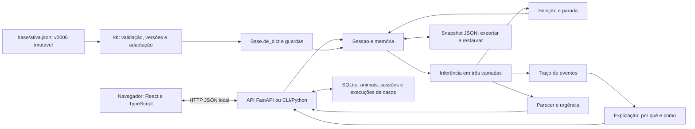

# Arquitetura tecnológica — implementação disponível

O núcleo é um pacote Python independente de interface, banco e base clínica. A entrada é uma base JSON e um conjunto ordenado de observações da sessão; a saída inclui estado, parecer e explicações. O estado integrado em `codex-davi` inclui interface React, API FastAPI, módulo `kb/` e persistência SQLite. O editor gráfico continua fora desta entrega do frontend.

## Fluxo implementado

`scripts/rodar.ps1` inicia a API e serve a SPA em `127.0.0.1:8000`; `rodar.sh` oferece o fluxo equivalente para Linux/macOS. Na ausência de `web/dist/index.html`, os scripts instalam e compilam a interface. O contrato versionado em `contratos/openapi.json` contém **27 operações HTTP**. A documentação de rotas, configuração e execução está em [api/README.md](../../api/README.md); o contrato da base está em [kb/README.md](../../kb/README.md).

## Sete componentes do modelo conceitual dos organizadores

| Componente de [A], slide 14 | Implementação atual | Parte planejada |
|---|---|---|
| Interface com o usuário | React em `web/`, CLI `engine/__main__.py` e interface Python de `Sessao` | Editor gráfico |
| Motor de inferência | `inferencia`, `avaliacao`, `cf`, `selecao` e `parada`, consumidos pela API | Revisão/calibração clínica |
| Base de conhecimento | `kb/`, versões imutáveis, `base/ativa.json` e `base/versoes/v0006.json` | Edição no frontend e novas versões revisadas |
| Memória de trabalho | `memoria.py`, `Fato`, `sessao.py` e snapshot persistido pela API em SQLite | Ensaios em dispositivos físicos |
| Módulo de explicação | `traco.py` e `explicacao.py`, chamados por `porque`/`como` e exibidos em diálogos na web | Revisão de compreensão com usuários |
| Aquisição de conhecimento | Edição e revisão do JSON, com regras documentadas pelo gerador | Editor em grafo e revisão por especialista |
| Fontes externas de fatos | Argumento `ficha` e observações com origem `importacao` | Prontuário, sensores e conectores reais |

## Tecnologias e dependências

| Item | Estado comprovado |
|---|---|
| Linguagem do núcleo | Python 3.12+, verificado nesta máquina com Python 3.12.14 |
| Incerteza | `fractions.Fraction`, biblioteca padrão |
| Intercâmbio de dados | JSON, biblioteca padrão |
| Testes | `pytest`, `hypothesis`, `httpx`/`TestClient` e `unittest`; Camada 3 em `tests/casos/` |
| Documentação | Markdown e gerador Python com modo `--verificar` |
| Navegação do conhecimento | Graphify e exportação Obsidian, ferramentas auxiliares fora da consulta |
| Dependências de runtime externas do núcleo | Nenhuma |
| API e base editorial | FastAPI/Pydantic, `kb/`, JSON Schema e OpenAPI versionados; versões em `pyproject.toml` |
| Banco | SQLite para animais, sessões, versões e resultados dos casos |
| Web | React 19, TypeScript 5 e Vite 8; Vitest, Testing Library, Playwright/Chromium e axe para verificação |
| Editor gráfico | Pendente, fora deste recorte |
| Licença do projeto | Arquivo de licença ausente; decisão da equipe pendente |

O motor e os exemplos CLI continuam usando só a biblioteca padrão. A API e os testes completos exigem as dependências de `pyproject.toml`: criar `.venv` e instalar `.[dev]` uma vez, com internet. O build web requer Node.js 24 e usa o lockfile do npm. A execução da decisão não chama serviços externos.

## Camada web implementada

`web/src/api/tipos.gerado.ts` deriva do OpenAPI por `npm run gerar-tipos`. O cliente HTTP centraliza erros públicos; as páginas Início, Anamnese e Parecer usam rotas React. A API serve o build e resolve URLs da SPA, preservando as rotas `/api/`.

O navegador não infere doença, CF, urgência nem próxima pergunta. Renderiza os campos e opções de `EstadoSessao.proxima`; múltiplas respostas enviam todos os booleanos e desconhecimento envia `nao_sei`. Números seguem como texto bruto, sem conversão ou normalização de vírgula. Um 422 conserva o valor e mostra a mensagem no campo; um conflito 409 provoca leitura do estado, sem repetição automática da mutação. O botão fica bloqueado durante o envio.

A partir da segunda pergunta, a lateral apresenta os quatro maiores percentuais retornados por `/parecer`. A tabela final conserva os blocos da API e ordena seus itens por percentual. As barras usam `role="meter"`. Os diálogos por quê/como mostram regras e evidências do backend; no fechamento de 22/10, "Como cheguei aqui?" passou a painel arrastável e centralizado (variante `folha` de `web/src/componentes/Modal.tsx`), com a subida de confiança por regra (campo `combinacao` da API, ex. 0% → 50% → 80%), a frase Se/então, os fatos com origem, as deduções aninhadas e a fonte pelo domínio. O parecer exibe em todos os níveis de urgência o aviso "Este parecer não é um laudo" (a nota da tela inicial diz o mesmo), e a rota `/privacidade` (`web/src/paginas/Privacidade.tsx`) descreve os dados guardados num SQLite local, sem dados pessoais, cookies ou recursos externos, como prova de conceito. As barras de confiança crescem até o valor com a porcentagem contando junto (`web/src/componentes/Contador.tsx`), a barra de hipóteses desliza do valor antigo ao novo e o boi animado dos SVGs pisca e balança, tudo respeitando `prefers-reduced-motion`. A interface foi feita e verificada só para desktop; a pausa de bandeira tem precedência sobre `proxima: null` e mantém o foco até uma ação autorizada.

O histórico desta navegação permite voltar e corrigir por PUT; o estado clínico persistente pertence à API. Recarregar a página retoma a sessão pelo identificador, mas não reconstrói o histórico local de botões Voltar. O contrato atual não expõe `casas_decimais` na próxima pergunta; a precisão é validada pelo backend (R18). Fontes `@fontsource`, SVGs e estilos são empacotados localmente. Os cenários E2E usam API real, SQLite temporário e casos sintéticos da base ativa (`v0004`; a `v0002` era a ativa quando os cenários foram escritos). A tela "Por que estou perguntando isso?" usa linguagem comum: a API devolve, por doença, `sinais` e `sinais_contra`, e a tela diz, por exemplo, "Em casos de Cetose, o animal pode apresentar apetite reduzido ou ausente." e "Febre torna essa hipótese menos provável." Em "Como cheguei aqui?", a API devolve `frase` por evidência e `nome` por fato, e a tela mostra "Porque foi observado: puerpério e corrimento vaginal fétido." e "Puerpério: sim (calculado pelo sistema)", sem ids de regra e com um aviso único de que as regras são suposições.

A troca produtor ↔ especialista usa `PATCH /api/sessoes/{id}`, com `veterinario` como nome técnico do especialista. Mantém os fatos, o histórico desta navegação e um único parecer da API; controla confirmação, concorrência e conflitos sem cálculo clínico no navegador. Também está disponível na pausa e no parecer parcial. Para corrigir uma tela antiga cujos símbolos mudam entre modos, a interface usa o modo original para o PUT e restaura o escolhido sob a mesma trava, reconciliando falhas com GET. O protocolo e seus limites estão no [roteiro](05-apresentacao-e-demo.md).

Após encerrar voluntariamente pelo alerta, Continuar respondendo envia a ação de bandeira `continuar` e navega conforme o estado recebido. Conflito 409 relê a sessão. Uma parada automática do motor não pode ser anulada pela interface; a limitação e o pedido à API estão em R21.

## Motor e modelo de incerteza

Uma observação é representada por símbolo, valor, CF e origem. Intensidade é valor, não certeza. Um booleano falso carrega evidência negativa; `None` ou `nao_sei` carrega CF zero. Campo vazio da ficha é ausente e pode ser perguntado; desconhecimento explícito conta como resposta.

As camadas são estritas: derivados consomem perguntas/ficha; doenças consomem esses fatos e derivados; urgências e bandeiras consomem camadas inferiores. Uma regra não lê uma conclusão de sua própria camada. A agenda resolve por camada, prioridade decrescente, número de condições e ID. As prioridades da base são 100 para bandeiras, 50 para urgências e 10 para evidências.

O CF da premissa é o mínimo das condições. A regra dispara somente se esse mínimo for **maior que 0,20**; sua contribuição é `CF_premissa × CF_regra`. Pesos ficam entre −0,99 e +0,99. Para duas evidências `a` e `b`, a combinação é:

| Sinais | Combinação |
|---|---|
| Ambas não negativas | `a + b × (1 − a)` |
| Ambas não positivas | `a + b × (1 + a)` |
| Sinais opostos | `(a + b) / (1 − min(abs(a), abs(b)))` |

A guarda defensiva de conflito entre extremos retorna zero. A aritmética interna é racional, evitando arredondamento prematuro. O operador `max` é permitido em derivados positivos; na base atual agrupa dois relatos da alteração do leite.

O parecer exibe `max(0, CF) × 100`, com arredondamento meio para cima, e três blocos: principal a partir de 0,50, diferencial acima de 0,20 e abaixo de 0,50, pouco provável até 0,20. Os cortes de exibição vêm da base. Essa porcentagem é confiança do sistema, **não probabilidade**.

## Diálogo, parada e bandeiras

As seis telas de triagem vêm antes das perguntas dinâmicas. Produtor e veterinário compartilham fatos e motor; disponibilidade e texto das perguntas mudam por modo. A base limita a fase dinâmica a 12/25 perguntas. Perguntas capazes de confirmar uma bandeira pendente têm preferência na seleção.

Após a triagem, a parada considera confirmação, hipóteses concorrentes, potencial conservador, bandeiras pendentes, ausência de perguntas e limite. `limite_dinamico=0` nos dois exemplos é uma substituição por sessão usada para demonstrar somente a triagem.

Bandeira ativa leva a `chamar_agora`, independentemente da hipótese de doença. O produtor recebe pausa; o veterinário não. Respostas novas não reduzem a urgência já travada. A implementação atual trata correções reprocessando os valores atuais por prefixos dos lotes na **ordem real de entrada**: ficha, telas e perguntas. Corrigir não muda essa ordem. Uma bandeira só desaparece se nenhum prefixo com os dados corrigidos a disparar. O reconhecimento vale apenas para bandeiras ativas.

O núcleo `inferir(base, fatos)` é sem estado. O estado de uma sessão também inclui ordem e reconhecimento. Portanto, determinismo da sessão significa mesma base, mesmos valores, mesma ordem e mesmas ações; não significa ignorar a ordem de chegada dos dados.

## Contratos Python disponíveis

| Entrada pública | Responsabilidade |
|---|---|
| `Base.de_dict(dados)` | Validar e adaptar JSON ou objeto com `model_dump` |
| `inferir(base, fatos)` | Calcular CF, regras disparadas, urgência e traço |
| `analisar(base, fatos, modo)` | Calcular hipóteses abertas, potencial e próxima pergunta |
| `Sessao(base, modo, ficha, limite_dinamico)` | Gerenciar triagem e diálogo |
| `estado`, `responder_triagem`, `responder`, `trocar_modo`, `acao_bandeira` | Operar a consulta |
| `parecer`, `porque`, `como` | Consultar saídas e explicações |
| `exportar` / `Sessao.restaurar(base, **snapshot)` | Serializar e restaurar diretamente o estado |
| `executar_caso(base, caso)` | Executar cenário determinístico e conferir critérios |

Assinaturas completas e exemplos estão no [README do motor](../../engine/README.md). A documentação desta entrega não muda o contrato público.

Para restauração exata, persistir o snapshot completo, inclusive `ordem_respostas`, origens, `tela_id`, perguntas feitas e reconhecimento. Sem a ordem explícita, o método pode derivar uma aproximação que diverge em telas reabertas ao trocar de modo. O parâmetro antigo `bandeiras_ativas` é aceito por compatibilidade e ignorado; as bandeiras são reconstruídas pelos lotes. Isso não equivale a repetir o diálogo pela API.

## Base, validação e rastreabilidade

A base ativa tem `meta`, `simbolos`, `regras` e `layout`, com 103 símbolos e 137 regras (111 de evidência, 20 de urgência e 6 bandeiras vermelhas), 20 doenças, 2 pares em `meta.exclusoes` e `tratamento` (texto, fonte e URL https em `embrapa.br`, `gov.br` ou `msdvetmanual.com`) em todas as doenças. `base/ativa.json` aponta para `v0005` (pai `v0004`; histórico: a `v0004` tinha 51 símbolos, 61 regras e 8 doenças), gravada por `python -m kb.fonte juntar --salvar`; a `v0004` só renomeia dois derivados para nomes com acento (`puerperio` vira "Puerpério" e `inicio_lactacao` vira "Início da lactação"), com regras e pesos idênticos aos da `v0003` (51 símbolos, 61 regras, todas suposição, 34/34 casos). A `v0003` introduziu as regras de sinal isolado e a `v0002` (56 regras), recebida da branch compartilhada, foi preservada. `kb.validar` não registra erros (W03 informa as 61 suposições pendentes). A `v0003` acrescenta cinco regras de sinal isolado, todas suposições novas de peso baixo: R-HIP-05 (decúbito com dias em lactação > 3, CF 0,20), R-HIP-06 (hipotermia com dias > 3, 0,15) e R-CET-06, R-DAB-04 e R-ACI-05 (apetite reduzido ou ausente, 0,05 cada). Motivo: um teste manual dava 0% em todas as doenças porque toda regra era conjunção; agora dá hipocalcemia 30% e 5% para cetose, abomaso e acidose. O parecer traz, por doença, o `potencial` (até quanto a confiança pode chegar com as perguntas que faltam), exibido como "pode chegar a X%"; se nenhuma doença tem percentual, aparece um aviso pedindo mais respostas. `Base.de_dict(kb.para_motor(base))` carrega no motor. O arquivo de desenvolvimento foi alinhado aos domínios numéricos da `v0002`, sem mudar IDs, regras ou triagem. Dias em lactação aceita 0–1000 inteiros; temperatura retal, 30–45 °C com uma casa; pH ruminal, 0–14 com uma casa; BHB e cálcio sérico, 0–20 com duas casas. As versões imutáveis foram preservadas.

Uma alteração de regra deve ser gravada com `Repositorio.salvar_nova(..., pai="v0002")`, tornando-se uma versão nova; executar os casos antes de ativar. `v0001` não foi regravada nem promovida a base clinicamente validada. Os 34 casos em `base/casos/casos.json` cobrem os dois modos, oito doenças, seis bandeiras, comorbidade, limite, troca de modo e os dois exemplos preservados. A correção é testada diretamente em `Sessao`, pois `kb.Caso` não codifica essa operação. Os desvios e a observação prévia do caso de abomaso estão em R15/R16 do [registro de riscos](06-riscos-e-pendencias.md).

Os eventos documentam observações, regras e combinações de CF. O motivo de uma pergunta é registrado quando ela é apresentada. A sessão conserva perguntas/correções e somente o cálculo de inferência atual, evitando acumulação de traços antigos. O documento 03 é gerado do JSON; o documento 04, da execução dos casos. O teste de sincronismo impede afirmar uma regra diferente da executável.

## Base por doença e grafo 2

A equipe passa a editar `base/fonte/comum.json` e `base/fonte/doencas/<doença>.json` (20 arquivos, um por doença), com `indice.json`. `python -m kb.fonte juntar` reproduziu a `v0002` byte a byte (prova da separação, há teste) e gerou a `v0003` depois que a fonte recebeu as cinco regras novas; com `--salvar --autor X --nota Y` grava a próxima versão pelo `salvar_nova`, que valida e não ativa. O motor e a API continuam lendo as versões imutáveis de `base/versoes/`, e a `v0005` é a ativa. `kb/exportar_grafo.py` gera o grafo exato (`graphify-out-dados/grafo_exato.json`, via `kb/grafo.py`) e a extração para o graphify; `carregar_do_grafo` devolve a mesma base e os casos dão o mesmo resultado (teste). O grafo 2 do Obsidian, em `obsidian/02-Dados de Treino/`, é gerado sem IA por `scripts/grafo_dados.py`: 240 nós, 351 arestas EXTRACTED (inclui 2 arestas `exclui`, uma por par excludente; histórico da primeira geração, com a `v0002`: 107 nós e 137 arestas), 21 comunidades (20 doenças e Comum) e custo zero de tokens. O motor não lê o `graph.json` do graphify, porque extração por IA não é determinística. Ver o [README da pasta](../../obsidian/02-Dados%20de%20Treino/README.md) e a [spec](../superpowers/specs/2026-10-22-grafo-dados-por-doenca-design.md).

## Testes, execução e limites

O estado atual (v0006, 25/10) é de **1151 testes Python aprovados** e 260 subtestes, e **84 de 84 testes Vitest em 12 arquivos** (o teste de preparação do frontend, `inicializacao.test.ts`, às vezes estoura o tempo de 5 s; é conhecido e intermitente). Histórico: 1082 Python, 170 subtestes e 72 Vitest (após `0a76d75`); os 6 arquivos de spec E2E em `web/e2e/` não foram rodados e não se afirma um número novo. Histórico: 1080 Python e 71 Vitest (após `0300cdb`). Histórico: no fechamento de 22/10, após o merge `7587de4`, eram 1077 Python, 170 subtestes, 0 ignorados e 68 Vitest. Como histórico, no checkpoint da troca de modo (`09f5754`), a suíte registra **1066 testes Python aprovados, 1 ignorado e 170 subtestes aprovados**; a suíte `unittest` do motor/base registra **132 testes**, já incluídos na execução pytest, e não deve ser somada a ela. Os **60 casos sintéticos** (v0005) são uma categoria separada. A interface registra **60 testes Vitest** e **11 cenários Playwright**, descritos em [QUALIDADE.md](../../web/QUALIDADE.md); 39/8 são as contagens históricas da integração inicial. As evidências históricas anteriores constam de [evidencias-verificacao.json](evidencias-verificacao.json). Entre as verificações estão permutações MYCIN, desconhecimento, comorbidade, correção, restauração e isolamento do motor em relação à API, ao banco e a `kb`.

O ensaio HTTP histórico da API é registrado separadamente dos testes atuais no navegador. Ensaio físico com Wi-Fi desligado, máquina reserva e apresentação ainda exigem confirmação da equipe. Não há validação clínica nem autenticação implementada neste recorte. A integração acrescentou `web/` e preparo do build nos scripts; API, motor, kb, contratos e versões imutáveis foram preservados.
