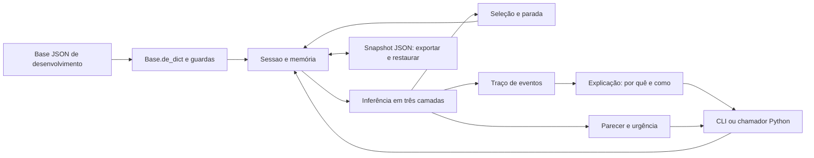

# Arquitetura tecnológica — implementação disponível

O núcleo é um pacote Python independente de interface, banco e base clínica. A entrada é uma base JSON e um conjunto ordenado de observações da sessão; a saída inclui estado, parecer e explicações. A execução atual é local por terminal ou chamada Python. API, SQLite, interface React e editor em grafo são partes do desenho futuro, ausentes neste checkout.

## Fluxo implementado

O chamador futuro pode ser uma API. O diagrama não representa um servidor web já instalado.

## Sete componentes do modelo conceitual dos organizadores

| Componente de [A], slide 14 | Implementação atual | Parte planejada |
|---|---|---|
| Interface com o usuário | CLI `engine/__main__.py` e interface Python de `Sessao` | Formulários e parecer no navegador |
| Motor de inferência | `inferencia`, `avaliacao`, `cf`, `selecao` e `parada` | Consumo pelo backend web |
| Base de conhecimento | JSON em `base/desenvolvimento/` | Versões imutáveis, ponteiro ativo e validador editorial em `kb/` |
| Memória de trabalho | `memoria.py`, `Fato` e `sessao.py` | Gravação em banco pela API |
| Módulo de explicação | `traco.py` e `explicacao.py`, chamados por `porque`/`como` | Visualização dessas respostas na interface |
| Aquisição de conhecimento | Edição e revisão do JSON, com regras documentadas pelo gerador | Editor em grafo e revisão por especialista |
| Fontes externas de fatos | Argumento `ficha` e observações com origem `importacao` | Prontuário, sensores e conectores reais |

## Tecnologias e dependências

| Item | Estado comprovado |
|---|---|
| Linguagem do núcleo | Python 3.12+, verificado nesta máquina com Python 3.12.14 |
| Incerteza | `fractions.Fraction`, biblioteca padrão |
| Intercâmbio de dados | JSON, biblioteca padrão |
| Testes | `unittest`, inclusive execução da CLI por subprocesso |
| Documentação | Markdown e gerador Python com modo `--verificar` |
| Navegação do conhecimento | Graphify e exportação Obsidian, ferramentas auxiliares fora da consulta |
| Dependências de runtime externas do núcleo | Nenhuma |
| API/web/banco | FastAPI/Pydantic, React e SQLite constam do planejamento; não estão implementados neste checkout |
| Licença do projeto | Arquivo de licença ausente; decisão da equipe pendente |

Não há instalação via `pip`, Node, Docker ou serviço externo para executar os exemplos atuais. A aplicação completa poderá introduzir outras dependências e exigirá nova verificação de versões, licenças e execução offline.

## Motor e modelo de incerteza

Uma observação é representada por símbolo, valor, CF e origem. Intensidade é valor, não certeza. Um booleano falso carrega evidência negativa; `None` ou `nao_sei` carrega CF zero. Campo vazio da ficha é ausente e pode ser perguntado; desconhecimento explícito conta como resposta.

As camadas são estritas: derivados consomem perguntas/ficha; doenças consomem esses fatos e derivados; urgências e bandeiras consomem camadas inferiores. Uma regra não lê uma conclusão de sua própria camada. A agenda resolve por camada, prioridade decrescente, número de condições e ID. As prioridades da base são 100 para bandeiras, 50 para urgências e 10 para evidências.

O CF da premissa é o mínimo das condições. A regra dispara somente se esse mínimo for **maior que 0,20**; sua contribuição é `CF_premissa × CF_regra`. Pesos ficam entre −0,99 e +0,99. Para duas evidências `a` e `b`, a combinação é:

| Sinais | Combinação |
|---|---|
| Ambas não negativas | `a + b × (1 − a)` |
| Ambas não positivas | `a + b × (1 + a)` |
| Sinais opostos | `(a + b) / (1 − min(abs(a), abs(b)))` |

A guarda defensiva de conflito entre extremos retorna zero. A aritmética interna é racional, evitando arredondamento prematuro. O operador `max` é permitido em derivados positivos; na base atual agrupa dois relatos da alteração do leite.

O parecer exibe `max(0, CF) × 100`, com arredondamento meio para cima, e três blocos: principal a partir de 0,50, diferencial acima de 0,20 e abaixo de 0,50, pouco provável até 0,20. Os cortes de exibição vêm da base. Essa porcentagem é confiança do sistema, **não probabilidade**.

## Diálogo, parada e bandeiras

As seis telas de triagem vêm antes das perguntas dinâmicas. Produtor e veterinário compartilham fatos e motor; disponibilidade e texto das perguntas mudam por modo. A base limita a fase dinâmica a 12/25 perguntas. Perguntas capazes de confirmar uma bandeira pendente têm preferência na seleção.

Após a triagem, a parada considera confirmação, hipóteses concorrentes, potencial conservador, bandeiras pendentes, ausência de perguntas e limite. `limite_dinamico=0` nos dois exemplos é uma substituição por sessão usada para demonstrar somente a triagem.

Bandeira ativa leva a `chamar_agora`, independentemente da hipótese de doença. O produtor recebe pausa; o veterinário não. Respostas novas não reduzem a urgência já travada. A implementação atual trata correções reprocessando os valores atuais por prefixos dos lotes na **ordem real de entrada**: ficha, telas e perguntas. Corrigir não muda essa ordem. Uma bandeira só desaparece se nenhum prefixo com os dados corrigidos a disparar. O reconhecimento vale apenas para bandeiras ativas.

O núcleo `inferir(base, fatos)` é sem estado. O estado de uma sessão também inclui ordem e reconhecimento. Portanto, determinismo da sessão significa mesma base, mesmos valores, mesma ordem e mesmas ações; não significa ignorar a ordem de chegada dos dados.

## Contratos Python disponíveis

| Entrada pública | Responsabilidade |
|---|---|
| `Base.de_dict(dados)` | Validar e adaptar JSON ou objeto com `model_dump` |
| `inferir(base, fatos)` | Calcular CF, regras disparadas, urgência e traço |
| `analisar(base, fatos, modo)` | Calcular hipóteses abertas, potencial e próxima pergunta |
| `Sessao(base, modo, ficha, limite_dinamico)` | Gerenciar triagem e diálogo |
| `estado`, `responder_triagem`, `responder`, `trocar_modo`, `acao_bandeira` | Operar a consulta |
| `parecer`, `porque`, `como` | Consultar saídas e explicações |
| `exportar` / `Sessao.restaurar(base, **snapshot)` | Serializar e restaurar diretamente o estado |
| `executar_caso(base, caso)` | Executar cenário determinístico e conferir critérios |

Assinaturas completas e exemplos estão no [README do motor](../../engine/README.md). A documentação desta entrega não muda o contrato público.

Para restauração exata, persistir o snapshot completo, inclusive `ordem_respostas`, origens, `tela_id`, perguntas feitas e reconhecimento. Sem a ordem explícita, o método pode derivar uma aproximação que diverge em telas reabertas ao trocar de modo. O parâmetro antigo `bandeiras_ativas` é aceito por compatibilidade e ignorado; as bandeiras são reconstruídas pelos lotes. Isso não equivale a repetir o diálogo pela API.

## Base, validação e rastreabilidade

A base atual tem `meta`, `simbolos`, `regras` e `layout`, com 51 símbolos e 56 regras. Não há ponteiro ativo; os comandos indicam o arquivo de desenvolvimento explicitamente. `Base.de_dict` aplica guardas de execução; não substitui o validador editorial completo previsto para `kb/`. Os testes da base acrescentam cobertura por triagem, caminhos do produtor, bandeiras e cenários conhecidos.

Os eventos documentam observações, regras e combinações de CF. O motivo de uma pergunta é registrado quando ela é apresentada. A sessão conserva perguntas/correções e somente o cálculo de inferência atual, evitando acumulação de traços antigos. O documento 03 é gerado do JSON; o documento 04, da execução dos casos. O teste de sincronismo impede afirmar uma regra diferente da executável.

## Testes, execução e limites

Há 100 testes do núcleo/regressões, 25 da base/CLI e 10 da documentação, totalizando 135 no checkpoint. Entre as evidências estão permutações MYCIN de 2 a 6 entradas, extremos, desconhecimento, comorbidade, correção, restauração e isolamento de `api`, `web`, banco e `kb`.

A execução atual não exige rede; um ensaio presencial com a rede desligada ainda precisa ser registrado pela equipe. A arquitetura web planejada não tem contrato OpenAPI, persistência SQLite ou testes de navegador disponíveis aqui. Também não há validação clínica, autenticação implementada, editor visual ou explicação “por que não é a doença X?”. Essas limitações estão no [registro de riscos](06-riscos-e-pendencias.md).
