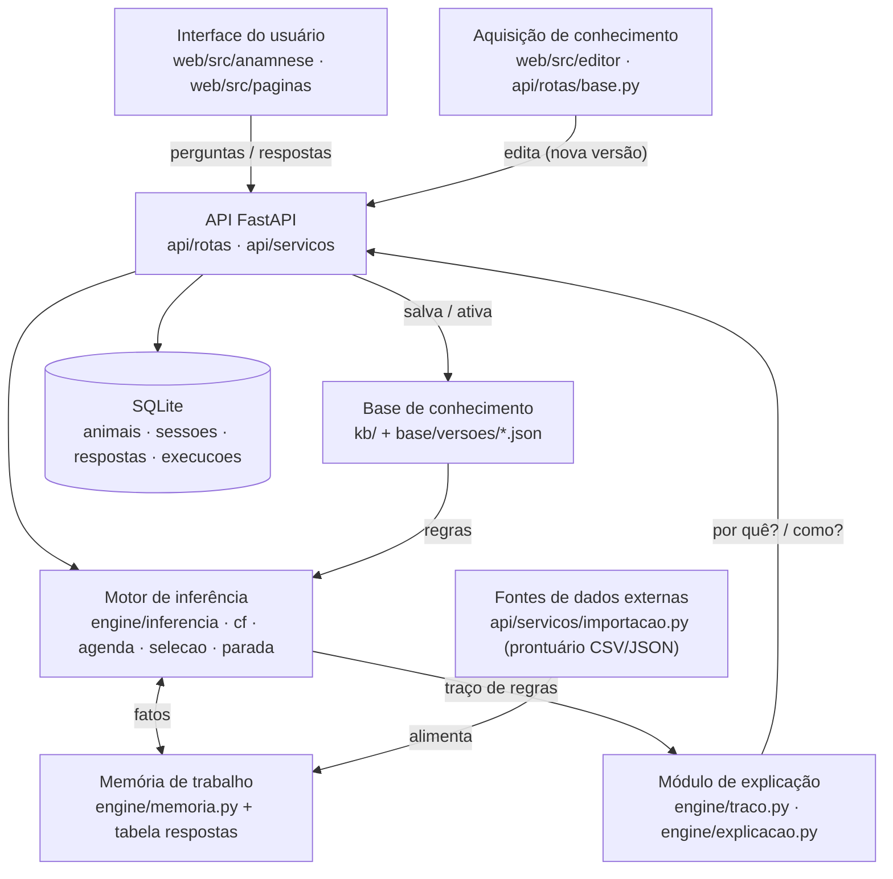

# Prompt de revisão — Seção 4: Tecnologias, monorepo e contratos da API

> Status da seção: **RASCUNHO, pendente de aprovação** (20/10/2026). Cole tudo abaixo da linha numa IA revisora.

---

Você vai atuar como **revisor técnico independente** da especificação de um sistema especialista (trabalho acadêmico, Hackathon UFJF 2026, tema "Anamnese de bovinos leiteiros em lactação"). Esta seção define tecnologias e versões, estrutura de pastas, contratos REST, tabelas SQLite e geração de tipos. Verifique se os contratos cobrem tudo que as Seções 1–3 exigem e se o escopo cabe em 2,5 dias para 3 pessoas. Não presuma que a seção está certa nem errada. Verifique por conta própria.

## Restrições obrigatórias do desafio (não são discutíveis)

1. Nenhuma LLM no caminho da decisão em tempo de execução.
2. Decisão determinística e auditável.
3. Open source.
4. Tudo roda em localhost.

## Decisões já tomadas (não reabra; aponte só se criarem contradição)

- D1. Motor Python puro em `engine/`; base em `kb/` + `base/` JSON versionado.
- D2. FastAPI serve o frontend compilado num processo único em `http://localhost:8000`.
- D3. React + TypeScript + Vite + React Flow.
- D4. SQLite.
- D5. Motor sem estado (recalcula a partir das respostas gravadas).
- D6. Dois modos trocáveis sem perder respostas; triagem de 6 telas; bandeira vermelha pausa o modo produtor.
- D7. Três pessoas e agentes de IA diferentes trabalhando em paralelo.

## Como revisar

Para cada problema encontrado, responda:

1. **Veredito:** erro / lacuna / decisão em aberto / ressalva menor.
2. **Trecho exato** da seção que sustenta o veredito (se o texto não diz algo, é lacuna, não erro).
3. **Prova:** se o ponto for algorítmico (rotas faltando, payload incoerente com as Seções 1–3, dependência com licença não aberta), descreva ou execute um contraexemplo concreto.
4. **Correção mínima:** uma frase ou parágrafo reescrito, sem mecanismos novos além do necessário.

Regras: não elogie por cortesia; diga qual pergunta responderia o que depender de informação que você não tem; ao final, liste problemas que não estão nesta lista e dê um resumo de 3 linhas do que precisa mudar.

---

## SEÇÃO 4 — Tecnologias, monorepo e contratos da API (rascunho)

### 4.1 Tecnologias e versões

| Item | Versão | Licença | Por quê |
|---|---|---|---|
| Python | 3.14 (última correção da linha) | PSF-2.0 | estável há um ano; a 3.15 saiu em 09/10/2026, recente demais para pacotes compilados no Windows |
| uv | 0.13.x | MIT OR Apache-2.0 | instala o Python e as dependências; trava versões em `uv.lock` |
| FastAPI | 0.156.x | MIT | API e documentação interativa; serve o frontend compilado |
| Pydantic | 2.14.x | MIT | modelos da base e dos contratos (fonte única de tipos) |
| uvicorn | 0.54.x | BSD-3-Clause | servidor ASGI local |
| sqlite3 | biblioteca padrão | PSF-2.0 | persistência sem ORM |
| pytest | 9.1.x | MIT | testes do motor, da base e dos casos |
| hypothesis | 6.170.x | MPL-2.0 | testes de propriedade (ordem da combinação MYCIN, potencial máximo) |
| httpx | 0.28.1 | BSD-3-Clause | cliente de teste da API (não usar a 1.0 de desenvolvimento) |
| ruff | 0.17.x | MIT | lint e formatação Python |
| Node.js | 24 LTS | MIT | o Node 26 só vira LTS em 28/10/2026, depois da entrega |
| TypeScript | última versão da linha em JavaScript (5.x/6.x; confirmar na instalação) | Apache-2.0 | não usar a 7.0 (compilador nativo novo): o openapi-typescript usa a API JavaScript do TypeScript (suposição a confirmar) |
| Vite | 8.x | MIT | build e servidor de desenvolvimento (exige Node ^20.19 ou ≥ 22.12) |
| React / React DOM | 19.x | MIT | interface |
| @xyflow/react (React Flow) | 12.x | MIT | editor gráfico da base |
| @dagrejs/dagre | 3.x | MIT | layout automático inicial do grafo |
| @playwright/test | 1.64.x | Apache-2.0 | ponta a ponta; no Windows exige `npx playwright install chromium` |
| openapi-typescript | 7.x | MIT | gera os tipos TypeScript a partir do OpenAPI |

**Descartados:** TanStack Query (o estado da sessão vem pronto do backend em `EstadoSessao`; `fetch` basta), MSW (um simulador simples basta), elkjs (licença EPL-2.0/GPL), ORM (sqlite3 basta), Docker (opcional; não é necessário para rodar em localhost). **Política:** versões exatas travadas em `uv.lock` e `package-lock.json`; atualizar só com motivo. Versões pesquisadas em 20/10/2026; detalhes em `docs/pesquisa/versoes-bibliotecas.md`.

### 4.2 Arquitetura (modelo conceitual → módulos)



### 4.3 Árvore de pastas

Setas de dependência (sem ciclos): `api → engine → kb`; `kb` não importa nada do projeto; `engine` não importa web nem banco.

```
hackatom/
├─ README.md               # como rodar em 2 comandos; mapa do repositório
├─ pyproject.toml          # um projeto Python com 3 pacotes: engine, kb, api (instalação editável)
├─ contratos/              # FONTE COMPARTILHADA entre as 3 pessoas
│  ├─ openapi.json         # gerado do FastAPI; versionado no git
│  └─ exemplos/*.json      # 1 payload por rota (os deste documento); base dos mocks e dos testes de contrato
├─ engine/                 # MOTOR (Seção 1): Python puro, sem web, sem banco
│  ├─ inferencia.py        # ponto de entrada único: (base, fatos, modo) -> Resultado (CFs, urgência, próxima, parada, traço)
│  ├─ memoria.py           # MEMÓRIA DE TRABALHO: conjunto de fatos (variável, valor, CF, origem); sem estado entre chamadas
│  ├─ avaliacao.py         # avaliação de condição (op, negado, cf_minimo/cf_maximo) e das 3 camadas
│  ├─ cf.py                # premissa = mínimo, combinação MYCIN, combinacao max, guarda 0/0
│  ├─ agenda.py            # resolução de conflito: prioridade, especificidade, id
│  ├─ selecao.py           # regra viável e escolha da próxima pergunta (gravidade desempata)
│  ├─ parada.py            # potencial máximo e critérios de parada
│  ├─ traco.py             # eventos pergunta_feita, fato_adicionado, regra_disparada, cf_combinado
│  ├─ explicacao.py        # MÓDULO DE EXPLICAÇÃO: "por quê?" (motivo da pergunta) e "como?" (percurso do traço)
│  ├─ parecer.py           # lista das 8 doenças, % e três blocos, urgência final
│  └─ casos.py             # executor dos casos de teste (usa kb.carregador); roda em pytest e pela API
├─ kb/                     # BASE DE CONHECIMENTO (Seção 2): leaf, depende só de Pydantic
│  ├─ modelos.py           # modelos Pydantic v2: Meta, Simbolo, Condicao, Regra, Triagem, Layout, Base, Caso (fonte única de verdade)
│  ├─ carregador.py        # lê/grava base/versoes/vNNNN.json, ativa.json, casos.json; nunca sobrescreve
│  ├─ validador.py         # erros e avisos da Seção 2
│  ├─ analise.py           # grafo de dependência: ciclos, alcançabilidade, camadas, ordem topológica (usado também pelo engine)
│  ├─ grafo.py             # conversão 1:1 regras <-> grafo bipartido (nós de símbolo e de regra) com layout separado
│  └─ schema/              # JSON Schema exportado dos modelos (base.schema.json, caso.schema.json)
├─ api/                    # APLICAÇÃO (FastAPI): casca fina sobre engine e kb
│  ├─ main.py              # cria o app, monta as rotas em /api, serve web/dist em /, handler único de erro
│  ├─ config.py            # porta 8000, caminhos de base/ e do arquivo SQLite
│  ├─ erros.py             # formato único de erro e exceções de domínio
│  ├─ schemas/             # contratos Pydantic: sessao.py, parecer.py, explicacao.py, animal.py, base.py, erro.py
│  ├─ rotas/               # sessoes.py, animais.py, base.py (sem lógica; chamam servicos)
│  ├─ servicos/            # sessao_servico (carrega fatos -> engine -> monta EstadoSessao), base_servico, casos_servico, importacao
│  ├─ db/                  # esquema.sql (DDL), conexao.py, repositorios.py (sqlite3 da biblioteca padrão, sem ORM) (suposição)
│  └─ exportar_openapi.py  # grava contratos/openapi.json sem subir o servidor
├─ web/                    # INTERFACE + EDITOR: React + TypeScript + Vite
│  ├─ vite.config.ts       # dev na :5173 com proxy /api -> :8000; build em web/dist
│  └─ src/
│     ├─ api/              # cliente.ts (fetch tipado, trata o erro único), tipos.gerado.ts (NÃO editar), mocks/ (lê contratos/exemplos)
│     ├─ paginas/          # Animais, Anamnese, Parecer, Editor
│     ├─ anamnese/         # TelaTriagem, PerguntaDinamica, SeletorModo, AlertaBandeira, QuadroUrgencia, ParecerBlocos, PorQue, Como
│     └─ editor/           # CanvasGrafo (React Flow), NoSimbolo, NoRegra, PainelPropriedades, PainelMeta, PainelValidacao, PainelCasos
├─ base/                   # DADOS da base (vão para o git)
│  ├─ versoes/vNNNN.json   # imutáveis
│  ├─ ativa.json           # {"versao": "v0002"}
│  └─ casos/casos.json     # casos de teste compartilhados
├─ tests/
│  ├─ engine/              # unitários do motor (lista da Seção 1) com mini-bases próprias
│  ├─ kb/                  # validador, ida e volta regras <-> grafo, camadas, ciclos
│  ├─ casos/               # roda casos.json contra a base ativa e contra cada versão em base/versoes
│  ├─ api/                 # testes de contrato: respostas validam contra openapi.json; exemplos validam contra os schemas
│  └─ fixtures/            # mini-bases, prontuários CSV/JSON fictícios
├─ e2e/                    # Playwright: produtor completo, bandeira + pausa, troca de modo, importação, editor (salvar e rodar casos)
├─ scripts/                # rodar.ps1/.sh (build do web se faltar + uvicorn :8000), gerar_tipos, resetar_db, semear_fictícios
└─ docs/                   # superpowers/specs, superpowers/plans, fontes/fontes.md, prompts/, rascunhos/
```

### Mapa: modelo conceitual [A] slide 14 → pasta

| Componente | Pasta |
|---|---|
| Base de conhecimento | `kb/` (formato, validação, grafo) e `base/` (arquivos versionados) |
| Motor de inferência | `engine/` (`inferencia`, `cf`, `agenda`, `selecao`, `parada`) |
| Memória de trabalho | `engine/memoria.py` (fatos da chamada); `respostas` no SQLite guarda só as entradas da sessão |
| Módulo de explicação | `engine/explicacao.py` e `engine/traco.py`; expostos por `api/rotas/sessoes.py` |
| Interface do usuário | `web/src/anamnese/` e `web/src/paginas/` |
| Aquisição de conhecimento | `web/src/editor/` + `api/rotas/base.py` + `kb/` |
| Fontes de dados externas | `api/servicos/importacao.py` e `api/rotas/animais.py` (prontuário CSV/JSON); sensores e APIs ficam fora do PoC |

### 4.4 Convenções dos contratos

- Prefixo `/api`; o resto de `/` é o frontend compilado, servido pelo mesmo processo em `http://localhost:8000`. Documentação interativa gerada em `/api/docs`.
- Chaves em `snake_case` sem acento; ids do domínio como nas Seções 1 a 3 (`veterinario`, `chamar_agora`, `R-MAS-01`). Textos de tela em português com acento. Datas ISO-8601.
- **O cliente nunca envia CF.** Envia valor ou `"nao_sei": true`; o servidor aplica o mapeamento da Seção 1 (sim = +1, não = −1, não sei = 0). `percentual` = `round(max(0, cf) × 100)`.
- Toda rota de sessão que muda algo devolve o mesmo objeto **`EstadoSessao`** (exemplo em 4.5.1). O backend dita a próxima tela; o frontend só renderiza. `revisao` sobe a cada mudança.
- A sessão fica presa à `versao_base` com que nasceu; ativar outra versão só afeta sessões novas.
- Cada chamada recalcula tudo a partir das respostas gravadas (motor sem estado). Corrigir ou trocar o modo nunca apaga respostas.

### Formato único de erro

```json
{ "erro": { "codigo": "base_invalida", "mensagem": "A base tem 2 erros.", "requisicao_id": "rq_8f2a",
    "detalhes": [ { "codigo": "camada", "severidade": "erro", "alvo": { "tipo": "regra", "id": "R-MAS-99" }, "mensagem": "Regra de doença lê outra doença (metrite -> R-MAS-99 -> mastite)." } ] } }
```
`detalhes` é opcional (lista de `{codigo, severidade, alvo?, mensagem}`; o mesmo item serve ao validador da base).

| HTTP | `codigo` | Quando |
|---|---|---|
| 404 | `nao_encontrado` | sessão, animal, versão, símbolo ou execução inexistente |
| 409 | `conflito` | brinco duplicado; `ja_respondida` (POST em tela/símbolo já respondido); `nao_respondida` (PUT em algo não respondido); `casos_falhando` (ativar com casos falhando sem confirmação) |
| 422 | `entrada_invalida` | corpo fora do schema (substitui o 422 padrão do FastAPI) |
| 422 | `resposta_invalida` | valor fora do domínio; símbolo que não é pergunta da sessão no modo atual |
| 422 | `base_invalida` | salvar base com erros de validação (`detalhes` traz a lista) |
| 422 | `simbolo_invalido` | "como?" sobre símbolo que não é `doenca`, `derivado` ou `urgencia` |
| 422 | `importacao_invalida` | arquivo ilegível ou formato desconhecido |
| 500 | `erro_interno` | qualquer outra falha; sem detalhes técnicos na mensagem |

### 4.5 Contratos da API

#### Tabela de rotas

| Método | Rota (após `/api`) | Propósito | Prioridade |
|---|---|---|---|
| GET | `/saude` | saúde do servidor (usada por `rodar` e pelo e2e) | núcleo |
| POST | `/sessoes` | criar sessão com animal e modo | núcleo |
| GET | `/sessoes/{id}` | estado atual: fase, progresso, próxima tela ou pergunta, urgência, alerta | núcleo |
| PATCH | `/sessoes/{id}` | trocar o modo sem perder respostas | núcleo |
| POST | `/sessoes/{id}/triagem/{tela_id}` | responder uma tela da triagem | núcleo |
| PUT | `/sessoes/{id}/triagem/{tela_id}` | corrigir uma tela já respondida | núcleo |
| POST | `/sessoes/{id}/respostas` | responder uma pergunta da fase dinâmica | núcleo |
| PUT | `/sessoes/{id}/respostas/{simbolo}` | corrigir uma resposta dinâmica | núcleo |
| POST | `/sessoes/{id}/acoes/bandeira` | `ver_parecer` ou `continuar` depois da bandeira vermelha | núcleo |
| GET | `/sessoes/{id}/parecer` | parecer (parcial se a sessão não encerrou) | núcleo |
| GET | `/sessoes/{id}/porque/{simbolo}` | "por quê?" de uma pergunta (triagem ou dinâmica) | núcleo |
| GET | `/sessoes/{id}/como/{simbolo}` | "como?" de uma conclusão | núcleo |
| GET | `/sessoes/{id}/traco` | traço bruto de eventos (auditoria; opcional na interface) | extra |
| GET | `/animais` | listar fichas (`?busca=`) | núcleo |
| GET | `/animais/{id}` | obter ficha | núcleo |
| POST | `/animais` | criar ficha | núcleo |
| GET | `/animais/{id}/sessoes` | histórico de anamneses do animal | extra |
| POST | `/animais/importacao` | importar prontuário CSV/JSON (`?gravar=false` simula) | núcleo |
| GET | `/base/versoes` | listar versões (com a ativa marcada) | núcleo |
| GET | `/base/versoes/{versao}` | obter a base inteira (`meta`, `simbolos`, `regras`, `layout`) | núcleo |
| GET | `/base/versoes/{versao}/grafo` | obter a base como grafo para o editor | núcleo |
| POST | `/base/validar` | validar uma edição sem salvar | núcleo |
| POST | `/base/versoes` | salvar nova versão (valida, bloqueia se houver erro, roda os casos) | núcleo |
| PUT | `/base/ativa` | ativar uma versão | núcleo |
| POST | `/base/versoes/{versao}/execucoes` | rodar os casos de teste nessa versão | núcleo |
| GET | `/base/versoes/{versao}/execucoes` | listar execuções da versão | extra |
| GET | `/base/versoes/{versao}/execucoes/{execucao_id}` | obter o resultado de uma execução | núcleo |

Rotas **extra** só entram se sobrar tempo; o frontend não depende delas.

#### 4.5.1 Sessões de anamnese

`POST /sessoes` — requisição e resposta 201 (**`EstadoSessao`**; `versao_base: null` na requisição = a ativa):
```json
{ "animal_id": "an_001", "modo": "produtor", "versao_base": null }
```
```json
{ "sessao_id": "ses_0001", "animal_id": "an_001", "modo": "produtor", "versao_base": "v0002", "revisao": 1,
  "fase": "triagem",
  "progresso": { "triagem_respondidas": 1, "triagem_total": 6, "dinamicas_feitas": 0, "limite_dinamico": 12 },
  "proxima": { "tipo": "tela_triagem", "tela_id": "estado_termico", "selecao": "unica", "permite_nao_sei": true,
    "titulo": "Como estão as orelhas e as pontas dos membros?",
    "campos": [ { "simbolo": "extremidades", "entrada": "categorico",
      "opcoes": [ { "valor": "fria", "rotulo": "Frias" }, { "valor": "normal", "rotulo": "Normais" }, { "valor": "quente", "rotulo": "Quentes" } ] } ] },
  "urgencia": { "nivel": "sem_problema", "provisoria": true, "origem": "padrao" },
  "alerta": null }
```
`fase` ∈ `triagem` | `dinamica` | `encerrada`. `proxima.tipo` ∈ `tela_triagem` | `pergunta` | `null` (encerrada). `entrada` ∈ `booleano` | `categorico` | `numerico` (numérico traz `unidade`, `min`, `max`). Tela 1 (`dias_em_lactacao`) já conta como respondida se a ficha tem o dado. Ids das telas (`dias_em_lactacao`, `estado_termico`, `atitude_locomocao`, `apetite_ruminacao`, `producao_leite`, `excrecoes`) são **(suposição)**; valem os de `meta.triagem`.

`GET /sessoes/{id}` — sem corpo; resposta: `EstadoSessao`. Exemplo em fase dinâmica, modo produtor (`proxima` é uma pergunta):
```json
{ "fase": "dinamica", "progresso": { "triagem_respondidas": 6, "triagem_total": 6, "dinamicas_feitas": 2, "limite_dinamico": 12 },
  "proxima": { "tipo": "pergunta", "simbolo": "teste_caneca_positivo", "entrada": "booleano", "permite_nao_sei": true,
    "texto": "Há grumos no teste da caneca de fundo escuro?", "motivo_resumo": "Ajuda a confirmar ou afastar mastite.", "porque_disponivel": true },
  "urgencia": { "nivel": "observar", "provisoria": true, "origem": "regra_urgencia", "regras": ["R-URG-mastite"] }, "alerta": null }
```
(demais campos como no exemplo anterior)

`PATCH /sessoes/{id}` — troca o modo; resposta: `EstadoSessao` (limite passa de 12 para 25; `proxima` vira a pergunta do veterinário; `dinamicas_feitas` não muda):
```json
{ "modo": "veterinario" }
```

`POST /sessoes/{id}/triagem/{tela_id}` — múltipla escolha grava um booleano por opção; `nao_sei` grava 0 em todos. Resposta: `EstadoSessao`, aqui com bandeira (decúbito marcado, modo produtor):
```json
{ "valores": { "apatia": true, "claudicacao": false, "decubito": true } }
```
```json
{ "fase": "triagem", "urgencia": { "nivel": "chamar_agora", "provisoria": true, "origem": "bandeira_vermelha", "regras": ["R-BV-01"] },
  "alerta": { "nivel": "chamar_agora", "regras": ["R-BV-01"], "pausa": true, "acoes": ["ver_parecer", "continuar"],
    "texto": "Sintoma grave: chame um veterinário o mais rápido possível." } }
```
Variantes do corpo: `{ "nao_sei": true }`; escolha única categórica `{ "valores": { "apetite": "reduzido" } }`; numérica `{ "valores": { "temperatura_retal": 39.8 } }` (só o veterinário). `PUT` na mesma rota tem o mesmo corpo e a mesma resposta.

`POST /sessoes/{id}/respostas` (dinâmica) e `PUT /sessoes/{id}/respostas/{simbolo}` (corrigir; sem `simbolo` no corpo). Resposta: `EstadoSessao`.
```json
{ "simbolo": "teste_caneca_positivo", "valor": true }
```
```json
{ "simbolo": "cmt_positivo", "nao_sei": true }
```
Pergunta exclusiva do veterinário respondida no modo produtor → 422 `resposta_invalida`.

`POST /sessoes/{id}/acoes/bandeira` — registra que o alerta foi visto. `alerta.pausa` só é `true` no modo produtor e enquanto houver bandeira não reconhecida; bandeira nova pausa de novo. Resposta: `EstadoSessao` com `alerta.pausa: false`; o quadro urgente continua no topo.
```json
{ "acao": "continuar" }
```

`GET /sessoes/{id}/parecer` — `final: false` se a sessão não encerrou:
```json
{ "sessao_id": "ses_0001", "versao_base": "v0002", "modo": "produtor", "final": true, "motivo_parada": "confirmacao",
  "urgencia": { "nivel": "chamar_agora", "origem": "bandeira_vermelha", "regras": ["R-BV-01"],
    "texto": "Chame um veterinário o mais rápido possível." },
  "aviso": "A porcentagem é o grau de confiança do sistema, não uma probabilidade.",
  "blocos": [
    { "id": "hipoteses_principais", "titulo": "Hipóteses principais", "itens": [
      { "doenca": "hipocalcemia", "nome": "Hipocalcemia", "gravidade": "alta", "cf": 0.87, "percentual": 87, "situacao": "com_evidencia" } ] },
    { "id": "diagnostico_diferencial", "titulo": "Diagnóstico diferencial / sinais inespecíficos", "itens": [
      { "doenca": "cetose", "nome": "Cetose", "gravidade": "media", "cf": 0.32, "percentual": 32, "situacao": "com_evidencia" } ] },
    { "id": "pouco_provavel", "titulo": "Pouco provável ou descartada", "itens": [
      { "doenca": "mastite", "nome": "Mastite clínica", "gravidade": "media", "cf": -0.60, "percentual": 0, "situacao": "descartada" } ] } ],
  "inconclusivas": [], "bandeiras_nao_verificadas": [] }
```
`situacao` ∈ `com_evidencia` | `sem_evidencia` (CF entre −0,2 e 0,2) | `descartada` (CF < −0,2). `motivo_parada` ∈ `confirmacao` | `sem_perguntas` | `limite` | `sem_potencial` | `null`. Os 3 blocos e as 8 doenças vêm sempre, em ordem decrescente de CF (desempate por id); o exemplo mostra 1 item por bloco só por brevidade.

`GET /sessoes/{id}/porque/{simbolo}` — lido do evento `pergunta_feita`:
```json
{ "simbolo": "teste_caneca_positivo", "origem": "fase_dinamica", "pergunta": "Há grumos no teste da caneca de fundo escuro?",
  "motivo": "Mastite está aberta (CF 0,60) e esta resposta pode confirmá-la.",
  "serve_a": [ { "doenca": "mastite", "nome": "Mastite clínica", "gravidade": "media", "cf_atual": 0.60, "regras": ["R-MAS-03"] } ],
  "evento_traco": "ev_014" }
```
Para símbolos da triagem: `origem: "triagem"`, `motivo` fixo ("Triagem obrigatória, tela 3 de 6") e `serve_a` com as doenças que o símbolo alimenta.

`GET /sessoes/{id}/como/{simbolo}` — percurso da conclusão até as respostas; `entradas` com `origem: "regra"` trazem `evidencias` aninhadas (derivados):
```json
{ "simbolo": "mastite", "nome": "Mastite clínica", "cf": 0.88, "percentual": 88,
  "combinacao": [ { "apos_regra": "R-MAS-01", "antes": 0.0, "depois": 0.70 }, { "apos_regra": "R-MAS-02", "antes": 0.70, "depois": 0.88 } ],
  "evidencias": [
    { "regra_id": "R-MAS-01", "texto": "SE leite_alterado ENTÃO mastite +0,70", "fonte": "F1", "status": "suposicao_a_validar",
      "premissa": 1.0, "cf_regra": 0.70, "cf_saida": 0.70,
      "entradas": [ { "simbolo": "leite_alterado", "valor": true, "cf": 1.0, "origem": "resposta", "tela_id": "producao_leite" } ] },
    { "regra_id": "R-MAS-02", "texto": "SE ubere_inflamado ENTÃO mastite +0,60", "fonte": "F1", "status": "suposicao_a_validar",
      "premissa": 1.0, "cf_regra": 0.60, "cf_saida": 0.60,
      "entradas": [ { "simbolo": "ubere_inflamado", "valor": true, "cf": 1.0, "origem": "resposta", "tela_id": "producao_leite" } ] } ] }
```
`origem` ∈ `resposta` | `ficha` | `importacao` | `regra`. Limitação da Seção 1 mantida: não existe "por que não é a doença X?".

`GET /sessoes/{id}/traco` — `{ "eventos": [ { "id": "ev_001", "tipo": "fato_adicionado", ... } ] }`, com os quatro tipos da Seção 1; é o que alimenta `porque` e `como`.

#### 4.5.2 Animais e ficha

Ficha: `ficha` usa exatamente os símbolos de tipo `ficha` da Seção 3.2. `data_ultimo_parto` é gravada e `dias_em_lactacao` é calculado na criação da sessão **(suposição; ver decisão 4)**. `origens` marca, por campo, `manual` ou `importacao` (vira `origem` do fato no traço). Campo `null` = ausente (a pergunta é feita se for perguntável).

`GET /animais?busca=mim` →
```json
{ "total": 1, "itens": [ { "id": "an_001", "brinco": "BR-0001", "nome": "Mimosa", "dias_em_lactacao": 6, "ultima_sessao_id": "ses_0001" } ] }
```
`POST /animais` (resposta 201 = a ficha completa; brinco repetido → 409 `conflito`) e `GET /animais/{id}`:
```json
{ "id": "an_001", "brinco": "BR-0001", "nome": "Mimosa", "dias_em_lactacao": 6,
  "ficha": { "data_ultimo_parto": "2026-10-14", "raca_grupo": "cruzada", "numero_lactacoes": 3, "retencao_placenta": false,
    "parto_distocico": false, "historico_mastite_12m": true, "mudanca_dieta_recente": null, "casos_podais_no_rebanho": null },
  "origens": { "historico_mastite_12m": "importacao" } }
```
`GET /animais/{id}/sessoes` → `{ "itens": [ { "sessao_id": "ses_0001", "modo": "produtor", "versao_base": "v0002", "fase": "encerrada", "urgencia": "chamar_agora", "top1": "hipocalcemia", "criada_em": "2026-10-20T10:12:00" } ] }`

`POST /animais/importacao?gravar=false` — `multipart/form-data` com o campo `arquivo` (`.csv` ou `.json`). CSV: cabeçalho com `brinco`, `nome` e os campos da ficha; JSON: `{ "animais": [ { "brinco": "...", "ficha": {...} } ] }`. Chave de atualização: `brinco`. Com `gravar=false` só simula. Resposta 200:
```json
{ "formato": "csv", "gravado": false, "criados": [ { "linha": 2, "brinco": "BR-0007" } ],
  "atualizados": [ { "linha": 3, "brinco": "BR-0001", "campos": ["historico_mastite_12m"] } ],
  "rejeitados": [ { "linha": 4, "erros": [ { "campo": "raca_grupo", "mensagem": "Valor 'nelore' fora de europeia/zebuina/cruzada." } ] } ] }
```

#### 4.5.3 Base de conhecimento

`GET /base/versoes` →
```json
{ "ativa": "v0002", "itens": [ { "versao": "v0002", "pai": "v0001", "autor": "equipe", "data": "2026-10-20", "nota": "ajuste de CF da cetose",
  "simbolos": 71, "regras": 104, "suposicao_a_validar": 104, "ultima_execucao": { "execucao_id": "ex_0007", "passou": 30, "falhou": 0 } } ] }
```
`GET /base/versoes/{versao}` → o arquivo `vNNNN.json` inteiro, no formato da Seção 2: `{ "meta": {...}, "simbolos": [...], "regras": [...], "layout": {...} }`.

`GET /base/versoes/{versao}/grafo` — grafo bipartido; `dados` é o símbolo ou a regra completos (o grafo não perde nada do JSON); `layout` fica separado:
```json
{ "versao": "v0002", "meta": { "limiares": { "premissa": 0.2, "confirmacao": 0.8 }, "triagem": [ ] },
  "nos": [ { "id": "ubere_inflamado", "tipo_no": "simbolo", "triagem": true, "dados": { "tipo": "pergunta", "dominio": { "tipo": "booleano" } } },
           { "id": "R-MAS-02", "tipo_no": "regra", "dados": { "classe": "evidencia", "prioridade": 10, "fonte": "F1", "status": "suposicao_a_validar" } },
           { "id": "mastite", "tipo_no": "simbolo", "dados": { "tipo": "doenca", "gravidade": "media" } } ],
  "arestas": [ { "id": "e1", "papel": "condicao", "origem": "ubere_inflamado", "destino": "R-MAS-02", "op": "=", "valor": true, "negado": false },
               { "id": "e2", "papel": "conclusao", "origem": "R-MAS-02", "destino": "mastite", "cf": 0.60 } ],
  "layout": { "ubere_inflamado": { "x": 0, "y": 40 }, "R-MAS-02": { "x": 220, "y": 40 }, "mastite": { "x": 440, "y": 40 } } }
```
Aresta de condição pode levar também `cf_minimo` e `cf_maximo`.

`POST /base/validar` — corpo **`EdicaoBase`** (o mesmo de salvar, com `nota`): `{ "pai": "v0002", "nota": "...", "meta": {...}, "grafo": { "nos": [...], "arestas": [...] }, "layout": {...} }`. A conversão grafo -> regras é feita no backend (decisão 1). Sempre 200:
```json
{ "valida": false,
  "erros": [ { "codigo": "camada", "severidade": "erro", "alvo": { "tipo": "regra", "id": "R-MAS-99" }, "mensagem": "Regra de doença lê outra doença (metrite -> R-MAS-99 -> mastite)." } ],
  "avisos": [ { "codigo": "simbolo_nao_usado", "severidade": "aviso", "alvo": { "tipo": "simbolo", "id": "cmt_positivo" }, "mensagem": "Pergunta nunca usada." } ],
  "resumo": { "simbolos": 71, "regras": 104, "suposicao_a_validar": 104 } }
```

`POST /base/versoes` — corpo `EdicaoBase`. Com erro: 422 `base_invalida` e nada é gravado. Sem erro: grava `vNNNN.json` (com `pai`), roda os casos na nova versão e na pai, resposta 201 (a ativação é separada):
```json
{ "versao": "v0003", "pai": "v0002", "hash": "sha256:9c1e...", "validacao": { "valida": true, "erros": [], "avisos": [], "resumo": { "simbolos": 71, "regras": 105, "suposicao_a_validar": 105 } },
  "execucao_nova": { "execucao_id": "ex_0008", "total": 30, "passou": 28, "falhou": 2 },
  "execucao_pai": { "execucao_id": "ex_0007", "total": 30, "passou": 30, "falhou": 0 },
  "mudancas": [ { "caso_id": "C-MAS-02", "antes": "passou", "depois": "falhou" } ] }
```

`PUT /base/ativa` — resposta 200 `{ "versao": "v0003", "anterior": "v0002" }`. Se a última execução da versão tem falhas e `confirmar_falhas` não é `true` → 409 `casos_falhando` (decisão 5).
```json
{ "versao": "v0003", "confirmar_falhas": false }
```

`POST /base/versoes/{versao}/execucoes` — corpo `{ "casos": null }` (todos) ou `{ "casos": ["C-MAS-01"] }`. Síncrono (decisão 3). Resposta 201, igual a `GET .../execucoes/{execucao_id}`; a listagem devolve só o cabeçalho (`execucao_id`, `executada_em`, `total`, `passou`, `falhou`):
```json
{ "execucao_id": "ex_0008", "versao": "v0003", "executada_em": "2026-10-20T15:40:00", "total": 30, "passou": 28, "falhou": 2, "comparada_com": "v0002",
  "resultados": [ { "caso_id": "C-MAS-02", "descricao": "Mastite típica, modo produtor", "status": "falhou", "mudou_vs_pai": "passou->falhou",
      "falhas": [ { "campo": "faixas.mastite", "esperado": [70, 100], "obtido": 55 } ],
      "obtido": { "urgencia": "observar", "top1": "mastite", "percentuais": { "mastite": 55, "metrite": 0 }, "motivo_parada": "confirmacao" } } ],
  "mudancas": [ { "caso_id": "C-MAS-02", "antes": "passou", "depois": "falhou" } ] }
```
`status` ∈ `passou` | `falhou` | `erro` (caso mal formado). O exemplo lista 1 resultado só por brevidade.

### 4.6 Tabelas SQLite (mínimas)

Os arquivos de `base/` continuam sendo a fonte da verdade da base (Seção 2); o banco guarda índice, sessões e resultados. Dados fictícios apenas.

| Tabela | Colunas | Propósito |
|---|---|---|
| `animais` | `id` PK, `brinco` UNIQUE, `nome`, `ficha_json`, `origens_json`, `criado_em`, `atualizado_em` | ficha; `ficha_json` guarda os campos `campo_ficha` da base, sem uma coluna por campo, para a base poder mudar sem migração |
| `sessoes` | `id` PK, `animal_id` FK, `modo`, `versao_base`, `revisao`, `fase`, `motivo_parada`, `bandeiras_reconhecidas_json`, `criada_em`, `atualizada_em` | uma anamnese; `modo` e `versao_base` são as únicas "configurações" da sessão |
| `respostas` | `sessao_id` FK, `simbolo`, `valor_json`, `nao_sei`, `origem` (`resposta`/`ficha`/`importacao`), `tela_id` NULL, `ordem`, `modo_na_resposta`, `respondida_em`; PK (`sessao_id`, `simbolo`) | o conjunto de fatos de entrada; corrigir faz upsert; `ordem` conta as perguntas dinâmicas |
| `perguntas_feitas` | `sessao_id` FK, `simbolo`, `ordem`, `motivo_json`, `feita_em`; PK (`sessao_id`, `simbolo`) | motivo gravado no momento em que a pergunta foi escolhida; alimenta o "por quê?" (decisão 2) |
| `versoes_base` | `versao` PK, `pai`, `autor`, `data`, `nota`, `hash`, `criada_em` | índice dos arquivos; `hash` detecta arquivo alterado à mão |
| `execucoes_casos` | `id` PK, `versao` FK, `executada_em`, `total`, `passou`, `falhou`, `comparada_com` | cabeçalho de cada rodada dos casos, por versão |
| `resultados_casos` | `execucao_id` FK, `caso_id`, `status`, `obtido_json`, `falhas_json`; PK (`execucao_id`, `caso_id`) | resultado por caso; base do "o que passou, falhou e mudou" |

### 4.7 Tipos TypeScript a partir do backend

1. **Fonte única:** modelos Pydantic v2 em `kb/modelos.py` (base e casos) e `api/schemas/` (requisições e respostas). Nada é declarado à mão no frontend.
2. `scripts/gerar_tipos` faz duas etapas: `api/exportar_openapi.py` grava `contratos/openapi.json` (sem subir o servidor) e o gerador `openapi-typescript` (open source, devDependency) grava `web/src/api/tipos.gerado.ts`. O mesmo script exporta o JSON Schema de `Base` e `Caso` para `kb/schema/`.
3. **Cuidados para os tipos saírem bons:** o FastAPI configurado com `separate_input_output_schemas=False` (senão o OpenAPI duplica cada modelo em `-Input`/`-Output`); campos discriminadores literais (`proxima.tipo`, `tipo_no`, `papel`) para o TypeScript estreitar uniões; enums como `Literal`; opcionais explícitos (`| null`); `operationId` estável por rota, para os nomes das funções do cliente.
4. `contratos/openapi.json`, `kb/schema/*.json` e `tipos.gerado.ts` vão para o git. `tests/api/` falha se regenerar e o resultado diferir do commitado, o que impede contrato e tipos desalinhados.
5. `web/src/api/cliente.ts` (escrito à mão) só envolve `fetch` com os tipos gerados e converte o corpo `{ erro }` em uma exceção tipada.

### 4.8 Trabalho em paralelo (três pessoas, três agentes)

- **Passo 0 (primeira hora):** congelar `api/schemas/` e os exemplos em `contratos/exemplos/` (os deste documento). Daí saem `openapi.json` e `tipos.gerado.ts`. Depois, mudança de contrato é um commit pequeno que toca só `api/schemas/` + arquivos gerados, avisado aos outros dois.
- **Frontend sem backend:** `web/src/api/mocks/` responde com os arquivos de `contratos/exemplos/` por um módulo simples ativado por variável de ambiente (sem biblioteca extra), então a pessoa do web trabalha desde o início. O backend, por sua vez, cobre os exemplos com `tests/api/`.
- **Dono por pasta (sugestão):** A = `engine/`, `kb/`, `tests/engine`, `tests/kb`; B = `api/`, `tests/api`, `scripts/`; C = `web/`, `e2e/`. Quem precisa de algo de outra pasta pede por contrato, não edita.
- **Ligação final:** B troca a implementação falsa do serviço de sessão pelo motor real de A (`inferencia.py`) quando `tests/engine` passar; o web só desliga os mocks.

### 4.9 Decisões tomadas pelo arquiteto

1. **Onde converter grafo <-> regras?** (a) no backend, `kb/grafo.py`, a API recebe o grafo; (b) no frontend, que envia o JSON da base. **Decidido: (a).** uma só implementação, testada em pytest, e o frontend não duplica regra de negócio (o contrato acima já assume (a)).
2. **"Por quê?" de uma pergunta já respondida:** (a) gravar o motivo em `perguntas_feitas` quando a pergunta é escolhida; (b) recalcular por replay do traço. **Decidido: (a).** mostra exatamente o que o usuário viu, e o replay mudaria depois de uma correção.
3. **Execução dos casos:** (a) síncrona dentro do POST; (b) tarefa em segundo plano com consulta periódica. **Decidido: (a).** cerca de 30 casos rodam em segundos e evita fila e estado extra.
4. **Dias em lactação na ficha:** (a) gravar `data_ultimo_parto` e calcular `dias_em_lactacao`; (b) gravar `dias_em_lactacao` direto. **Decidido: (a).** o dado não envelhece, mas a Seção 3 precisa dizer que o `campo_ficha` desse símbolo é derivado.
5. **Ativar versão com casos falhando:** (a) permitir só com `confirmar_falhas: true`; (b) bloquear sempre. **Decidido: (a).** os casos também são suposição a validar, e bloquear travaria a demo.
6. **Sessão em andamento quando a base ativa muda:** (a) fica presa à versão em que começou; (b) migra para a nova ativa na próxima resposta. **Decidido: (a).** garante parecer reproduzível e auditável (o contrato acima já assume (a)).

### 4.10 Impacto nas Seções 2 e 3
- Seção 3.2: `dias_em_lactacao` vem de `data_ultimo_parto` gravada na ficha; o `campo_ficha` desse símbolo é calculado na criação da sessão.
- Seção 2: dependência entre pacotes `api → engine → kb`; o executor de casos fica em `engine/casos.py`.
