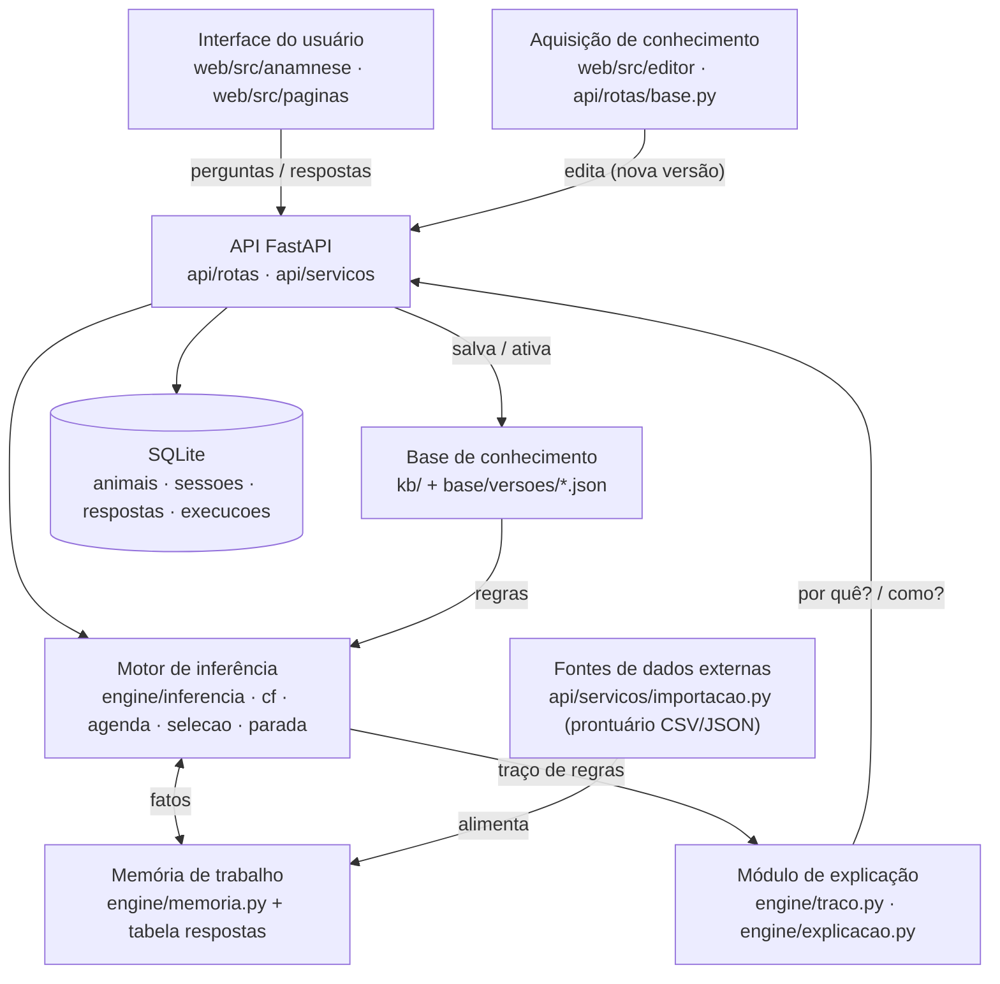

# Especificação — PoC "Anamnese de Bovinos Leiteiros" (Hackathon UFJF 2026)

> Especificação consolidada em 20/10/2026 a partir das Seções 1 a 6 aprovadas (`docs/prompts/secao-N.md`). Fontes oficiais: **[A]** `docs/fontes/apresentacaoRerun.pdf`; **[D]** `docs/fontes/DocumentárioRerun.pdf`. Fontes de domínio: `docs/fontes/fontes.md`. Suposições levantadas: `docs/pesquisa/suposicoes.md`. Agentes e skills: `docs/agentes-e-skills.md`. Tudo que não vem de [A] ou [D] é **(suposição)**; todo conhecimento veterinário é **(suposição a validar)**.
> **Fonte canônica:** a partir de 20/10/2026 esta especificação prevalece sobre `docs/prompts/secao-N.md`, que ficam como histórico das revisões.

## 0.1 Entendimento

**Objetivo (oficial):** "construir uma aplicação para usuário final que resolva um problema da pecuária leiteira por meio de uma base explícita de conhecimento e um motor de inferência" ([A] slide 8; [D] p. 3). **Tema T1 Anamnese:** "coleta estruturada de sinais e histórico de bovinos leiteiros em lactação, com triagem explicável" ([A] slide 9).

**Para quem:** produtor ou ordenhador (linguagem simples) e veterinário (perguntas técnicas), na mesma tela, com troca de modo a qualquer momento sem perder respostas.

**O que o sistema entrega:** uma triagem explicável de 8 doenças comuns em rebanhos leiteiros brasileiros, com:
- urgência (`chamar_agora`, `observar`, `sem_problema`), com bandeira vermelha que manda chamar o veterinário imediatamente;
- todas as 8 doenças em porcentagem de confiança, em ordem decrescente, em três blocos (hipóteses principais, diagnóstico diferencial, pouco provável);
- explicação "por quê?" de cada pergunta e "como?" de cada conclusão, a partir do traço de inferência;
- editor gráfico da base (aquisição de conhecimento) que valida, salva nova versão e roda os casos de teste.

**Restrições obrigatórias:** sem LLM no caminho da decisão ([A] slides 8 e 13); decisão determinística e auditável ([A] slide 8); open source ([A] slides 3 e 13); roda por completo em localhost ([A] slides 10 e 15); desenvolvimento apoiado por agente de IA ([A] slide 3).

**Critérios de sucesso:** demonstração em localhost na sexta 23/10 às 9:00; os 31 casos conhecidos passando na versão ativa; documentação (processo, arquitetura, regras de produção) e apresentação enviadas até quinta 22/10 às 20:00 ([A] slides 10 e 15), com alvo interno às 18:30.

## 0.2 Escopo do PoC

**Entra:**
- Motor de inferência próprio em Python sem dependência de web, banco ou rede; depende só de `kb` (Pydantic) (Seção 1).
- Base de conhecimento em JSON versionado e imutável, com validador e conversão 1:1 para grafo (Seção 2).
- 8 doenças: mastite clínica, metrite puerperal, tristeza parasitária bovina, cetose, hipocalcemia, deslocamento de abomaso, acidose ruminal, dermatite digital; 6 bandeiras vermelhas; urgência por gravidade × confiança (Seção 3).
- Triagem obrigatória de 6 telas e fase dinâmica com limite de 12 (produtor) e 25 (veterinário) perguntas.
- Dois modos (produtor e veterinário), mesma base e mesmo motor.
- Ficha do animal com histórico de anamneses e importação de prontuário CSV/JSON (fontes externas).
- Editor gráfico nível B: visualizar, editar CF, condições e textos, adicionar e remover nós e arestas, validar, salvar versão, rodar casos, ativar.
- API FastAPI que serve o frontend React compilado num processo único em `http://localhost:8000` (Seção 4).
- Testes em quatro camadas, 31 casos por versão e 6 cenários ponta a ponta (Seção 5).
- Documentação de entrega e apresentação (Seção 6).

**Fica de fora (e por quê):**
- Editor nível C (criar base do zero, desfazer/refazer, comparar versões): previsto no formato, sem tempo no prazo de 2,5 dias.
- Sensores e APIs externas reais: só a importação de prontuário representa "fontes de dados externas".
- "Por que **não** é a doença X?": o traço só registra o que disparou.
- Foot rot, laminite e outras doenças: sem fonte confirmada ou fora do escopo de 8.
- Autenticação e múltiplos usuários: PoC local.
- Validação clínica por especialista: tentativa até quinta 12:00; sem ela, tudo segue como suposição a validar.

**Plano de corte** se o prazo apertar: Seção 5.4.

## 0.3 Rastreabilidade (itens exigidos pelo `CLAUDE.md`)

| # | Item | Onde |
|---|---|---|
| 1 | Escopo do PoC | 0.2 |
| 2 | Diagrama Mermaid componente → módulo | Seção 4.2 |
| 3 | Desenho do motor (encadeamento, conflito, CF, traço, por quê/como) | Seção 1 |
| 4 | Formato da base (schema, versão, grafo ↔ regras, validação) | Seção 2 |
| 5 | Conhecimento do domínio com regras em pseudocódigo | Seção 3 |
| 6 | Linguagens, bibliotecas e versões | Seção 4.1 |
| 7 | Pastas do monorepo e contratos da API | Seções 4.3 a 4.7 |
| 8 | Estratégia de testes | Seção 5.1 |
| 9 | Execução em localhost | Seção 5.2 |
| 10 | Plano por dia, marcos e cortes | Seções 5.3 e 5.4 |
| 11 | Documentação e apresentação | Seções 6.1 e 6.2 |
| 12 | Riscos e pontos em aberto | Seção 6.3 |

---

## SEÇÃO 1 — Motor de inferência

**Pacote:** `engine/`, Python sem dependência de web, banco ou rede; depende só de `kb` (Pydantic); testável sozinho.

### Tipo de encadeamento

Avaliação **para frente** em três camadas a cada resposta (fatos → derivados → doenças → urgências), e escolha da próxima pergunta **para trás**, dirigida por objetivo (as hipóteses abertas puxam as variáveis que faltam). Motivo: o encadeamento para frente dá o parecer completo a qualquer momento; o para trás deixa o diálogo curto e explicável ("por quê?").

### Fatos e condições

Fato: `(variável, valor, CF)` com CF em [−1, +1]. Só fatos observados chegam a ±1.

- **Booleanas:** o mapeamento de resposta é sim = +1, não = −1, "não sei" = 0, e vale **só** para perguntas booleanas. A condição `X` usa o CF do fato; a condição negada (`X == não`) usa −CF. Assim, resposta "não" para febre (CF −1) satisfaz `febre == não` com +1.
- **Categóricas e numéricas:** o fato guarda valor e CF separados. Se o valor satisfaz o operador, o CF da condição é o CF do fato; se não satisfaz, é −CF.
- **Intensidade** (leve/moderada/grave) é **valor categórico, nunca CF**. O CF expressa só a certeza da resposta.
- **Sem valor:** variável ainda sem fato, ou respondida com "não sei", faz **toda** condição sobre ela valer CF 0, com qualquer operador (numérico, categórico ou booleano) e também negada (−0 = 0). O operador nunca é avaliado sem valor.

### Regras

`id`, condições (conjunção de `variável op valor`), `cf_regra`, conclusão, `prioridade`, `classe` (`evidencia` | `bandeira_vermelha` | `urgencia`).

- `cf_regra` ∈ [−0,99; +0,99]. Valor negativo = regra de exclusão (evidência contra).
- Premissa = **mínimo** dos CF das condições. A regra só dispara com premissa > `premissa` (0,2). Esse limiar vale **só** para o CF da premissa.
- CF da conclusão = `premissa × cf_regra`.
- **Limites de CF na condição:** `cf_minimo` (a condição só vale se o CF do símbolo ≥ valor) e `cf_maximo` (só vale se ≤ valor). Valendo, a condição usa o próprio CF do símbolo (ou −CF, para `cf_maximo`). Usados nas regras de urgência ("doença com CF ≥ 0,50").
- **Três camadas estritas**, avaliadas nesta ordem: (1) regras que concluem `derivado`, com entradas em perguntas e ficha; (2) regras que concluem `doenca`, com entradas em perguntas, ficha e derivados; (3) regras de `bandeira_vermelha` e `urgencia`, com entradas em qualquer camada abaixo. Nenhuma regra lê símbolo da própria camada ou de camada acima. `sem_problema` não é regra: é o resultado quando nenhuma regra de urgência disparou e todas as doenças estão ≤ 0,35.

### Combinação (MYCIN)

Duas evidências da mesma conclusão: ambas positivas, `a + b(1−a)`; ambas negativas, `a + b(1+a)`; sinais mistos, `(a+b) / (1 − min(|a|,|b|))`.

- O resultado **independe da ordem dos disparos**, para qualquer número de evidências. Verificado em aritmética exata com 2 a 6 evidências, em todas as permutações. Prova: a função `t(x) = sinal(x)·(−ln(1−|x|))` transforma a combinação em soma (`t(comb(a,b)) = t(a) + t(b)`), e a soma é associativa e comutativa. A forma par a par fica; não trocar por acumuladores separados (dão resultado idêntico).
- Como `cf_regra` ≤ 0,99 em módulo, conclusões nunca chegam a ±1 e o caso 0/0 não ocorre. Mesmo assim há **guarda defensiva**: denominador 0 retorna 0.
- Motivo do limite ±0,99: com `cf_regra = +1` e premissa 1, a conclusão chega a +1 e trava (`[+1, −0,5, −0,5]` dá 1 em qualquer ordem).
- **Derivado com `combinacao: max`:** quando as entradas são redundantes (sinais sinônimos ou correlacionados, como distocia e retenção de placenta), o derivado recebe o **maior** CF das regras que disparam, em vez da soma MYCIN, para não inflar a evidência. Só é permitido se todas as regras desse derivado tiverem `cf_regra` positivo. Sinais independentes continuam como regras separadas somadas por MYCIN.

### Troca de modo sem perder dados

Fatos são guardados por **variável**, não por texto de pergunta. A resposta do produtor ("orelhas frias/quentes") e a do veterinário ("temperatura retal") alimentam **sinais derivados** (`febre`, `hipotermia`) por regras com CF próprios, e o MYCIN combina as fontes. O motor recalcula tudo a partir do conjunto de fatos a cada resposta, o que também permite corrigir uma resposta anterior.

### Correções e recálculo

Como o motor recalcula tudo a partir dos fatos, corrigir uma resposta (PUT) pode remover uma bandeira. "A urgência não desce mais" vale para **novas** respostas, não para correções; a correção fica registrada no traço. Perguntas dinâmicas já feitas continuam contando no limite mesmo se corrigidas. "Não sei" conta como respondida: não é perguntada de novo e vale CF 0.

### Triagem obrigatória (`meta.triagem`)

Seis telas fixas, perguntadas primeiro e nessa ordem; depois entra a seleção dinâmica. Telas de múltipla escolha gravam **símbolos booleanos separados** (marcado = +1, não marcado = −1, "não sei" na tela = 0 para todos). Texto por modo; os símbolos são os mesmos nos dois.

1. `dias_em_lactacao` (numérico; vem da ficha, perguntado só se ausente).
2. Estado térmico (escolha única): veterinário informa `temperatura_retal`; produtor informa `extremidades` (fria / normal / quente). Alimentam `febre` e `hipotermia`. "Orelhas frias" sugere hipocalcemia (suposição a validar).
3. Atitude e locomoção (múltipla): `apatia`, `claudicacao`, `decubito`. A opção "Nenhuma alteração" grava `apatia`, `claudicacao` e `decubito` como não (−1).
4. Apetite e ruminação (escolha única): `apetite` = normal / reduzido / ausente.
5. Produção e aspecto do leite (múltipla): `queda_producao`, `leite_alterado` (grumos, sangue, aguado), `ubere_inflamado`.
6. Excreções e secreções (múltipla): `diarreia`, `fezes_ressecadas`, `corrimento_vaginal`, `urina_escura`.

"Respondida" inclui "não sei", para a triagem nunca travar o diálogo. A triagem **não conta** no limite de perguntas. Marcar `decubito` dispara a bandeira já na triagem (pausa no modo produtor).

### Bandeiras vermelhas

Regras de classe `bandeira_vermelha`, com conclusão fixa `chamar_agora`. Disparam quando a premissa passa de 0,2 (resposta "sim"), sem depender do CF de nenhuma doença; "não sei" não dispara. Depois de disparada, a urgência **não desce mais** com novas respostas (correções: ver "Correções e recálculo"). No modo produtor, a interface pausa com o alerta ("sintoma grave, chame um veterinário o mais rápido possível") e oferece *Ver parecer* e *Continuar as perguntas*; o quadro urgente fica fixo no topo. No modo veterinário, mostra o mesmo quadro em linguagem técnica, sem pausar.

### Parecer

Lista **todas as 8 doenças em ordem decrescente de CF** (desempate por id), com **porcentagem nos dois modos**: `% = max(0, CF) × 100` sempre, arredondado. Rótulos: "descartada" se CF < −0,2; "sem evidência" se −0,2 ≤ CF ≤ 0,2 (aparece de 0% a 20%); "com evidência" acima de 0,2. A porcentagem é **grau de confiança do sistema, não probabilidade**, e a tela diz isso. O CF bruto aparece na explicação "como?". A urgência vem das bandeiras e, na ausência delas, das regras de classe `urgencia` (gravidade × confiança).

A lista é dividida em blocos visuais: **Hipóteses principais** (CF ≥ 0,50), **Diagnóstico diferencial / sinais inespecíficos** (0,20 < CF < 0,50) e **Pouco provável ou descartada** (CF ≤ 0,20). A fronteira 0,20 é exclusiva no bloco diferencial, para coincidir com o rótulo "com evidência" (CF > 0,2): uma doença com CF exatamente 0,20 aparece como "sem evidência" (20%) no bloco "Pouco provável". Os cortes de exibição vêm de `meta.limiares` (`bloco_principal` 0,50 e `bloco_diferencial` 0,20). Cada doença mostra também sua gravidade (alta, média, baixa).

### Resolução de conflito

Agenda ordenada por `prioridade` (decrescente), depois especificidade (mais condições primeiro), depois `id`. Entre urgências disparadas, a mais urgente vence. A agenda não altera os CF (a combinação independe da ordem); só decide a urgência e a ordem de avaliação.

### Próxima pergunta (fase dinâmica)

- **Regra viável:** regra que ainda pode atingir premissa > 0,2 com os fatos conhecidos e as variáveis perguntáveis no modo atual. Exclui regra morta por condição conhecida e regra com variável exclusiva do veterinário ainda não respondida, no modo produtor.
- Escolha: variável desconhecida, perguntável no modo atual, que aparece em mais regras **viáveis** de hipóteses abertas, ponderada por |`cf_regra`|. **Através de derivados:** uma variável que alimenta um derivado conta também para cada regra viável de doença que usa esse derivado, com peso |`cf_regra` da regra de doença| × |`cf_regra` da regra do derivado|; empate pela maior **gravidade** da hipótese servida (alta > média > baixa), depois por `id`.
- Variáveis exclusivas do veterinário não são perguntadas no modo produtor, mas, se já respondidas, seus fatos continuam valendo.
- **Diretriz de autoria:** não misturar sinal do produtor e exame do veterinário na mesma conjunção. Usar uma regra do produtor (`cf_regra` menor) e uma regra de confirmação do veterinário (`cf_regra` maior), que se somam via MYCIN.

### Parada

Limiares nomeados em `meta.limiares` da base (calibráveis e versionados): `descarte` −0,2; `premissa` 0,2; `hipotese_relevante` 0,35; `exaustao` 0,60; `potencial` 0,70; `confirmacao` 0,80; e os cortes de exibição `bloco_principal` 0,50 e `bloco_diferencial` 0,20 (usados nos três blocos do parecer).

**Fronteiras em ponto flutuante (vale para todo o motor):** toda comparação com limiar (`premissa`, `descarte`, `hipotese_relevante`, `exaustao`, `potencial`, `confirmacao`, `cf_minimo`, `cf_maximo` e os cortes de exibição) usa tolerância de 1e-9: |x − limiar| ≤ 1e-9 conta como igual ("x > limiar" é falso e "x ≥ limiar" é verdadeiro). Assim, TPB = −0,20 na triagem-padrão fica no limite de `descarte` e não é hipótese aberta (exige CF > −0,2), e acidose = 0,50 atinge `cf_minimo` 0,50.

**Hipótese aberta:** doença com CF > `descarte` (−0,2) e < `confirmacao` (0,80). É o conjunto usado na escolha da próxima pergunta e na saída por exaustão. `hipotese_relevante` (0,35) serve **só** ao critério (b) abaixo e à lista de inconclusivas do parecer. Assim, uma triagem que termina com todas as doenças abaixo de 0,35 não encerra por isso; só encerra por exaustão se nenhuma hipótese aberta tiver potencial ≥ 0,60 (as hipóteses continuam abertas e recebem perguntas).

**Potencial máximo** de uma hipótese: combinação MYCIN do CF atual com todos os `cf_regra` positivos das suas regras viáveis, supondo premissa 1. É um limite superior válido porque a combinação de positivos é monotônica e evidência negativa só reduz. Quando a regra depende de sinal derivado, o potencial é propagado de baixo para cima pelo grafo acíclico.

O motor **encerra por confirmação** quando ao menos uma doença tem CF ≥ 0,80 **e**:

- (a) toda a `meta.triagem` foi respondida;
- (b) nenhuma outra hipótese **aberta** (CF > −0,2 e < 0,80) com CF atual > 0,35 tem potencial máximo ≥ 0,70; doenças já ≥ 0,80 nunca bloqueiam a parada (comorbidade encerra junta);
- (c) nenhuma regra `bandeira_vermelha` com alguma condição ativada (CF > 0,2) tem condição ainda desconhecida e perguntável no modo atual.

Comorbidade: não há distância mínima entre hipóteses; todas as doenças ≥ 0,80 saem juntas.

Outras saídas:
- acabaram as perguntas aplicáveis ao modo;
- atingiu o limite da **fase dinâmica** (12 perguntas no produtor, 25 no veterinário; a triagem não conta);
- nenhuma hipótese aberta tem potencial máximo ≥ `exaustao` (0,60); aparece como `motivo_parada: "sem_potencial"`.

Ao parar por limite, o parecer destaca as hipóteses inconclusivas (CF > 0,35) e as bandeiras não verificadas.

### Traço

Lista ordenada de eventos: `pergunta_feita` (com o motivo), `fato_adicionado` (com origem: resposta, ficha, importação ou regra), `regra_disparada` (fatos de entrada com CF, CF de saída) e `cf_combinado` (antes/depois). **"Por quê?"** é o motivo gravado no evento da pergunta; **"Como?"** percorre o traço de trás para frente, da conclusão até as respostas. Limitação declarada: o traço não responde "por que **não** é a doença X?".

### Testes do motor

- Embaralhar a ordem das evidências não muda o resultado (tolerância de ponto flutuante).
- Caso +1/−1 sem exceção (guarda retorna 0).
- `febre == não` com resposta "não" dispara a regra.
- Tela de múltipla escolha grava um booleano por opção; "não sei" grava 0 em todos.
- Com CF ≥ 0,80 e triagem incompleta, o motor não encerra.
- Líder em 0,85 e outra hipótese **aberta** em 0,5 com potencial ≥ 0,70: continua; com potencial < 0,70: encerra e lista as duas.
- Bandeira com condição ativada e outra condição pendente impede a parada.
- Duas doenças ≥ 0,80 encerram e aparecem juntas, mesmo que ambas tenham potencial ≥ 0,70 (doença já ≥ 0,80 não é hipótese aberta e não bloqueia o critério (b)).
- Modo produtor: nenhuma pergunta é escolhida por causa de regra inviável; hipótese > 0,35 cujo potencial depende só de variável exclusiva do veterinário não bloqueia a parada.
- O limite conta só perguntas dinâmicas.
- Potencial máximo propagado por sinal derivado é ≥ ao CF alcançado em qualquer sequência de respostas (teste de propriedade).
- Derivado `max`: duas regras positivas de 0,9 dão 0,9 (não 0,99).
- `cf_minimo 0,50`: doença em 0,49 não dispara a urgência; em 0,50 dispara.
- Camadas: regra de doença que lê outra doença é rejeitada pelo validador.
- Empate na próxima pergunta é resolvido pela gravidade antes do `id`.
- Condição numérica ou categórica sobre variável sem fato, ou com "não sei", vale 0 sem erro (inclusive negada).
- Pergunta que só alimenta um derivado (ex.: `temperatura_retal` → `febre`) é escolhida quando o derivado pesa em hipóteses abertas.
- Triagem que termina com todas as doenças abaixo de 0,35 (e acima de −0,2): o motor não encerra por isso e continua perguntando enquanto alguma hipótese aberta tiver potencial ≥ 0,60; só sai por exaustão (`sem_potencial`) quando nenhuma tiver.
- Combinação com 4, 5 e 6 evidências em todas as permutações (aritmética exata): resultado idêntico ao de acumuladores separados.
- Fronteiras em ponto flutuante (tolerância de 1e-9): TPB em −0,20 (triagem-padrão) não é hipótese aberta; acidose em 0,50 atinge `cf_minimo` 0,50; premissa em 0,20 não dispara a regra; valores a mais de 1e-9 do limiar se comportam normalmente.
- Corrigir (PUT) a resposta que disparou uma bandeira remove a bandeira e a correção fica no traço; pergunta dinâmica corrigida continua contando no limite; "não sei" conta como respondida e não é perguntada de novo.

## SEÇÃO 2 — Base de conhecimento e editor gráfico

**Formato canônico: JSON**, validado por modelos Pydantic (fonte única da verdade; deles se exporta o JSON Schema e os tipos TypeScript do frontend). Não uso YAML: o YAML 1.1 lido pelo PyYAML converte `no` e `yes` em booleanos, e nossas respostas e valores são palavras em português. O humano edita pelo grafo, então a legibilidade do arquivo importa menos do que a ausência de ambiguidade. Observações vão em campos `nota`.

**Arquivos.**
```
base/
  versoes/v0001.json, v0002.json …   (imutáveis)
  ativa.json                          {"versao": "v0002"}
  casos/casos.json                    (casos de teste, compartilhados)
```
Os arquivos são a fonte da verdade (e vão para o git); o SQLite guarda só o índice de versões e os resultados de teste. O editor **nunca sobrescreve**: salvar cria o próximo `vNNNN.json` com `pai`.

**Estrutura do arquivo.** `meta`, `simbolos[]`, `regras[]`, `layout`.
- **`meta`:** `versao`, `pai`, `autor`, `data`, `nota`, mais:
  - `limiares`: `descarte` −0,2; `premissa` 0,2; `hipotese_relevante` 0,35; `exaustao` 0,60; `potencial` 0,70; `confirmacao` 0,80; e os cortes de exibição `bloco_principal` 0,50 e `bloco_diferencial` 0,20 (usados nos três blocos do parecer).
  - `limite_dinamico`: `produtor` 12, `veterinario` 25 (a triagem não conta).
  - `triagem`: lista ordenada de 6 telas. Cada tela tem `id`, `selecao` (`unica` | `multipla`), `simbolos` (ids que a tela grava) e textos por modo (`produtor`, `veterinario`), incluindo o rótulo de cada opção.
- **Símbolo** (namespace único para tudo que a regra lê ou conclui): `id`, `tipo` (`pergunta` | `ficha` | `derivado` | `doenca` | `urgencia`), `dominio` (`booleano`, `categorico` com valores, ou `numerico` com min/max/unidade), `nome` e, quando perguntável na fase dinâmica, `pergunta` e `por_que` **por modo** (`produtor`, `veterinario`; texto ausente = não perguntável naquele modo), `campo_ficha` (tipo `ficha`), `fonte`, `gravidade` (obrigatório em `doenca`: `alta` | `media` | `baixa`), `combinacao` (só em `derivado`: `mycin`, padrão, ou `max`).
- **Regra:** `id`, `se` (lista de `{simbolo, op, valor, negado, cf_minimo?, cf_maximo?}`; `op` ∈ `=`, `≠`, `<`, `≤`, `>`, `≥`, `em`), `entao` (`{simbolo, cf}`), `prioridade`, `classe` (`evidencia` | `bandeira_vermelha` | `urgencia`), `fonte` (citação), `status` (`suposicao_a_validar` | `validada`), `nota`.
  - **Defaults da base:** `cf_regra` das bandeiras vermelhas = +0,99; `prioridade`: `bandeira_vermelha` 100, `urgencia` 50, `evidencia` (doenças e derivados) 10.
  - **Forma canônica da condição:** `X = não` em booleano é escrito `{simbolo: X, op: "=", valor: true, negado: true}`; `op "="` com `valor` false em booleano é erro do validador. Fatos vindos da ficha e da importação têm CF +1 (booleano verdadeiro, valor numérico ou categórico) ou −1 (booleano falso).

**Grafo ↔ regras.** O grafo é **bipartido**: nós de símbolo e nós de regra. Aresta símbolo→regra é uma condição (carrega `op`, `valor`, `negado`); aresta regra→símbolo é a conclusão (carrega `cf`). Cada regra do JSON é exatamente um nó de regra, então a conversão é 1:1 e sem perda, nos dois sentidos. Símbolos da triagem aparecem com um selo de triagem. O `layout` guarda x, y por id e fica **separado** da semântica: mover um nó não cria versão semântica nem ruído no diff. O grafo não carrega nenhuma lógica que não esteja no JSON. A triagem e os limiares são editados num painel de `meta`, fora do grafo.

**Ciclo de edição (nível B).** Carregar a ativa → editar → *Salvar* → o backend valida e **bloqueia se houver erro** → grava `vNNNN.json` → roda `casos.json` na nova versão e na anterior → mostra o que passou, falhou e mudou → *Ativar* é uma ação separada. Desfazer/refazer e comparação (nível C) são operações sobre arquivos imutáveis e não mudam o formato.

**Validação** (pacote `kb/`, usado pelo editor, pela API e pelos testes).
- *Erros (bloqueiam):*
  - símbolo indefinido em condição, conclusão ou tela de triagem; id duplicado;
  - valor fora do domínio ou `op` incompatível com o tipo (inclui `op "="` com `valor` false em booleano: usar `negado: true`); `cf` fora de ±0,99;
  - **ciclo** na dependência símbolo→regra→símbolo (DFS; a propagação para frente e o cálculo de potencial exigem grafo acíclico);
  - **regra inalcançável** (condição em símbolo derivado que nenhuma regra conclui, ou em pergunta sem texto em nenhum modo, fora da triagem e sem campo de ficha, ou **condição negada sobre derivado que nenhuma regra conclui com CF negativo** — essa condição nunca vale, porque o derivado fica em CF 0 e −0 = 0);
  - bandeira vermelha cuja conclusão não é `chamar_agora`;
  - **bandeira vermelha sem nenhuma condição sobre símbolo da triagem** (senão ela nunca seria exigida antes da parada);
  - doença sem nenhuma regra; doença sem nenhuma regra só com símbolos perguntáveis no modo produtor;
  - **cobertura da triagem:** doença sem nenhuma regra cujas condições sejam todas símbolos da triagem ou derivados cujas entradas são **todas** da triagem;
  - **camadas:** regra que lê símbolo da própria camada ou de camada acima (camada 1 `derivado` ← perguntas e ficha; camada 2 `doenca` ← perguntas, ficha e derivados; camada 3 `bandeira_vermelha`/`urgencia` ← qualquer camada abaixo);
  - `doenca` sem `gravidade`; derivado `max` com alguma regra de `cf` negativo; `cf_minimo`/`cf_maximo` fora de [0, 1] ou usados em símbolo que não seja `doenca`/`derivado`;
  - tela de triagem sem texto em algum dos dois modos (símbolo de ficha dispensa);
  - limiares fora da ordem `descarte < 0 < premissa < hipotese_relevante < exaustao < potencial < confirmacao`, ou `bloco_diferencial` ≥ `bloco_principal`;
  - regra sem `fonte`.
- *Avisos:* símbolo perguntável nunca usado; duas regras com as mesmas condições e conclusão de sinal oposto; contagem de regras ainda `suposicao_a_validar`.

**Casos de teste** (`casos.json`): `id`, `descricao`, `modo`, `ficha`, `triagem` (respostas das 6 telas), `respostas` (símbolo → valor, fase dinâmica), opcionais `continuacao` (troca de modo no meio: novo `modo`, triagem extra e respostas) e `limite_dinamico` (substitui o de `meta` só nessa execução), e `esperado` (`urgencia`, `bandeira` opcional, `top1` ou `top3_contem`, **faixas de porcentagem por doença**, e opcionalmente `motivo_parada`, `inconclusivas` (lista de doenças) e `alerta` (`{ "pausa": bool }`)). Uso faixas, não valores exatos, para o teste não quebrar a cada ajuste de CF. Nos casos, a `ficha` traz `dias_em_lactacao` direto (determinístico, sem depender da data de hoje). Cobertura: por doença, ao menos 2 casos típicos e 1 ambíguo; casos de bandeira vermelha (incluindo decúbito na triagem); um caso de comorbidade; um caso de troca de modo (respostas do produtor mais continuação como veterinário); um caso de parada por limite. Os casos são inventados por nós, então são **suposição a validar**. Cada execução fica registrada por versão. Convenções do executor (`engine/casos.py`): pergunta dinâmica feita e ausente em `respostas` vale "não sei"; resposta que o motor não chegou a pedir é ignorada; bandeira com pausa recebe `continuar` automaticamente. A versão ativa precisa passar todos os casos; versões antigas só reportam.

**Dimensão estimada** (suposição, para caber em dois dias e meio): cerca de 75 regras e 6 sinais derivados (Seção 3), 8 doenças, 3 urgências e 31 casos de teste.

## SEÇÃO 3 — Conhecimento do domínio

### 3.1 Fontes

Tabela completa, com status de conferência e fatos extraídos, em `docs/fontes/fontes.md`. Resumo: F1 mastite, F2 metrite, F3–F5 TPB, F6 cetose (**lida**), F7 hipocalcemia, F8 deslocamento de abomaso, F9–F10 acidose, F11–F12 dermatite digital (F12 **lida**). Todas do MSD Veterinary Manual, exceto F5 (Embrapa).

### 3.2 Histórico (ficha do animal e importação de prontuário)

| símbolo | tipo | uso |
|---|---|---|
| `data_ultimo_parto` | data ISO-8601 (campo de entrada da ficha; não é símbolo de regra) | origem de `dias_em_lactacao` |
| `dias_em_lactacao` | numérico (dias desde o parto; calculado de `data_ultimo_parto` na criação da sessão) | triagem; gera os sinais de período |
| `numero_lactacoes` | numérico | registrado; sem regra no PoC (sem fonte) |
| `raca_grupo` | categórico: europeia / zebuina / cruzada (o rótulo de tela pode ter acento: "zebuína") | TPB (F5) |
| `retencao_placenta` | booleano (último parto) | metrite (suposição) |
| `parto_distocico` | booleano (último parto) | metrite (suposição) |
| `historico_mastite_12m` | booleano | mastite (suposição) |
| `mudanca_dieta_recente` | booleano (aumento brusco de concentrado nos últimos 3 dias) | acidose (F9); também perguntável |
| `casos_podais_no_rebanho` | booleano | dermatite digital (F12, doença de rebanho); também perguntável |

A ficha grava `data_ultimo_parto`; `dias_em_lactacao` é calculado na criação da sessão e é o símbolo usado pela triagem e pelas regras. Nos casos de teste, a `ficha` traz `dias_em_lactacao` direto (determinístico, sem depender da data de hoje).

### 3.3 Sinais derivados (camada 1)

Combinação padrão MYCIN; `prioridade` 10 (classe `evidencia`). `combinacao: max` é usada quando as entradas são **redundantes** (mesmo fenômeno, fontes correlacionadas), para não inflar a soma.
```
R-DER-01  SE dias_em_lactacao ≤ 3               ENTÃO periparto_imediato  +0,99 | F7 (48 h + margem)
R-DER-02  SE dias_em_lactacao ≤ 21              ENTÃO puerperio           +0,99 | F2
R-DER-03  SE dias_em_lactacao ≤ 42              ENTÃO inicio_lactacao     +0,99 | F6 (6 semanas)
R-DER-04  SE temperatura_retal ≥ 39,5           ENTÃO febre               +0,95 | F2      [vet]
R-DER-05  SE temperatura_retal < 38,0           ENTÃO hipotermia          +0,90 | suposição [vet]
R-DER-06  SE 38,0 ≤ temperatura_retal < 39,5    ENTÃO febre               −0,90 | suposição [vet]
R-DER-07  SE extremidades = quente              ENTÃO febre               +0,50 | suposição [produtor]
R-DER-08  SE extremidades = fria                ENTÃO hipotermia          +0,60 | F7       [produtor]
R-DER-09  SE extremidades = normal              ENTÃO febre               −0,40 | suposição [produtor]
R-DER-10  SE retencao_placenta                  ENTÃO parto_complicado    +0,90 | suposição  (combinacao: max)
R-DER-11  SE parto_distocico                    ENTÃO parto_complicado    +0,90 | suposição  (combinacao: max)
```
`febre` e `hipotermia` usam MYCIN (termômetro e extremidades são evidências independentes e podem se contradizer). `parto_complicado` usa `max` (distocia e retenção de placenta são correlacionadas).
Derivados de triagem (contam para a cobertura): `periparto_imediato`, `puerperio`, `inicio_lactacao`, `febre`, `hipotermia` — todas as entradas vêm de `meta.triagem`. `parto_complicado` **não** conta.
Os derivados de período (`periparto_imediato`, `puerperio`, `inicio_lactacao`) só recebem evidência positiva: fora da janela ficam em CF 0, não −1. Por isso as regras de exclusão por período (R-MET-06, R-CET-08, R-HIP-06) testam `dias_em_lactacao` direto, nunca o derivado negado.

### 3.4 Perguntas da fase dinâmica

| símbolo | produtor | veterinário | serve a |
|---|---|---|---|
| `teste_caneca_positivo` | sim ("grumos no teste da caneca de fundo escuro?") | sim | mastite (F1) |
| `cmt_positivo` | — | sim | mastite (F1) |
| `um_quarto_afetado` | sim | sim | mastite (suposição) |
| `corrimento_fetido` | sim ("cheiro forte, aquoso, marrom-avermelhado?") | sim | metrite (F2) |
| `utero_aumentado_palpacao` | — | sim | metrite (F2) |
| `carrapatos_presentes` | sim | sim | TPB (F3, F5) |
| `mucosas_palidas_amareladas` | sim ("olho/gengiva pálidos ou amarelados?") | sim | TPB (F3, F5) |
| `esfregaco_hemoparasita` | — | sim | TPB (F3, F4) |
| `abdomen_vazio` | sim ("barriga murcha, vazia?") | sim | cetose (F6) |
| `sinais_nervosos` | sim ("lambe ou mastiga objetos, anda sem coordenação?") | sim | cetose (F6) |
| `perda_condicao_corporal` | sim | sim | cetose (F6) |
| `bhb_sanguineo` | — | sim (mmol/L) | cetose (F6) |
| `fraqueza_tremores` | sim | sim | hipocalcemia (suposição) |
| `calcio_sanguineo` | — | sim (mmol/L) | hipocalcemia (F7) |
| `ping_flanco_esquerdo` | — | sim | deslocamento de abomaso (F8) |
| `costelas_esquerdas_saltadas` | sim | sim | deslocamento de abomaso (F8) |
| `mudanca_dieta_recente` | sim (se a ficha não tiver) | sim | acidose (F9) |
| `graos_nas_fezes` | sim | sim | acidose (F9) |
| `ph_ruminal` | — | sim | acidose (F9) |
| `ferida_vermelha_entre_unhas` | sim ("ferida vermelha e dolorida entre as unhas ou atrás do casco?") | sim | dermatite digital (F12) |
| `lesao_dd_ativa` | — | sim (ulcerada, dolorosa, > 2 cm) | dermatite digital (F12) |
| `inchaco_simetrico_acima_casco` | sim | sim | dermatite digital — exclusão (F12, sugere foot rot) |
| `casos_podais_no_rebanho` | sim (se a ficha não tiver) | sim | dermatite digital (F12) |

Total: 23 perguntas dinâmicas (8 exclusivas do veterinário) + cerca de 15 símbolos gravados pela triagem.

Os textos de pergunta por modo, o `por_que` e os rótulos das opções da triagem são gerados por agente a partir desta tabela e revisados por A (conteúdo) e C (linguagem do produtor).

### 3.5 Regras por doença (camada 2)

Formato: `id [onde] SE condições ENTÃO doença cf | fonte`. `[T]` = só símbolos de triagem ou derivados de triagem; `[P]` = perguntável no modo produtor; `[V]` = usa variável exclusiva do veterinário. **Todas com `status: suposicao_a_validar`.** CF são estimativas minhas. `prioridade` 10 (classe `evidencia`, padrão da base). Nas condições, `X = não` é açúcar de notação para `negado: true` (forma canônica da Seção 2: `op "="`, `valor: true`, `negado: true`).

**Mastite clínica (`mastite`, gravidade média)**
```
R-MAS-01 [T] SE leite_alterado                         ENTÃO mastite +0,70 | F1
R-MAS-02 [T] SE ubere_inflamado                        ENTÃO mastite +0,60 | F1
R-MAS-03 [P] SE teste_caneca_positivo                  ENTÃO mastite +0,65 | F1
R-MAS-04 [P] SE um_quarto_afetado                      ENTÃO mastite +0,30 | suposição
R-MAS-05 [V] SE cmt_positivo                           ENTÃO mastite +0,75 | F1
R-MAS-06 [P] SE historico_mastite_12m                  ENTÃO mastite +0,15 | suposição
R-MAS-07 [T] SE leite_alterado = não E ubere_inflamado = não ENTÃO mastite −0,60 | suposição
```

**Metrite puerperal (`metrite`, gravidade alta)**
```
R-MET-01 [T] SE corrimento_vaginal E puerperio         ENTÃO metrite +0,60 | F2
R-MET-02 [T] SE febre E puerperio E apetite ∈ {reduzido, ausente} ENTÃO metrite +0,35 | F2
R-MET-03 [P] SE corrimento_fetido E puerperio          ENTÃO metrite +0,80 | F2
R-MET-04 [P] SE parto_complicado                       ENTÃO metrite +0,30 | suposição
R-MET-05 [V] SE utero_aumentado_palpacao E puerperio   ENTÃO metrite +0,50 | F2
R-MET-06 [T] SE dias_em_lactacao > 21                  ENTÃO metrite −0,80 | F2 (janela de 21 dias)
```

**Tristeza parasitária bovina (`tpb`, gravidade alta)**
```
R-TPB-01 [T] SE urina_escura E febre                   ENTÃO tpb +0,70 | F3
R-TPB-02 [T] SE febre E apatia                         ENTÃO tpb +0,30 | F5
R-TPB-03 [P] SE mucosas_palidas_amareladas             ENTÃO tpb +0,60 | F3, F4, F5
R-TPB-04 [P] SE carrapatos_presentes E febre           ENTÃO tpb +0,45 | F3, F5
R-TPB-05 [P] SE raca_grupo = europeia                  ENTÃO tpb +0,10 | F5
R-TPB-06 [V] SE esfregaco_hemoparasita                 ENTÃO tpb +0,90 | F3, F4
R-TPB-07 [T] SE febre = não E urina_escura = não       ENTÃO tpb −0,50 | suposição
```

**Cetose (`cetose`, gravidade média)**
```
R-CET-01 [T] SE inicio_lactacao E apetite ∈ {reduzido, ausente} E queda_producao ENTÃO cetose +0,45 | F6
R-CET-02 [T] SE inicio_lactacao E fezes_ressecadas     ENTÃO cetose +0,30 | F6
R-CET-03 [P] SE sinais_nervosos E inicio_lactacao      ENTÃO cetose +0,40 | F6
R-CET-04 [P] SE perda_condicao_corporal E inicio_lactacao ENTÃO cetose +0,30 | F6
R-CET-05 [P] SE abdomen_vazio E inicio_lactacao        ENTÃO cetose +0,25 | F6
R-CET-06 [V] SE bhb_sanguineo ≥ 1,2                    ENTÃO cetose +0,85 | F6
R-CET-07 [T] SE febre                                  ENTÃO cetose −0,30 | suposição (cetose primária é afebril)
R-CET-08 [T] SE dias_em_lactacao > 42                  ENTÃO cetose −0,60 | F6 (risco nas 6 primeiras semanas)
```

**Hipocalcemia / febre do leite (`hipocalcemia`, gravidade alta)**
```
R-HIP-01 [T] SE decubito E periparto_imediato          ENTÃO hipocalcemia +0,80 | F7
R-HIP-02 [T] SE hipotermia E periparto_imediato        ENTÃO hipocalcemia +0,60 | F7
R-HIP-03 [P] SE fraqueza_tremores E periparto_imediato ENTÃO hipocalcemia +0,50 | suposição
R-HIP-04 [V] SE calcio_sanguineo < 1,5                 ENTÃO hipocalcemia +0,90 | F7
R-HIP-05 [T] SE febre                                  ENTÃO hipocalcemia −0,50 | F7 (afebril)
R-HIP-06 [T] SE dias_em_lactacao > 7                   ENTÃO hipocalcemia −0,70 | F7 (até 48 h; margem suposição)
```

**Deslocamento de abomaso (`deslocamento_abomaso`, gravidade alta)**
```
R-DAB-01 [T] SE inicio_lactacao E apetite ∈ {reduzido, ausente} E queda_producao ENTÃO deslocamento_abomaso +0,30 | F8
R-DAB-02 [T] SE febre = não E apetite ∈ {reduzido, ausente} ENTÃO deslocamento_abomaso +0,15 | F8 (vitais normais)
R-DAB-03 [P] SE costelas_esquerdas_saltadas            ENTÃO deslocamento_abomaso +0,40 | F8
R-DAB-04 [V] SE ping_flanco_esquerdo                   ENTÃO deslocamento_abomaso +0,90 | F8
```

**Acidose ruminal (`acidose`, gravidade média)**
```
R-ACI-01 [T] SE diarreia E apetite ∈ {reduzido, ausente} ENTÃO acidose +0,40 | F9
R-ACI-02 [P] SE mudanca_dieta_recente                  ENTÃO acidose +0,60 | F9
R-ACI-03 [P] SE graos_nas_fezes                        ENTÃO acidose +0,50 | F9
R-ACI-04 [T] SE diarreia E apatia                      ENTÃO acidose +0,20 | suposição
R-ACI-05 [V] SE ph_ruminal < 5,5                       ENTÃO acidose +0,90 | F9
```

**Dermatite digital (`dermatite_digital`, gravidade baixa)**
```
R-DD-01 [T] SE claudicacao                             ENTÃO dermatite_digital +0,40 | F11 (lesão de casco mais comum em leiteiras)
R-DD-02 [T] SE claudicacao E febre = não E apetite = normal ENTÃO dermatite_digital +0,25 | suposição (quadro local)
R-DD-03 [P] SE ferida_vermelha_entre_unhas             ENTÃO dermatite_digital +0,75 | F12
R-DD-04 [P] SE casos_podais_no_rebanho                 ENTÃO dermatite_digital +0,20 | F12 (doença de rebanho)
R-DD-05 [V] SE lesao_dd_ativa                          ENTÃO dermatite_digital +0,90 | F12
R-DD-06 [P] SE inchaco_simetrico_acima_casco           ENTÃO dermatite_digital −0,40 | F12 (aponta foot rot)
```
Observação: foot rot (pododermatite) fica fora do escopo; o inchaço simétrico só reduz a confiança em dermatite digital, e o parecer recomenda exame do casco.

### 3.6 Bandeiras vermelhas (camada 3, classe `bandeira_vermelha`, conclusão `chamar_agora`)

Todas têm ao menos uma condição de triagem (exigência do validador). Defaults: `cf_regra` +0,99 e `prioridade` 100.
```
R-BV-01 SE decubito                                    | vaca caída: hipocalcemia, choque, trauma (F7)
R-BV-02 SE urina_escura                                | hemólise: TPB aguda (F3)
R-BV-03 SE apetite = ausente E apatia                  | quadro sistêmico grave (suposição)
R-BV-04 SE hipotermia E apatia                         | colapso circulatório (F7)
R-BV-05 SE ubere_inflamado E febre E apatia            | mastite com sinais sistêmicos (F1, coliformes)
R-BV-06 SE temperatura_retal ≥ 41,0                    | febre muito alta (vet; limiar suposição)
```

### 3.7 Urgência por gravidade × confiança (camada 3, classe `urgencia`)

Gravidade é atributo do símbolo `doenca` (suposição): **alta** — TPB, hipocalcemia, deslocamento de abomaso, metrite; **média** — mastite, cetose, acidose; **baixa** — dermatite digital. Condições usam `cf_minimo`; `prioridade` 50.
```
R-URG-<doença> (uma por doença):
  gravidade alta:  SE <doença> [cf_minimo 0,50]  ENTÃO chamar_agora +0,90
  gravidade média: SE <doença> [cf_minimo 0,50]  ENTÃO observar     +0,90
  gravidade baixa: SE <doença> [cf_minimo 0,50]  ENTÃO observar     +0,90
```
"A mais urgente vence." `sem_problema` **não é regra**: é o resultado quando nenhuma regra de urgência ou bandeira disparou e todas as doenças estão ≤ 0,35. Nos demais casos sem regra disparada, o resultado é `observar`. Assim nenhuma regra da camada 3 lê outra da mesma camada.

### 3.8 Impacto nas Seções 1 e 2

Aplicados (aprovados em 20/10):
1. `cf_minimo` na condição; três camadas estritas.
2. `gravidade` no símbolo `doenca`: usada na interface e como desempate na escolha da próxima pergunta.
3. Derivado de triagem só conta para a cobertura se **todas** as entradas vierem de `meta.triagem`.
4. "OU" com sinais redundantes vira derivado com `combinacao: max`; com sinais independentes, vira regras separadas.
5. Hipóteses entre 20% e 50% aparecem num bloco separado na interface: "Diagnóstico diferencial / sinais inespecíficos".

6. `sem_problema` sai das regras e vira resultado padrão (evita regra da camada 3 lendo bandeira da mesma camada). **Confirmada pela equipe em 20/10/2026.**

### 3.9 Riscos de domínio

- CF são estimativas sem calibração com dados reais; os casos de teste usam faixas largas por isso.
- Sinais de triagem inespecíficos (apetite, queda de leite) somam em várias doenças: espere três ou quatro hipóteses entre 20% e 50% em casos vagos. Vão para o bloco "Diagnóstico diferencial".
- Hemoglobinúria também ocorre em hipofosfatemia pós-parto e hemoglobinúria bacilar (fora do escopo); o parecer não deve afirmar TPB com certeza só por urina escura.
- Foot rot fica fora do escopo e pode ser confundido com dermatite digital pelo produtor.

## SEÇÃO 4 — Tecnologias, monorepo e contratos da API

### 4.1 Tecnologias e versões

| Item | Versão | Licença | Por quê |
|---|---|---|---|
| Python | 3.14 (última correção da linha) | PSF-2.0 | estável há um ano; a 3.15 saiu em 09/10/2026, recente demais para pacotes compilados no Windows |
| uv | 0.13.x | MIT OR Apache-2.0 | instala o Python e as dependências; trava versões em `uv.lock` |
| FastAPI | 0.156.x | MIT | API e documentação interativa; serve o frontend compilado |
| Pydantic | 2.14.x | MIT | modelos da base e dos contratos (fonte única de tipos) |
| uvicorn | 0.54.x | BSD-3-Clause | servidor ASGI local |
| sqlite3 | biblioteca padrão | PSF-2.0 | persistência sem ORM |
| pytest | 9.1.x | MIT | testes do motor, da base e dos casos |
| hypothesis | 6.170.x | MPL-2.0 | testes de propriedade (ordem da combinação MYCIN, potencial máximo) |
| httpx | 0.28.1 | BSD-3-Clause | cliente de teste da API (não usar a 1.0 de desenvolvimento) |
| ruff | 0.17.x | MIT | lint e formatação Python |
| Node.js | 24 LTS | MIT | o Node 26 só vira LTS em 28/10/2026, depois da entrega |
| TypeScript | última versão da linha em JavaScript (5.x/6.x; confirmar na instalação) | Apache-2.0 | não usar a 7.0 (compilador nativo novo): o openapi-typescript usa a API JavaScript do TypeScript (suposição a confirmar) |
| Vite | 8.x | MIT | build e servidor de desenvolvimento (exige Node ^20.19 ou ≥ 22.12) |
| React / React DOM | 19.x | MIT | interface |
| @xyflow/react (React Flow) | 12.x | MIT | editor gráfico da base |
| @dagrejs/dagre | 3.x | MIT | layout automático inicial do grafo |
| @playwright/test | 1.64.x | Apache-2.0 | ponta a ponta; no Windows exige `npx playwright install chromium` |
| openapi-typescript | 7.x | MIT | gera os tipos TypeScript a partir do OpenAPI |

**Descartados:** TanStack Query (o estado da sessão vem pronto do backend em `EstadoSessao`; `fetch` basta), MSW (um simulador simples basta), elkjs (licença EPL-2.0/GPL), ORM (sqlite3 basta), Docker (opcional; não é necessário para rodar em localhost). **Política:** versões exatas travadas em `uv.lock` e `package-lock.json`; atualizar só com motivo. Versões pesquisadas em 20/10/2026; detalhes em `docs/pesquisa/versoes-bibliotecas.md`.

### 4.2 Arquitetura (modelo conceitual → módulos)



### 4.3 Árvore de pastas

Setas de dependência (sem ciclos): `api → engine → kb`; `kb` não importa nada do projeto; `engine` não importa web nem banco.

```
hackatom/
├─ README.md               # como rodar em 2 comandos; mapa do repositório
├─ pyproject.toml          # um projeto Python com 3 pacotes: engine, kb, api (instalação editável)
├─ contratos/              # FONTE COMPARTILHADA entre as 3 pessoas
│  ├─ openapi.json         # gerado do FastAPI; versionado no git
│  └─ exemplos/*.json      # 1 payload por rota (os deste documento); base dos mocks e dos testes de contrato
├─ engine/                 # MOTOR (Seção 1): Python sem dependência de web, banco ou rede; depende só de kb (Pydantic)
│  ├─ inferencia.py        # ponto de entrada único: (base, fatos, modo) -> Resultado (CFs, urgência, próxima, parada, traço)
│  ├─ memoria.py           # MEMÓRIA DE TRABALHO: conjunto de fatos (variável, valor, CF, origem); sem estado entre chamadas
│  ├─ avaliacao.py         # avaliação de condição (op, negado, cf_minimo/cf_maximo) e das 3 camadas
│  ├─ cf.py                # premissa = mínimo, combinação MYCIN, combinacao max, guarda 0/0
│  ├─ agenda.py            # resolução de conflito: prioridade, especificidade, id
│  ├─ selecao.py           # regra viável e escolha da próxima pergunta (gravidade desempata)
│  ├─ parada.py            # potencial máximo e critérios de parada
│  ├─ traco.py             # eventos pergunta_feita, fato_adicionado, regra_disparada, cf_combinado
│  ├─ explicacao.py        # MÓDULO DE EXPLICAÇÃO: "por quê?" (motivo da pergunta) e "como?" (percurso do traço)
│  ├─ parecer.py           # lista das 8 doenças, % e três blocos, urgência final
│  └─ casos.py             # executor dos casos de teste (usa kb.carregador); roda em pytest e pela API
├─ kb/                     # BASE DE CONHECIMENTO (Seção 2): leaf, depende só de Pydantic
│  ├─ modelos.py           # modelos Pydantic v2: Meta, Simbolo, Condicao, Regra, Triagem, Layout, Base, Caso (fonte única de verdade)
│  ├─ carregador.py        # lê/grava base/versoes/vNNNN.json, ativa.json, casos.json; nunca sobrescreve
│  ├─ validador.py         # erros e avisos da Seção 2
│  ├─ analise.py           # grafo de dependência: ciclos, alcançabilidade, camadas, ordem topológica (usado também pelo engine)
│  ├─ grafo.py             # conversão 1:1 regras <-> grafo bipartido (nós de símbolo e de regra) com layout separado
│  └─ schema/              # JSON Schema exportado dos modelos (base.schema.json, caso.schema.json)
├─ api/                    # APLICAÇÃO (FastAPI): casca fina sobre engine e kb
│  ├─ main.py              # cria o app, monta as rotas em /api, serve web/dist em /, handler único de erro
│  ├─ config.py            # porta 8000, caminhos de base/ e do arquivo SQLite
│  ├─ erros.py             # formato único de erro e exceções de domínio
│  ├─ schemas/             # contratos Pydantic: sessao.py, parecer.py, explicacao.py, animal.py, base.py, erro.py
│  ├─ rotas/               # sessoes.py, animais.py, base.py (sem lógica; chamam servicos)
│  ├─ servicos/            # sessao_servico (carrega fatos -> engine -> monta EstadoSessao), base_servico, casos_servico, importacao
│  ├─ db/                  # esquema.sql (DDL), conexao.py, repositorios.py (sqlite3 da biblioteca padrão, sem ORM) (suposição)
│  └─ exportar_openapi.py  # grava contratos/openapi.json sem subir o servidor
├─ web/                    # INTERFACE + EDITOR: React + TypeScript + Vite
│  ├─ vite.config.ts       # dev na :5173 com proxy /api -> :8000; build em web/dist
│  └─ src/
│     ├─ api/              # cliente.ts (fetch tipado, trata o erro único), tipos.gerado.ts (NÃO editar), mocks/ (lê contratos/exemplos)
│     ├─ paginas/          # Animais, Anamnese, Parecer, Editor
│     ├─ anamnese/         # TelaTriagem, PerguntaDinamica, SeletorModo, AlertaBandeira, QuadroUrgencia, ParecerBlocos, PorQue, Como
│     └─ editor/           # CanvasGrafo (React Flow), NoSimbolo, NoRegra, PainelPropriedades, PainelMeta, PainelValidacao, PainelCasos
├─ base/                   # DADOS da base (vão para o git)
│  ├─ versoes/vNNNN.json   # imutáveis
│  ├─ ativa.json           # {"versao": "v0002"}
│  └─ casos/casos.json     # casos de teste compartilhados
├─ tests/
│  ├─ engine/              # unitários do motor (lista da Seção 1) com mini-bases próprias
│  ├─ kb/                  # validador, ida e volta regras <-> grafo, camadas, ciclos
│  ├─ casos/               # roda casos.json contra a base ativa e contra cada versão em base/versoes
│  ├─ api/                 # testes de contrato: respostas validam contra openapi.json; exemplos validam contra os schemas
│  └─ fixtures/            # mini-bases, prontuários CSV/JSON fictícios
├─ e2e/                    # Playwright: produtor completo, bandeira + pausa, troca de modo, importação, editor (salvar e rodar casos)
├─ scripts/                # rodar.ps1/.sh (build do web se faltar + uvicorn :8000), gerar_tipos, gerar_doc_regras, resetar_db, semear_ficticios
└─ docs/                   # superpowers/specs, superpowers/plans, fontes/fontes.md, prompts/, rascunhos/
```

### Mapa: modelo conceitual [A] slide 14 → pasta

| Componente | Pasta |
|---|---|
| Base de conhecimento | `kb/` (formato, validação, grafo) e `base/` (arquivos versionados) |
| Motor de inferência | `engine/` (`inferencia`, `cf`, `agenda`, `selecao`, `parada`) |
| Memória de trabalho | `engine/memoria.py` (fatos da chamada); `respostas` no SQLite guarda só as entradas da sessão |
| Módulo de explicação | `engine/explicacao.py` e `engine/traco.py`; expostos por `api/rotas/sessoes.py` |
| Interface do usuário | `web/src/anamnese/` e `web/src/paginas/` |
| Aquisição de conhecimento | `web/src/editor/` + `api/rotas/base.py` + `kb/` |
| Fontes de dados externas | `api/servicos/importacao.py` e `api/rotas/animais.py` (prontuário CSV/JSON); sensores e APIs ficam fora do PoC |

### 4.4 Convenções dos contratos

- Prefixo `/api`; o resto de `/` é o frontend compilado, servido pelo mesmo processo em `http://localhost:8000`. Documentação interativa gerada em `/api/docs`.
- Chaves em `snake_case` sem acento; ids do domínio como nas Seções 1 a 3 (`veterinario`, `chamar_agora`, `R-MAS-01`). Textos de tela em português com acento. Datas ISO-8601.
- **O cliente nunca envia CF.** Envia valor ou `"nao_sei": true`; o servidor aplica o mapeamento da Seção 1 (sim = +1, não = −1, não sei = 0). `percentual` = `round(max(0, cf) × 100)`.
- Toda rota de sessão que muda algo devolve o mesmo objeto **`EstadoSessao`** (exemplo em 4.5.1). O backend dita a próxima tela; o frontend só renderiza. `revisao` sobe a cada mudança.
- A sessão fica presa à `versao_base` com que nasceu; ativar outra versão só afeta sessões novas.
- Cada chamada recalcula tudo a partir das respostas gravadas (motor sem estado). Corrigir ou trocar o modo nunca apaga respostas.

### Formato único de erro

```json
{ "erro": { "codigo": "base_invalida", "mensagem": "A base tem 2 erros.", "requisicao_id": "rq_8f2a",
    "detalhes": [ { "codigo": "camada", "severidade": "erro", "alvo": { "tipo": "regra", "id": "R-MAS-99" }, "mensagem": "Regra de doença lê outra doença (metrite -> R-MAS-99 -> mastite)." } ] } }
```
`detalhes` é opcional (lista de `{codigo, severidade, alvo?, mensagem}`; o mesmo item serve ao validador da base).

| HTTP | `codigo` | Quando |
|---|---|---|
| 404 | `nao_encontrado` | sessão, animal, versão, símbolo ou execução inexistente |
| 409 | `conflito` | brinco duplicado; `ja_respondida` (POST em tela/símbolo já respondido); `nao_respondida` (PUT em algo não respondido); `casos_falhando` (ativar com casos falhando sem confirmação) |
| 422 | `entrada_invalida` | corpo fora do schema (substitui o 422 padrão do FastAPI) |
| 422 | `resposta_invalida` | valor fora do domínio; símbolo que não é pergunta da sessão no modo atual |
| 422 | `base_invalida` | salvar base com erros de validação (`detalhes` traz a lista) |
| 422 | `simbolo_invalido` | "como?" sobre símbolo que não é `doenca`, `derivado` ou `urgencia` |
| 422 | `importacao_invalida` | arquivo ilegível ou formato desconhecido |
| 500 | `erro_interno` | qualquer outra falha; sem detalhes técnicos na mensagem |

### 4.5 Contratos da API

#### Tabela de rotas

| Método | Rota (após `/api`) | Propósito | Prioridade |
|---|---|---|---|
| GET | `/saude` | saúde do servidor (usada por `rodar` e pelo e2e) | núcleo |
| POST | `/sessoes` | criar sessão com animal e modo | núcleo |
| GET | `/sessoes/{id}` | estado atual: fase, progresso, próxima tela ou pergunta, urgência, alerta | núcleo |
| PATCH | `/sessoes/{id}` | trocar o modo sem perder respostas | núcleo |
| POST | `/sessoes/{id}/triagem/{tela_id}` | responder uma tela da triagem | núcleo |
| PUT | `/sessoes/{id}/triagem/{tela_id}` | corrigir uma tela já respondida | núcleo |
| POST | `/sessoes/{id}/respostas` | responder uma pergunta da fase dinâmica | núcleo |
| PUT | `/sessoes/{id}/respostas/{simbolo}` | corrigir uma resposta dinâmica | núcleo |
| POST | `/sessoes/{id}/acoes/bandeira` | `ver_parecer` ou `continuar` depois da bandeira vermelha | núcleo |
| GET | `/sessoes/{id}/parecer` | parecer (parcial se a sessão não encerrou) | núcleo |
| GET | `/sessoes/{id}/porque/{simbolo}` | "por quê?" de uma pergunta (triagem ou dinâmica) | núcleo |
| GET | `/sessoes/{id}/como/{simbolo}` | "como?" de uma conclusão | núcleo |
| GET | `/sessoes/{id}/traco` | traço bruto de eventos (auditoria; opcional na interface) | extra |
| GET | `/animais` | listar fichas (`?busca=`) | núcleo |
| GET | `/animais/{id}` | obter ficha | núcleo |
| POST | `/animais` | criar ficha | núcleo |
| GET | `/animais/{id}/sessoes` | histórico de anamneses do animal | extra |
| POST | `/animais/importacao` | importar prontuário CSV/JSON (`?gravar=false` simula) | núcleo |
| GET | `/base/versoes` | listar versões (com a ativa marcada) | núcleo |
| GET | `/base/versoes/{versao}` | obter a base inteira (`meta`, `simbolos`, `regras`, `layout`) | núcleo |
| GET | `/base/versoes/{versao}/grafo` | obter a base como grafo para o editor | núcleo |
| POST | `/base/validar` | validar uma edição sem salvar | núcleo |
| POST | `/base/versoes` | salvar nova versão (valida, bloqueia se houver erro, roda os casos) | núcleo |
| PUT | `/base/ativa` | ativar uma versão | núcleo |
| POST | `/base/versoes/{versao}/execucoes` | rodar os casos de teste nessa versão | núcleo |
| GET | `/base/versoes/{versao}/execucoes` | listar execuções da versão | extra |
| GET | `/base/versoes/{versao}/execucoes/{execucao_id}` | obter o resultado de uma execução | núcleo |

Rotas **extra** só entram se sobrar tempo; o frontend não depende delas.

Os números dos exemplos JSON desta seção (71 símbolos, 104 regras, 30 casos, contagens de execuções etc.) são ilustrativos, não a contagem real da base.

#### 4.5.1 Sessões de anamnese

`POST /sessoes` — requisição e resposta 201 (**`EstadoSessao`**; `versao_base: null` na requisição = a ativa):
```json
{ "animal_id": "an_001", "modo": "produtor", "versao_base": null }
```
```json
{ "sessao_id": "ses_0001", "animal_id": "an_001", "modo": "produtor", "versao_base": "v0002", "revisao": 1,
  "fase": "triagem",
  "progresso": { "triagem_respondidas": 1, "triagem_total": 6, "dinamicas_feitas": 0, "limite_dinamico": 12 },
  "proxima": { "tipo": "tela_triagem", "tela_id": "estado_termico", "selecao": "unica", "permite_nao_sei": true,
    "titulo": "Como estão as orelhas e as pontas dos membros?",
    "campos": [ { "simbolo": "extremidades", "entrada": "categorico",
      "opcoes": [ { "valor": "fria", "rotulo": "Frias" }, { "valor": "normal", "rotulo": "Normais" }, { "valor": "quente", "rotulo": "Quentes" } ] } ] },
  "urgencia": { "nivel": "sem_problema", "provisoria": true, "origem": "padrao" },
  "alerta": null }
```
`fase` ∈ `triagem` | `dinamica` | `encerrada`. `proxima.tipo` ∈ `tela_triagem` | `pergunta` | `null` (encerrada). `entrada` ∈ `booleano` | `categorico` | `numerico` (numérico traz `unidade`, `min`, `max`). Tela 1 (`dias_em_lactacao`) já conta como respondida se a ficha tem o dado. Ids das telas (`dias_em_lactacao`, `estado_termico`, `atitude_locomocao`, `apetite_ruminacao`, `producao_leite`, `excrecoes`) são **(suposição)**; valem os de `meta.triagem`.

`GET /sessoes/{id}` — sem corpo; resposta: `EstadoSessao`. Exemplo em fase dinâmica, modo produtor (`proxima` é uma pergunta):
```json
{ "fase": "dinamica", "progresso": { "triagem_respondidas": 6, "triagem_total": 6, "dinamicas_feitas": 2, "limite_dinamico": 12 },
  "proxima": { "tipo": "pergunta", "simbolo": "teste_caneca_positivo", "entrada": "booleano", "permite_nao_sei": true,
    "texto": "Há grumos no teste da caneca de fundo escuro?", "motivo_resumo": "Ajuda a confirmar ou afastar mastite.", "porque_disponivel": true },
  "urgencia": { "nivel": "observar", "provisoria": true, "origem": "regra_urgencia", "regras": ["R-URG-mastite"] }, "alerta": null }
```
(demais campos como no exemplo anterior)

`PATCH /sessoes/{id}` — troca o modo; resposta: `EstadoSessao` (limite passa de 12 para 25; `proxima` vira a pergunta do veterinário; `dinamicas_feitas` não muda):
```json
{ "modo": "veterinario" }
```

`POST /sessoes/{id}/triagem/{tela_id}` — múltipla escolha grava um booleano por opção; `nao_sei` grava 0 em todos. Resposta: `EstadoSessao`, aqui com bandeira (decúbito marcado, modo produtor):
```json
{ "valores": { "apatia": true, "claudicacao": false, "decubito": true } }
```
```json
{ "fase": "triagem", "urgencia": { "nivel": "chamar_agora", "provisoria": true, "origem": "bandeira_vermelha", "regras": ["R-BV-01"] },
  "alerta": { "nivel": "chamar_agora", "regras": ["R-BV-01"], "pausa": true, "acoes": ["ver_parecer", "continuar"],
    "texto": "Sintoma grave: chame um veterinário o mais rápido possível." } }
```
Variantes do corpo: `{ "nao_sei": true }`; escolha única categórica `{ "valores": { "apetite": "reduzido" } }`; numérica `{ "valores": { "temperatura_retal": 39.8 } }` (só o veterinário). `PUT` na mesma rota tem o mesmo corpo e a mesma resposta.

`POST /sessoes/{id}/respostas` (dinâmica) e `PUT /sessoes/{id}/respostas/{simbolo}` (corrigir; sem `simbolo` no corpo). Resposta: `EstadoSessao`.
```json
{ "simbolo": "teste_caneca_positivo", "valor": true }
```
```json
{ "simbolo": "cmt_positivo", "nao_sei": true }
```
Pergunta exclusiva do veterinário respondida no modo produtor → 422 `resposta_invalida`.

`POST /sessoes/{id}/acoes/bandeira` — registra que o alerta foi visto. `alerta.pausa` só é `true` no modo produtor e enquanto houver bandeira não reconhecida; bandeira nova pausa de novo. Resposta: `EstadoSessao` com `alerta.pausa: false`; o quadro urgente continua no topo.
```json
{ "acao": "continuar" }
```

`GET /sessoes/{id}/parecer` — `final: false` se a sessão não encerrou:
```json
{ "sessao_id": "ses_0001", "versao_base": "v0002", "modo": "produtor", "final": true, "motivo_parada": "confirmacao",
  "urgencia": { "nivel": "chamar_agora", "origem": "bandeira_vermelha", "regras": ["R-BV-01"],
    "texto": "Chame um veterinário o mais rápido possível." },
  "aviso": "A porcentagem é o grau de confiança do sistema, não uma probabilidade.",
  "blocos": [
    { "id": "hipoteses_principais", "titulo": "Hipóteses principais", "itens": [
      { "doenca": "hipocalcemia", "nome": "Hipocalcemia", "gravidade": "alta", "cf": 0.87, "percentual": 87, "situacao": "com_evidencia" } ] },
    { "id": "diagnostico_diferencial", "titulo": "Diagnóstico diferencial / sinais inespecíficos", "itens": [
      { "doenca": "cetose", "nome": "Cetose", "gravidade": "media", "cf": 0.32, "percentual": 32, "situacao": "com_evidencia" } ] },
    { "id": "pouco_provavel", "titulo": "Pouco provável ou descartada", "itens": [
      { "doenca": "mastite", "nome": "Mastite clínica", "gravidade": "media", "cf": -0.60, "percentual": 0, "situacao": "descartada" } ] } ],
  "inconclusivas": [], "bandeiras_nao_verificadas": [] }
```
`situacao` ∈ `com_evidencia` (CF > 0,2) | `sem_evidencia` (−0,2 ≤ CF ≤ 0,2, aparece de 0% a 20%) | `descartada` (CF < −0,2). `motivo_parada` ∈ `confirmacao` | `sem_perguntas` | `limite` | `sem_potencial` | `null`. Os 3 blocos e as 8 doenças vêm sempre, em ordem decrescente de CF (desempate por id); o exemplo mostra 1 item por bloco só por brevidade.

`GET /sessoes/{id}/porque/{simbolo}` — lido do evento `pergunta_feita`:
```json
{ "simbolo": "teste_caneca_positivo", "origem": "fase_dinamica", "pergunta": "Há grumos no teste da caneca de fundo escuro?",
  "motivo": "Mastite está aberta (CF 0,60) e esta resposta pode confirmá-la.",
  "serve_a": [ { "doenca": "mastite", "nome": "Mastite clínica", "gravidade": "media", "cf_atual": 0.60, "regras": ["R-MAS-03"] } ],
  "evento_traco": "ev_014" }
```
Para símbolos da triagem: `origem: "triagem"`, `motivo` fixo ("Triagem obrigatória, tela 3 de 6") e `serve_a` com as doenças que o símbolo alimenta.

`GET /sessoes/{id}/como/{simbolo}` — percurso da conclusão até as respostas; `entradas` com `origem: "regra"` trazem `evidencias` aninhadas (derivados):
```json
{ "simbolo": "mastite", "nome": "Mastite clínica", "cf": 0.88, "percentual": 88,
  "combinacao": [ { "apos_regra": "R-MAS-01", "antes": 0.0, "depois": 0.70 }, { "apos_regra": "R-MAS-02", "antes": 0.70, "depois": 0.88 } ],
  "evidencias": [
    { "regra_id": "R-MAS-01", "texto": "SE leite_alterado ENTÃO mastite +0,70", "fonte": "F1", "status": "suposicao_a_validar",
      "premissa": 1.0, "cf_regra": 0.70, "cf_saida": 0.70,
      "entradas": [ { "simbolo": "leite_alterado", "valor": true, "cf": 1.0, "origem": "resposta", "tela_id": "producao_leite" } ] },
    { "regra_id": "R-MAS-02", "texto": "SE ubere_inflamado ENTÃO mastite +0,60", "fonte": "F1", "status": "suposicao_a_validar",
      "premissa": 1.0, "cf_regra": 0.60, "cf_saida": 0.60,
      "entradas": [ { "simbolo": "ubere_inflamado", "valor": true, "cf": 1.0, "origem": "resposta", "tela_id": "producao_leite" } ] } ] }
```
`origem` ∈ `resposta` | `ficha` | `importacao` | `regra`. Limitação da Seção 1 mantida: não existe "por que não é a doença X?".

`GET /sessoes/{id}/traco` — `{ "eventos": [ { "id": "ev_001", "tipo": "fato_adicionado", ... } ] }`, com os quatro tipos da Seção 1; é o que alimenta `porque` e `como`.

#### 4.5.2 Animais e ficha

Ficha: `ficha` usa os símbolos de tipo `ficha` da Seção 3.2 e, como campo de entrada, `data_ultimo_parto`. A ficha grava `data_ultimo_parto`; `dias_em_lactacao` (o símbolo de triagem) é calculado na criação da sessão **(suposição; ver decisão 4)**. Nos casos de teste, a `ficha` traz `dias_em_lactacao` direto. `origens` marca, por campo, `manual` ou `importacao` (vira `origem` do fato no traço). Campo `null` = ausente (a pergunta é feita se for perguntável).

`GET /animais?busca=mim` →
```json
{ "total": 1, "itens": [ { "id": "an_001", "brinco": "BR-0001", "nome": "Mimosa", "dias_em_lactacao": 6, "ultima_sessao_id": "ses_0001" } ] }
```
`POST /animais` (resposta 201 = a ficha completa; brinco repetido → 409 `conflito`) e `GET /animais/{id}`:
```json
{ "id": "an_001", "brinco": "BR-0001", "nome": "Mimosa", "dias_em_lactacao": 6,
  "ficha": { "data_ultimo_parto": "2026-10-14", "raca_grupo": "cruzada", "numero_lactacoes": 3, "retencao_placenta": false,
    "parto_distocico": false, "historico_mastite_12m": true, "mudanca_dieta_recente": null, "casos_podais_no_rebanho": null },
  "origens": { "historico_mastite_12m": "importacao" } }
```
`GET /animais/{id}/sessoes` → `{ "itens": [ { "sessao_id": "ses_0001", "modo": "produtor", "versao_base": "v0002", "fase": "encerrada", "urgencia": "chamar_agora", "top1": "hipocalcemia", "criada_em": "2026-10-20T10:12:00" } ] }`

`POST /animais/importacao?gravar=false` — `multipart/form-data` com o campo `arquivo` (`.csv` ou `.json`). CSV: cabeçalho com `brinco`, `nome` e os campos da ficha; JSON: `{ "animais": [ { "brinco": "...", "ficha": {...} } ] }`. Chave de atualização: `brinco`. Com `gravar=false` só simula. Resposta 200:
```json
{ "formato": "csv", "gravado": false, "criados": [ { "linha": 2, "brinco": "BR-0007" } ],
  "atualizados": [ { "linha": 3, "brinco": "BR-0001", "campos": ["historico_mastite_12m"] } ],
  "rejeitados": [ { "linha": 4, "erros": [ { "campo": "raca_grupo", "mensagem": "Valor 'nelore' fora de europeia/zebuina/cruzada." } ] } ] }
```

#### 4.5.3 Base de conhecimento

`GET /base/versoes` →
```json
{ "ativa": "v0002", "itens": [ { "versao": "v0002", "pai": "v0001", "autor": "equipe", "data": "2026-10-20", "nota": "ajuste de CF da cetose",
  "simbolos": 71, "regras": 104, "suposicao_a_validar": 104, "ultima_execucao": { "execucao_id": "ex_0007", "passou": 30, "falhou": 0 } } ] }
```
`GET /base/versoes/{versao}` → o arquivo `vNNNN.json` inteiro, no formato da Seção 2: `{ "meta": {...}, "simbolos": [...], "regras": [...], "layout": {...} }`.

`GET /base/versoes/{versao}/grafo` — grafo bipartido; `dados` é o símbolo ou a regra completos (o grafo não perde nada do JSON); `layout` fica separado:
```json
{ "versao": "v0002", "meta": { "limiares": { "premissa": 0.2, "confirmacao": 0.8 }, "triagem": [ ] },
  "nos": [ { "id": "ubere_inflamado", "tipo_no": "simbolo", "triagem": true, "dados": { "tipo": "pergunta", "dominio": { "tipo": "booleano" } } },
           { "id": "R-MAS-02", "tipo_no": "regra", "dados": { "classe": "evidencia", "prioridade": 10, "fonte": "F1", "status": "suposicao_a_validar" } },
           { "id": "mastite", "tipo_no": "simbolo", "dados": { "tipo": "doenca", "gravidade": "media" } } ],
  "arestas": [ { "id": "e1", "papel": "condicao", "origem": "ubere_inflamado", "destino": "R-MAS-02", "op": "=", "valor": true, "negado": false },
               { "id": "e2", "papel": "conclusao", "origem": "R-MAS-02", "destino": "mastite", "cf": 0.60 } ],
  "layout": { "ubere_inflamado": { "x": 0, "y": 40 }, "R-MAS-02": { "x": 220, "y": 40 }, "mastite": { "x": 440, "y": 40 } } }
```
Aresta de condição pode levar também `cf_minimo` e `cf_maximo`.

`POST /base/validar` — corpo **`EdicaoBase`** (o mesmo de salvar, com `nota`): `{ "pai": "v0002", "nota": "...", "meta": {...}, "grafo": { "nos": [...], "arestas": [...] }, "layout": {...} }`. A conversão grafo -> regras é feita no backend (decisão 1). Sempre 200:
```json
{ "valida": false,
  "erros": [ { "codigo": "camada", "severidade": "erro", "alvo": { "tipo": "regra", "id": "R-MAS-99" }, "mensagem": "Regra de doença lê outra doença (metrite -> R-MAS-99 -> mastite)." } ],
  "avisos": [ { "codigo": "simbolo_nao_usado", "severidade": "aviso", "alvo": { "tipo": "simbolo", "id": "cmt_positivo" }, "mensagem": "Pergunta nunca usada." } ],
  "resumo": { "simbolos": 71, "regras": 104, "suposicao_a_validar": 104 } }
```

`POST /base/versoes` — corpo `EdicaoBase`. Com erro: 422 `base_invalida` e nada é gravado. Sem erro: grava `vNNNN.json` (com `pai`), roda os casos na nova versão e na pai, resposta 201 (a ativação é separada):
```json
{ "versao": "v0003", "pai": "v0002", "hash": "sha256:9c1e...", "validacao": { "valida": true, "erros": [], "avisos": [], "resumo": { "simbolos": 71, "regras": 105, "suposicao_a_validar": 105 } },
  "execucao_nova": { "execucao_id": "ex_0008", "total": 30, "passou": 28, "falhou": 2 },
  "execucao_pai": { "execucao_id": "ex_0007", "total": 30, "passou": 30, "falhou": 0 },
  "mudancas": [ { "caso_id": "C-MAS-01", "antes": "passou", "depois": "falhou" } ] }
```

`PUT /base/ativa` — resposta 200 `{ "versao": "v0003", "anterior": "v0002" }`. Se a última execução da versão tem falhas e `confirmar_falhas` não é `true` → 409 `casos_falhando` (decisão 5).
```json
{ "versao": "v0003", "confirmar_falhas": false }
```

`POST /base/versoes/{versao}/execucoes` — corpo `{ "casos": null }` (todos) ou `{ "casos": ["C-MAS-01"] }`. Síncrono (decisão 3). Resposta 201, igual a `GET .../execucoes/{execucao_id}`; a listagem devolve só o cabeçalho (`execucao_id`, `executada_em`, `total`, `passou`, `falhou`):
```json
{ "execucao_id": "ex_0008", "versao": "v0003", "executada_em": "2026-10-20T15:40:00", "total": 30, "passou": 28, "falhou": 2, "comparada_com": "v0002",
  "resultados": [ { "caso_id": "C-MAS-01", "descricao": "Mastite típica, modo produtor", "status": "falhou", "mudou_vs_pai": "passou->falhou",
      "falhas": [ { "campo": "faixas.mastite", "esperado": [75, 100], "obtido": 55 } ],
      "obtido": { "urgencia": "observar", "top1": "mastite", "percentuais": { "mastite": 55, "metrite": 0 }, "motivo_parada": "limite" } } ],
  "mudancas": [ { "caso_id": "C-MAS-01", "antes": "passou", "depois": "falhou" } ] }
```
`status` ∈ `passou` | `falhou` | `erro` (caso mal formado). O exemplo lista 1 resultado só por brevidade.

### 4.6 Tabelas SQLite (mínimas)

Os arquivos de `base/` continuam sendo a fonte da verdade da base (Seção 2); o banco guarda índice, sessões e resultados. Dados fictícios apenas.

| Tabela | Colunas | Propósito |
|---|---|---|
| `animais` | `id` PK, `brinco` UNIQUE, `nome`, `ficha_json`, `origens_json`, `criado_em`, `atualizado_em` | ficha; `ficha_json` guarda os campos `campo_ficha` da base, sem uma coluna por campo, para a base poder mudar sem migração |
| `sessoes` | `id` PK, `animal_id` FK, `modo`, `versao_base`, `revisao`, `fase`, `motivo_parada`, `bandeiras_reconhecidas_json`, `criada_em`, `atualizada_em` | uma anamnese; `modo` e `versao_base` são as únicas "configurações" da sessão |
| `respostas` | `sessao_id` FK, `simbolo`, `valor_json`, `nao_sei`, `origem` (`resposta`/`ficha`/`importacao`), `tela_id` NULL, `ordem`, `modo_na_resposta`, `respondida_em`; PK (`sessao_id`, `simbolo`) | o conjunto de fatos de entrada; corrigir faz upsert; `ordem` conta as perguntas dinâmicas |
| `perguntas_feitas` | `sessao_id` FK, `simbolo`, `ordem`, `motivo_json`, `feita_em`; PK (`sessao_id`, `simbolo`) | motivo gravado no momento em que a pergunta foi escolhida; alimenta o "por quê?" (decisão 2) |
| `versoes_base` | `versao` PK, `pai`, `autor`, `data`, `nota`, `hash`, `criada_em` | índice dos arquivos; `hash` detecta arquivo alterado à mão |
| `execucoes_casos` | `id` PK, `versao` FK, `executada_em`, `total`, `passou`, `falhou`, `comparada_com` | cabeçalho de cada rodada dos casos, por versão |
| `resultados_casos` | `execucao_id` FK, `caso_id`, `status`, `obtido_json`, `falhas_json`; PK (`execucao_id`, `caso_id`) | resultado por caso; base do "o que passou, falhou e mudou" |

### 4.7 Tipos TypeScript a partir do backend

1. **Fonte única:** modelos Pydantic v2 em `kb/modelos.py` (base e casos) e `api/schemas/` (requisições e respostas). Nada é declarado à mão no frontend.
2. `scripts/gerar_tipos` faz duas etapas: `api/exportar_openapi.py` grava `contratos/openapi.json` (sem subir o servidor) e o gerador `openapi-typescript` (open source, devDependency) grava `web/src/api/tipos.gerado.ts`. O mesmo script exporta o JSON Schema de `Base` e `Caso` para `kb/schema/`.
3. **Cuidados para os tipos saírem bons:** o FastAPI configurado com `separate_input_output_schemas=False` (senão o OpenAPI duplica cada modelo em `-Input`/`-Output`); campos discriminadores literais (`proxima.tipo`, `tipo_no`, `papel`) para o TypeScript estreitar uniões; enums como `Literal`; opcionais explícitos (`| null`); `operationId` estável por rota, para os nomes das funções do cliente.
4. `contratos/openapi.json`, `kb/schema/*.json` e `tipos.gerado.ts` vão para o git. `tests/api/` falha se regenerar e o resultado diferir do commitado, o que impede contrato e tipos desalinhados.
5. `web/src/api/cliente.ts` (escrito à mão) só envolve `fetch` com os tipos gerados e converte o corpo `{ erro }` em uma exceção tipada.

### 4.8 Trabalho em paralelo (três pessoas, três agentes)

- **Passo 0 (primeira hora):** congelar `api/schemas/` e os exemplos em `contratos/exemplos/` (os deste documento). Daí saem `openapi.json` e `tipos.gerado.ts`. Depois, mudança de contrato é um commit pequeno que toca só `api/schemas/` + arquivos gerados, avisado aos outros dois.
- **Frontend sem backend:** `web/src/api/mocks/` responde com os arquivos de `contratos/exemplos/` por um módulo simples ativado por variável de ambiente (sem biblioteca extra), então a pessoa do web trabalha desde o início. O backend, por sua vez, cobre os exemplos com `tests/api/`.
- **Dono por pasta (sugestão):** A = `engine/`, `kb/modelos.py`, `kb/carregador.py`, `kb/analise.py`, `tests/engine`, `tests/kb/test_analise.py`, `tests/kb/test_carregador.py`, `tests/casos`, `base/casos/casos.json` e a calibração; B = `api/`, `kb/validador.py`, `kb/grafo.py`, demais `tests/kb`, `tests/api`, `scripts/` (exceto `scripts/gerar_doc_regras`, de A), `contratos/`, `kb/schema/` e a transcrição estrutural de `base/versoes/v0001.json`; C = `web/`, `e2e/`. `tests/fixtures/`: cada um mantém as fixtures dos próprios testes. (B assume validador e grafo para equilibrar a carga de quarta; ver Seção 5.) **Dependência:** A entrega `kb/modelos.py` e as assinaturas de `kb/analise.py` até quarta 10:00 para B começar o validador. Quem precisa de algo de outra pasta pede por contrato, não edita.
- **Ligação final:** B troca a implementação falsa do serviço de sessão pelo motor real de A (`inferencia.py`) quando `tests/engine` passar; o web só desliga os mocks.

### 4.9 Decisões tomadas pelo arquiteto

1. **Onde converter grafo <-> regras?** (a) no backend, `kb/grafo.py`, a API recebe o grafo; (b) no frontend, que envia o JSON da base. **Decidido: (a).** uma só implementação, testada em pytest, e o frontend não duplica regra de negócio (o contrato acima já assume (a)).
2. **"Por quê?" de uma pergunta já respondida:** (a) gravar o motivo em `perguntas_feitas` quando a pergunta é escolhida; (b) recalcular por replay do traço. **Decidido: (a).** mostra exatamente o que o usuário viu, e o replay mudaria depois de uma correção.
3. **Execução dos casos:** (a) síncrona dentro do POST; (b) tarefa em segundo plano com consulta periódica. **Decidido: (a).** cerca de 31 casos rodam em segundos e evita fila e estado extra.
4. **Dias em lactação na ficha:** (a) gravar `data_ultimo_parto` e calcular `dias_em_lactacao`; (b) gravar `dias_em_lactacao` direto. **Decidido: (a).** o dado não envelhece, mas a Seção 3 precisa dizer que o `campo_ficha` desse símbolo é derivado.
5. **Ativar versão com casos falhando:** (a) permitir só com `confirmar_falhas: true`; (b) bloquear sempre. **Decidido: (a).** os casos também são suposição a validar, e bloquear travaria a demo.
6. **Sessão em andamento quando a base ativa muda:** (a) fica presa à versão em que começou; (b) migra para a nova ativa na próxima resposta. **Decidido: (a).** garante parecer reproduzível e auditável (o contrato acima já assume (a)).

### 4.10 Impacto nas Seções 2 e 3
- Seção 3.2: `dias_em_lactacao` vem de `data_ultimo_parto` gravada na ficha; o `campo_ficha` desse símbolo é calculado na criação da sessão.
- Seção 2: dependência entre pacotes `api → engine → kb`; o executor de casos fica em `engine/casos.py`.

## SEÇÃO 5 — Testes, execução em localhost, cronograma e plano de corte

> Siglas: **CA** = `chamar_agora`, **OB** = `observar`, **SP** = `sem_problema`. Faixas em porcentagem (`max(0, CF) × 100`). Tudo que não vem das Seções 1 a 4 ou de [A]/[D] está marcado **(suposição)**.

## 5.1 Estratégia de testes

### Visão geral (quatro camadas)

| Camada | Cobre | Pasta | Ferramenta | Comando | Quando roda |
|---|---|---|---|---|---|
| 1. Motor | cálculo de CF, avaliação, agenda, seleção, parada, parecer, traço | `tests/engine/` | pytest + hypothesis | `uv run pytest tests/engine -q` | a cada commit de A |
| 2. Validador e grafo | os erros e avisos da Seção 2, ida e volta regras ↔ grafo, camadas, ciclos | `tests/kb/` | pytest | `uv run pytest tests/kb -q` | a cada commit de A ou B; também ao salvar versão (via API) |
| 3. Casos conhecidos | `base/casos/casos.json` executado contra cada versão | `tests/casos/` | pytest (usa `engine/casos.py`) | `uv run pytest tests/casos -q` | antes de ativar versão; antes da entrega |
| 4a. Contrato da API | respostas e exemplos contra `contratos/openapi.json`; erros; sincronia dos tipos | `tests/api/` | pytest + httpx | `uv run pytest tests/api -q` | a cada commit de B; antes da entrega |
| 4b. Ponta a ponta | fluxos reais no navegador | `e2e/` | Playwright (Chromium) | `cd e2e && npx playwright test` **(suposição: `e2e/` com `package.json` próprio, para resolver `@playwright/test` sem depender de `web/node_modules`)** | quinta 12:00 em diante; antes da entrega |

Comando único antes de commitar: `uv run ruff check . && uv run pytest tests/engine tests/kb tests/casos tests/api -q`. Tempo-alvo: abaixo de 30 s **(suposição)**. Fixtures em `tests/fixtures/` (mini-bases, bases inválidas, prontuários fictícios). Dados fictícios apenas.

### Camada 1 — Unitários do motor (`tests/engine/`)

Lista da Seção 1, agrupada por arquivo. Cada teste usa mini-base própria em `tests/fixtures/`, nunca a base real.

| Arquivo | Testes |
|---|---|
| `test_cf.py` | embaralhar a ordem das evidências não muda o resultado (hypothesis, tolerância de ponto flutuante); caso +1/−1 sem exceção (guarda 0/0 retorna 0); derivado `max`: duas regras de 0,9 dão 0,9, não 0,99; as três formas de combinação (positivos, negativos, mistos) com valores exatos em `fractions` |
| `test_avaliacao.py` | `febre == não` com resposta "não" dispara; categórica/numérica: satisfaz → CF do fato, não satisfaz → −CF; premissa = mínimo; regra só dispara com premissa > 0,2; `cf_minimo 0,50`: doença em 0,49 não dispara a urgência, em 0,50 dispara; fronteiras em ponto flutuante (tolerância de 1e-9): premissa em 0,20 não dispara, acidose em 0,50 atinge `cf_minimo` 0,50; ordem das três camadas |
| `test_memoria.py` | tela de múltipla escolha grava um booleano por opção; "não sei" grava 0 em todos; fatos guardados por variável; corrigir resposta substitui o fato; corrigir (PUT) a resposta que disparou uma bandeira remove a bandeira e a correção fica no traço; pergunta dinâmica corrigida continua contando no limite; "não sei" conta como respondida; trocar modo preserva fatos |
| `test_agenda.py` | ordem: prioridade, depois especificidade, depois id; urgência mais urgente vence; bandeira disparada não desce com novas respostas (só a correção por PUT pode removê-la) |
| `test_selecao.py` | modo produtor nunca escolhe pergunta por causa de regra inviável; variável exclusiva do veterinário não é perguntada no produtor, mas fato já respondido continua valendo; empate resolvido pela gravidade antes do id |
| `test_parada.py` | CF ≥ 0,80 com triagem incompleta não encerra; líder 0,85 e outra hipótese aberta em 0,5 com potencial ≥ 0,70: continua; com potencial < 0,70: encerra e lista as duas; bandeira com condição ativada e outra pendente impede a parada; duas doenças ≥ 0,80 encerram juntas, mesmo com potencial ≥ 0,70 (não são hipóteses abertas e não bloqueiam o critério (b)); TPB em −0,20 (triagem-padrão) não é hipótese aberta (fronteira de `descarte`, tolerância de 1e-9); hipótese > 0,35 cujo potencial depende só de variável do veterinário não bloqueia no produtor; o limite conta só perguntas dinâmicas; propriedade: potencial propagado por derivado ≥ CF alcançado em qualquer sequência de respostas (hypothesis) |
| `test_parecer.py` | 8 doenças sempre presentes, ordem decrescente com desempate por id; `percentual` e `situacao` (limites −0,2 e 0,2); três blocos nos cortes `bloco_principal` (50%) e `bloco_diferencial` (20%); `percentual` = max(0, CF) × 100 também em `sem_evidencia` (0 a 20); `sem_problema` só se nenhuma urgência disparou e todas ≤ 0,35, senão `observar` |
| `test_traco_explicacao.py` | os quatro tipos de evento; "por quê?" é o motivo gravado no evento da pergunta; "como?" percorre do resultado às respostas, com derivados aninhados |
| `test_inferencia.py` | determinismo (mesma entrada, mesmo resultado e mesmo traço); recalcular do zero após cada resposta dá o mesmo que acumular; nenhum import de `api`, `web` ou `sqlite3` em `engine/` (teste de arquitetura, **suposição**) |

**Definição de pronto (camada 1):** todos os testes da Seção 1 existem e passam; escritos antes do código de cada módulo (TDD); cobertura das linhas de `engine/` acima de 90% **(suposição)**; sem teste marcado `skip`.

### Camada 2 — Validador e grafo (`tests/kb/`)

| Arquivo | Testes |
|---|---|
| `test_validador_erros.py` | um teste parametrizado: cada arquivo `tests/fixtures/kb_invalidas/E##_*.json` deve produzir exatamente o erro de mesmo código e nenhum outro. E01 símbolo indefinido (condição, conclusão, tela); E02 id duplicado; E03 valor fora do domínio ou `op` incompatível; E04 `cf` fora de ±0,99; E05 ciclo; E06 regra inalcançável (inclui condição negada sobre derivado sem regra de CF negativo); E07 bandeira que não conclui `chamar_agora`; E08 bandeira sem condição de triagem; E09 doença sem regra; E10 doença sem regra só do produtor; E11 cobertura da triagem; E12 camadas; E13 doença sem `gravidade`; E14 derivado `max` com `cf` negativo; E15 `cf_minimo`/`cf_maximo` inválido; E16 tela de triagem sem texto em um modo; E17 limiares fora de ordem; E18 regra sem `fonte` |
| `test_validador_avisos.py` | símbolo perguntável nunca usado; duas regras com mesmas condições e sinais opostos; contagem de regras `suposicao_a_validar` |
| `test_analise.py` | ciclo direto e indireto; ordem topológica; classificação em camadas; alcançabilidade |
| `test_grafo.py` | ida e volta: `regras → grafo → regras` idêntico, byte a byte após ordenar, para a mini-base e para a base real; `cf_minimo`/`cf_maximo`/`negado` preservados nas arestas; mover nó altera só `layout`, nunca as regras |
| `test_carregador.py` | salvar cria `vNNNN.json` com `pai` e nunca sobrescreve; `ativa.json`; hash detecta arquivo alterado à mão |
| `test_base_real.py` | toda versão em `base/versoes/` valida sem erros; validar a base real não dispara E11 (cobertura) para nenhuma das 8 doenças; nenhuma regra usa condição negada sobre derivado de período |

**Definição de pronto (camada 2):** os 18 erros e os 3 avisos têm fixture e teste; ida e volta passa na base real; o validador roda sobre `v0001.json` sem erros.

### Camada 3 — Casos conhecidos (`tests/casos/` + `base/casos/casos.json`)

`tests/casos/test_casos_por_versao.py` parametriza versão × caso. A versão **ativa** deve passar todos; versões antigas só reportam (não falham o pytest) **(suposição, pois um caso pode ter sido criado depois delas)**. Execuções gravadas em `execucoes_casos`/`resultados_casos` (Seção 4.6).

**Convenções do executor (`engine/casos.py`), todas (suposição):**
- pergunta dinâmica feita e ausente em `respostas` → `nao_sei`; resposta em `respostas` que o motor não pede (parou antes) → ignorada;
- bandeira com pausa → o executor registra `continuar` automaticamente; `esperado.bandeira` confere a regra;
- campos opcionais propostos para `Caso`: `continuacao` (modo, triagem extra, respostas) e `limite_dinamico` (substitui o de `meta` só na execução). Ver decisão 3 em 5.5;
- valores abaixo foram estimados à mão com os CF da Seção 3 v2; A confere na implementação e alarga a faixa se preciso. Faixas não listadas não são checadas.

**Padrões.** Ficha-padrão: `raca_grupo` cruzada, `retencao_placenta` e `parto_distocico` falsos, `historico_mastite_12m` falso, demais campos nulos. A `ficha` dos casos traz `dias_em_lactacao` direto (o "dias N" das entradas), sem `data_ultimo_parto`, para o resultado não depender da data de hoje. Triagem-padrão (TP): nada marcado, `apetite` normal; produtor com `extremidades` normal (febre −0,40), veterinário com `temperatura_retal` informada. Abaixo só aparecem os **desvios**. Todos os casos são inventados (**suposição a validar**).

| id | Descrição | Modo | Entradas principais (dias = `dias_em_lactacao`) | Esperado |
|---|---|---|---|---|
| C-MAS-01 | mastite típica | P | dias 90; leite_alterado, ubere_inflamado, queda_producao | OB; top1 mastite; mastite 75–100; parada confirmacao |
| C-MAS-02 | mastite típica com sinais sistêmicos | V | dias 150; temp 40,2; apatia, leite_alterado, ubere_inflamado; apetite reduzido; cmt_positivo sim | CA (R-BV-05); top1 mastite; mastite 75–100; tpb 0–45 |
| C-MAS-03 | mastite ambígua | P | dias 90; só ubere_inflamado; caneca não sei; um_quarto não | OB; top1 mastite; mastite 45–75 |
| C-MET-01 | metrite típica | P | dias 6; corrimento_vaginal; apetite reduzido; extremidades quente; corrimento_fetido sim; ficha retencao_placenta sim | CA; top1 metrite; metrite 75–100 |
| C-MET-02 | metrite típica | V | dias 8; temp 39,9; corrimento_vaginal; apetite reduzido; utero_aumentado_palpacao sim | CA; top1 metrite; metrite 75–100; hipocalcemia 0–10 |
| C-MET-03 | metrite ambígua (sensível ao limiar 0,50) | P | dias 12; só corrimento_vaginal; corrimento_fetido não sei | CA; top1 metrite; metrite 45–75 |
| C-TPB-01 | TPB típica | P | dias 100; ficha raca europeia; extremidades quente; apatia, urina_escura; mucosas_palidas sim; carrapatos sim | CA (R-BV-02); top1 tpb; tpb 70–100 |
| C-TPB-02 | TPB típica | V | dias 200; temp 40,1; apatia, urina_escura; esfregaco_hemoparasita sim; mucosas sim | CA (R-BV-02); top1 tpb; tpb 85–100 |
| C-TPB-03 | TPB ambígua | P | dias 100; ficha europeia; extremidades quente; apatia; carrapatos sim; mucosas não sei | OB; top3_contem tpb; tpb 30–50 |
| C-CET-01 | cetose típica | P | dias 25; apetite reduzido; queda_producao; fezes_ressecadas; sinais_nervosos sim; perda_condicao_corporal sim | OB; top1 cetose; cetose 75–100; deslocamento_abomaso 0–50 |
| C-CET-02 | cetose típica | V | dias 30; temp 38,6; apetite reduzido; queda_producao; fezes_ressecadas; bhb 1,8; ping não; costelas não | OB; top1 cetose; cetose 85–100; deslocamento_abomaso 20–55 |
| C-CET-03 | cetose ambígua | P | dias 20; apetite reduzido; queda_producao; abdomen_vazio não sei | OB; top3_contem cetose e deslocamento_abomaso; cetose 35–60 |
| C-HIP-01 | hipocalcemia típica, vaca caída | P | dias 1; decubito; extremidades fria | CA (R-BV-01); top1 hipocalcemia; hipocalcemia 80–100; parada confirmacao |
| C-HIP-02 | hipocalcemia típica, sem decúbito | V | dias 2; temp 37,2; apatia; apetite reduzido; calcio 1,1 | CA (R-BV-04); top1 hipocalcemia; hipocalcemia 85–100 |
| C-HIP-03 | hipocalcemia ambígua | P | dias 2; extremidades fria; fraqueza_tremores não sei | OB; top1 hipocalcemia; hipocalcemia 25–50 |
| C-DAB-01 | deslocamento de abomaso típico (produtor não vê o ping) | P | dias 35; apetite reduzido; queda_producao; costelas_esquerdas_saltadas sim | CA; top1 deslocamento_abomaso; deslocamento_abomaso 50–75; cetose 35–60 |
| C-DAB-02 | deslocamento de abomaso típico | V | dias 20; temp 38,5; apetite reduzido; queda_producao; ping_flanco_esquerdo sim | CA; top1 deslocamento_abomaso; deslocamento_abomaso 85–100; cetose 35–60 |
| C-DAB-03 | deslocamento de abomaso ambíguo | P | dias 35; apetite reduzido; costelas sim | OB; top1 deslocamento_abomaso; deslocamento_abomaso 30–55 |
| C-ACI-01 | acidose típica | P | dias 80; diarreia; apetite reduzido; mudanca_dieta_recente sim; graos_nas_fezes sim | OB; top1 acidose; acidose 75–100 |
| C-ACI-02 | acidose típica | V | dias 60; temp 38,7; diarreia; apatia; apetite reduzido; ph_ruminal 5,2 | OB; top1 acidose; acidose 85–100 |
| C-ACI-03 | acidose ambígua | P | dias 80; só diarreia; mudanca_dieta não sei; graos sim | OB; top1 acidose; acidose 40–60 |
| C-DD-01 | dermatite digital típica | P | dias 150; claudicacao; ferida_vermelha_entre_unhas sim | OB; top1 dermatite_digital; dermatite_digital 80–100 |
| C-DD-02 | dermatite digital típica | V | dias 150; temp 38,5; claudicacao; lesao_dd_ativa sim | OB; top1 dermatite_digital; dermatite_digital 85–100 |
| C-DD-03 | dermatite digital ambígua (sinal contra exclusão de foot rot) | P | dias 150; claudicacao; ferida sim; inchaco_simetrico_acima_casco sim; casos_podais não sei | OB; top1 dermatite_digital; dermatite_digital 60–90 |
| C-BV-01 | decúbito na triagem, sem doença que o explique (urgência independe do CF) | P | dias 200; decubito, apatia | CA (R-BV-01), alerta com pausa; todas as doenças 0–35 |
| C-BV-02 | apetite ausente com apatia | P | dias 100; apetite ausente; apatia | CA (R-BV-03); todas as doenças 0–35 |
| C-BV-03 | febre muito alta isolada | V | dias 100; temp 41,3 | CA (R-BV-06); todas as doenças 0–35 |
| C-COM-01 | comorbidade mastite + metrite | P | dias 5; corrimento_vaginal, leite_alterado, ubere_inflamado; corrimento_fetido sim | CA; top3_contem mastite e metrite; ambas 75–100; parada confirmacao |
| C-MODO-01 | troca de modo sem perder respostas | P→V | dias 40; produtor: apetite reduzido, queda_producao, costelas sim; continuação veterinário: temp 38,4, ping sim | CA; top1 deslocamento_abomaso; deslocamento_abomaso 85–100; cetose 35–60 |
| C-LIM-01 | parada por limite (caso vago) | P | dias 10; apetite reduzido, queda_producao, diarreia, claudicacao; `limite_dinamico` 3; respostas não sei | OB; motivo_parada limite; `inconclusivas` contém cetose, acidose, dermatite_digital; cetose 35–70 |
| C-SAD-01 | animal saudável | P | dias 120; TP | SP; todas as doenças 0–20; motivo_parada em {sem_potencial, sem_perguntas} **(suposição)** |

Cobertura da Seção 2: 8 doenças × (2 típicos + 1 ambíguo) = 24; bandeira (C-BV-01 com decúbito, C-BV-02, C-BV-03, e as bandeiras R-BV-02/04/05 dentro de C-TPB-0x, C-HIP-02, C-MAS-02); comorbidade; troca de modo; parada por limite; saudável. Total: **31**.

**Definição de pronto (camada 3):** 31 casos na versão ativa, todos passando (ou falha documentada com decisão do arquiteto); cada doença com 2 típicos e 1 ambíguo; execução registrada no SQLite; rodar a suíte inteira em menos de 10 s **(suposição)**.

### Camada 4a — Contrato da API (`tests/api/`)

| Arquivo | Testes |
|---|---|
| `test_exemplos.py` | cada `contratos/exemplos/*.json` valida contra o schema Pydantic da rota |
| `test_contrato_openapi.py` | respostas reais validam contra `contratos/openapi.json`; regenerar `openapi.json` e `tipos.gerado.ts` e comparar com o commitado (Seção 4.7 item 4) |
| `test_erros.py` | um teste por linha da tabela de erros da 4.4 (404, 409 ×4, 422 ×5, 500), todos no formato `{ "erro": {...} }` |
| `test_sessoes.py` | fluxo completo com serviço falso e, depois, com motor real; `revisao` sobe; PATCH de modo preserva respostas; sessão presa à `versao_base`; POST em tela já respondida → `ja_respondida`; pergunta de veterinário no modo produtor → `resposta_invalida`; bandeira: `pausa` só no produtor |
| `test_base.py` | validar sem salvar; salvar com erro → 422 `base_invalida` e nada gravado; salvar válido roda casos em nova e pai; ativar com casos falhando → 409 `casos_falhando`, com `confirmar_falhas` → 200 |
| `test_animais.py` | CRUD, brinco duplicado → 409; importação CSV e JSON, `gravar=false` não grava, linhas rejeitadas |

**Definição de pronto (camada 4a):** todas as rotas "núcleo" da tabela 4.5 cobertas; 100% dos códigos de erro da 4.4; teste de sincronia dos tipos verde.

### Camada 4b — Ponta a ponta (`e2e/`)

Banco e pasta `base/` temporários por execução, copiados de uma fixture (variáveis de ambiente lidas por `api/config.py`, **suposição**). `webServer` do Playwright sobe o uvicorn na :8000 e espera `/api/saude`.

| # | Cenário | Passos |
|---|---|---|
| E2E-01 | Anamnese do produtor até o parecer | abrir Animais → escolher "Mimosa" → iniciar em modo produtor → responder as 6 telas (leite alterado e úbere inflamado) → ver quadro de urgência → parecer com blocos e aviso "não é probabilidade" → clicar "Por quê?" numa pergunta e "Como?" em mastite e ver as regras R-MAS-01 e R-MAS-02 |
| E2E-02 | Bandeira vermelha com pausa | iniciar produtor → tela 3 marcando decúbito → aparece alerta com pausa e texto "chame um veterinário" → "Continuar as perguntas" → alerta some e o quadro urgente fica no topo → repetir e escolher "Ver parecer" |
| E2E-03 | Troca de modo | produtor responde triagem e 1 pergunta → trocar para veterinário → progresso e respostas continuam → responder temperatura e pergunta do veterinário → parecer em linguagem técnica com a mesma urgência |
| E2E-04 | Importação de prontuário | tela Animais → importar `tests/fixtures/prontuario.csv` com simulação → ver criados, atualizados e rejeitados → confirmar gravação → animal novo aparece, campo `origem: importacao` visível no "Como?" |
| E2E-05 | Editor: salvar versão e rodar casos | abrir Editor → ver grafo → mudar o CF de R-MAS-02 → criar uma aresta que viola as camadas (doença → regra de outra doença) → painel de validação mostra o erro `camada` e bloqueia salvar → remover a aresta → salvar (v0002) → painel de casos mostra passou/falhou/mudou → ativar |
| E2E-06 | Corrigir resposta anterior | no meio da fase dinâmica voltar a uma tela, corrigir (PUT) → parecer recalculado, nenhuma resposta perdida |

**Definição de pronto (camada 4b):** os 6 cenários verdes em Chromium, em máquina limpa, sem internet **(suposição: `--offline` do Chromium não é necessário; basta Wi-Fi desligado)**; cada falha gera trace do Playwright em `e2e/test-results/` **(suposição)**. Se o prazo apertar, os cenários 01, 02, 03 e 05 são o mínimo (ver 5.4).

## 5.2 Execução em localhost

### Pré-requisitos (Windows 11, **suposição** de que a demonstração roda em Windows)
Git; `uv` (`winget install --id astral-sh.uv -e`, **suposição de id**); Node 24 LTS (`winget install OpenJS.NodeJS.LTS`, **suposição de id**; confirmar a linha 24); Chromium do Playwright. Python 3.14 é instalado pelo `uv`. Nenhum Docker.

### Preparo único (com internet; terça à noite e repetir na máquina da demo)
```
git clone <repositório> hackatom && cd hackatom
uv sync --frozen
npm --prefix web ci
npm --prefix web run build
npm --prefix e2e ci
cd e2e && npx playwright install chromium && cd ..
powershell -ExecutionPolicy Bypass -File scripts\rodar.ps1 -SoPreparar
```
`-SoPreparar` **(suposição de nome)** executa as etapas 1 a 4 abaixo sem subir o servidor.

### Execução diária (2 comandos, README)
```
powershell -ExecutionPolicy Bypass -File scripts\rodar.ps1
```
Abre `http://localhost:8000`. Em Linux/macOS: `scripts/rodar.sh` (mesmo roteiro; fora da demo).

### O que `scripts/rodar.ps1` faz
1. Confere `uv` e `node` no PATH; se faltar, aborta com mensagem em português.
2. `uv sync --frozen` (rápido se `.venv` já existe; com `-Offline`, usa `uv sync --frozen --offline`, **suposição de flag**).
3. Se `web/dist` não existe ou `web/src` é mais novo: `npm --prefix web ci` (se faltar `node_modules`) e `npm --prefix web run build`.
4. Se o arquivo SQLite não existe: cria o esquema (`api/db/esquema.sql`) e semeia animais fictícios (`scripts/semear_ficticios`); `-Reset` apaga e recria.
5. Sobe `uv run uvicorn api.main:app --host 127.0.0.1 --port 8000`.
   O `api/main.py` serve `web/dist` e devolve `index.html` para qualquer rota fora de `/api` (rota coringa), para o React funcionar ao recarregar a página. Se a versão instalada do FastAPI tiver função própria para isso, pode substituir a rota coringa (a confirmar na instalação; ver `docs/pesquisa/execucao-local.md`).
6. Espera `GET /api/saude` responder (até 30 s **(suposição)**), imprime a URL e abre o navegador padrão. Ctrl+C encerra.

### Modo desenvolvimento
- Backend: `uv run uvicorn api.main:app --reload --port 8000`.
- Frontend: `npm --prefix web run dev` → Vite em `http://localhost:5173`, proxy `/api` → `:8000` (`web/vite.config.ts`).
- Sem backend (C trabalhando sozinho): variável de ambiente que ativa `web/src/api/mocks/` lendo `contratos/exemplos/` **(suposição: `VITE_USAR_MOCKS=1`)**.
- Depois de mudar um schema: `scripts/gerar_tipos` e commit dos arquivos gerados (4.7).

### Garantir que a demonstração roda sem internet
1. Todo o preparo (clone, `uv sync`, `npm ci`, build, `playwright install`) acontece com rede, na própria máquina da demo, até **quinta 18:00**.
2. O build do `web` não pode referenciar CDN, Google Fonts ou imagens externas: fontes do sistema ou empacotadas; `grep -rn "http" web/src web/index.html` revisado a mão **(suposição)**.
3. Nenhuma chamada de rede no backend (não há LLM no caminho; o motor roda sem dependência de rede).
4. Ensaio **com Wi-Fi desligado**: `rodar.ps1` do zero (apagando `web/dist` e o `.db`), E2E-01 e E2E-05 manualmente. Feito na quinta à noite e na sexta às 08:00 **(suposição de horário)**.
5. Plano B: segunda máquina com o mesmo preparo; vídeo curto de gravação da demonstração (resolve falha de projetor, não substitui o localhost).
6. `.venv` e `node_modules` ficam fora do git; o repositório entregue leva `uv.lock` e `package-lock.json` (reprodutível).

## 5.3 Cronograma (blocos de ~2 h)

Pessoas e pastas (Seção 4.8): **A** = `engine/`, `kb/modelos.py`, `kb/carregador.py`, `kb/analise.py`, `tests/engine`, `tests/kb/test_analise.py`, `tests/kb/test_carregador.py`, `tests/casos`, `base/casos/casos.json` e a calibração; **B** = `api/`, `kb/validador.py`, `kb/grafo.py`, demais `tests/kb`, `tests/api`, `scripts/` (exceto `gerar_doc_regras`, de A), `contratos/`, `kb/schema/` e a transcrição estrutural de `base/versoes/v0001.json`; **C** = `web/`, `e2e/`. Cada um mantém as fixtures de `tests/fixtures/` dos próprios testes. A entrega `kb/modelos.py` e as assinaturas de `kb/analise.py` até quarta 10:00 para B começar o validador (decisão 1 de 5.5; a Seção 4.8 repete esta divisão). Antes do código de cada módulo vem o teste. Cada pessoa registra prompts e decisões em `docs/processo/<pessoa>.md` **(suposição)** (insumo da documentação de processo e da apresentação).

| Bloco | A (motor e base) | B (API, validador, scripts) | C (web e e2e) |
|---|---|---|---|
| **Ter 20/10 noite (≤ 2 h, suposição)** | instalar uv/Node; criar repo, `pyproject.toml` e esqueleto `engine/` e `kb/`; pytest rodando com 0 testes | `api/main.py` com `/api/saude`; esqueleto de `scripts/rodar.ps1` | scaffold Vite + React + TS; `npm run build` ok; Playwright instalado |
| Marco terça | repositório compartilhado; os três rodam `rodar.ps1` e veem a página servida pelo FastAPI | | |
| **Qua 08–10** | `kb/modelos.py` (Pydantic) e `carregador.py`; `engine/cf.py` e `memoria.py` com testes primeiro | **Passo 0:** `api/schemas/`, `contratos/exemplos/`, `openapi.json`, tipos (até 09:00); esquema SQLite | `cliente.ts`, mocks, tipos gerados, rotas e páginas Animais; `TelaTriagem` |
| **Qua 10–12** | `avaliacao.py`, `kb/analise.py` (camadas, ciclos) com testes | `kb/validador.py` e `kb/grafo.py` com `tests/kb` (precisa de `modelos.py` e das assinaturas de `analise.py` às 10:00); rotas de animais | `PerguntaDinamica`, `SeletorModo`, página Anamnese (contra mocks) |
| **Qua 12–14** | `agenda.py`, `inferencia.py` (3 camadas), `traco.py` | rotas de sessões com serviço falso (lê exemplos); `tests/api` de contrato | `AlertaBandeira`, `QuadroUrgencia`, `ParecerBlocos` |
| **Qua 14–16** | `selecao.py`, `parada.py` com os testes da Seção 1 | `base/versoes/v0001.json`: B transcreve a estrutura (Seções 3.3 a 3.7); textos de pergunta por modo, `por_que` e rótulos das opções da triagem são gerados por agente a partir da tabela 3.4 e revisados por A (conteúdo) e C (linguagem do produtor); validada pelo validador; rotas de base | `PorQue`, `Como`, página Parecer |
| **Qua 16–18** | `parecer.py`, `explicacao.py`, `casos.py`; **gatilho 18:00: `tests/engine` verdes** | `sessao_servico` contra a interface do motor; `importacao.py`; `rodar.ps1` completo; `semear_ficticios` e `resetar_db` | Editor em leitura: `CanvasGrafo`, `NoSimbolo`, `NoRegra`, dagre |
| **Qua 18–20** | ligação: depurar `v0001` contra o motor real | troca o serviço falso pelo `inferencia.py` de A | desliga os mocks; E2E-01 e E2E-02 |
| Marco quarta 20:00 | **fluxo produtor ponta a ponta com motor real** (triagem, perguntas, parecer, por quê/como) sobre `v0001` válida | | |
| Qua 20–22 | folga opcional (não planejar trabalho; evita desgaste) | | |
| **Qui 08–10** | `casos.json` (31 casos da 5.1, mecânico) e `tests/casos`; primeira calibração de CF | `POST /base/versoes`, `PUT /base/ativa`, execuções; `tests/api` de base | Editor nível B: `PainelPropriedades`, `PainelMeta` |
| **Qui 10–12** | calibração até 31/31; revisão das regras contra a Seção 3 | importação (CSV/JSON); `tests/api` de importação | `PainelValidacao`, `PainelCasos`, salvar e ativar; E2E-03 a E2E-05 |
| **Qui 12:00** | **congelamento de funcionalidades:** só correções e documentação | | |
| Marco 12:00 | `casos.json` 31/31 na ativa; editor salva e roda casos; E2E-01 a E2E-03 verdes | | |
| **Qui 12–14** | corrigir falhas; `scripts/gerar_doc_regras` e o texto de regras de produção (gerado da base) | corrigir falhas; E2E-04 a E2E-06 | corrigir falhas; esqueleto dos slides |
| **Qui 14:00** | **congelamento de código:** só correção de bug; tag `entrega-rc1` | | |
| **Qui 14–16** | documentação: motor e **regras de produção** | documentação: **arquitetura tecnológica**, README, execução | documentação: **processo de desenvolvimento** (uso da IA por pessoa); conversão Markdown→PDF de `docs/entrega/` (Pandoc ou "imprimir em PDF" do navegador); slides |
| **Qui 16–18** | slides do motor e da base; ensaio 1 (A cronometra) | verificação a frio: clone limpo, `rodar.ps1`, Wi-Fi desligado; suíte completa + E2E | slides de interface e de uso da IA; ensaio 1 |
| **Qui 18:00–18:30** | empacotar (tag `entrega`, zip sem `.venv`/`node_modules`, documentação, slides) e **enviar** por e-mail ou WhatsApp com nome e telefone dos três ([A] slide 15); confirmar recebimento | | |
| Qui 18:30–20:00 | margem (prazo 20:00) e ensaio 2; sem mudar código | | |
| Sex 23/10 08:00 | ensaio offline na máquina da demo; apresentação às 09:00 | | |

**Marcos verificáveis:** terça `rodar.ps1` abre a página; quarta 09:00 contratos congelados e tipos gerados; quarta 18:00 `tests/engine` verdes; quarta 20:00 produtor ponta a ponta com motor real; quinta 12:00 31/31 casos, editor salva e roda casos; quinta 14:00 código congelado; quinta 18:30 enviado.

## 5.4 Plano de corte

Corte da primeira linha para baixo. A lista **não** corta: motor, triagem, parecer, "por quê?/como?", casos de teste, execução em localhost, as três peças de documentação e a apresentação (são exigências de [A] slides 8 e 10 e a base da avaliação).

| # | Cortar | Gatilho | A demo perde | Ganho (suposição) |
|---|---|---|---|---|
| 1 | Rotas **extra** (`/traco`, `/animais/{id}/sessoes`, listagem de execuções) e a página de histórico | não implementar antes do marco de quarta 20:00; só se sobrar tempo depois | histórico de anamneses por animal e traço bruto na tela; "como?" cobre a auditoria | 2 h (B e C) |
| 2 | E2E-06 e E2E-04 reduzidos a teste de API; e2e fica com 01, 02, 03 e 05 | quinta 10:00 e `tests/api` ainda não está verde | nenhuma perda visível na demo; menos rede de segurança | 1,5 h (C) |
| 3 | Importação de prontuário: primeiro só JSON sem CSV; depois cortar a tela (ficha vem da semente) | quinta 10:00 sem `tests/api` de importação verde (passo a); quinta 12:00 sem fluxo na tela (passo b) | componente "fontes de dados externas" ([A] slide 14) fica só na semente de fichas e na API; dizer isso na apresentação | 2 h (B e C) |
| 4 | Editor nível B → A (só visualizar e validar, sem editar na tela): primeiro tirar adicionar/remover nós e arestas (passo a), depois a edição de CF/texto (passo b) | quarta 18:00 `CanvasGrafo` não lê o grafo real (passo a); quinta 10:00 `PainelPropriedades` não salva (passo b) | edição visual da base ("aquisição de conhecimento"); a nova versão passa a ser demonstrada editando o JSON em `base/versoes` e rodando os casos pelo `PainelCasos` | 3 a 4 h (C e B) |
| 5 | Troca de modo no meio da sessão (PATCH) vira escolha só no início | quinta 12:00 sem E2E-03 verde | a decisão de dois modos com a mesma base fica demonstrada só entre sessões, não em uma | 1 h (B, C) |
| 6 | De 8 para 6 doenças: remover dermatite digital e acidose, com suas regras e casos (-6) | quarta 20:00 sem fluxo ponta a ponta com motor real, ou quinta 10:00 com mais de 8 casos falhando | menos cobertura de domínio; escopo das 8 doenças reduzido (decisão do arquiteto) | 3 h (A) |

Ordem do que protege a nota: a avaliação premia assertividade e potencial de resolver o problema ([A] slides 3 e 11); por isso a lista corta periferia (extras, importação, edição) antes de reduzir o núcleo clínico.

### 5.5 Decisões tomadas pelo arquiteto

1. **Quem é dono de `kb/validador.py`, `kb/grafo.py` e `tests/kb/`?** (a) A mantém (4.8 como está); (b) B assume validador, grafo e seus testes (`test_analise.py` e `test_carregador.py` ficam com A). **Decidido: (b).** A já carrega motor, parada, parecer, casos e 31 casos para calibrar, e B fica ocioso na quarta de manhã esperando o motor.
2. **Lacuna na Seção 3:** R-MET-06 (`puerperio = não`) e R-CET-08 (`inicio_lactacao = não`) nunca disparam, porque R-DER-02 e R-DER-03 só emitem evidência positiva e, com `dias_em_lactacao` = 120, o derivado fica em CF 0, não −1. (a) trocar as condições por `dias_em_lactacao > 21` e `> 42`, como R-HIP-06; (b) criar regras derivadas negativas (−0,99). **Decidido: (a).** não cria regra nem símbolo novo e preserva as três camadas. Aplicado na Seção 3 (R-MET-06 e R-CET-08) e generalizado no validador da Seção 2.
3. **Onde ficam os casos de troca de modo e de parada por limite?** (a) em `casos.json`, com campos opcionais `continuacao` e `limite_dinamico` no modelo `Caso`; (b) em testes pytest dedicados, fora do `casos.json`. **Decidido: (a).** o `PainelCasos` do editor só enxerga o que está em `casos.json`, e a Seção 2 exige esses dois casos no conjunto.
4. **Alvo interno de envio na quinta:** (a) 18:30 (margem de 1 h 30 antes das 20:00); (b) 19:30. **Decidido: (a).** e-mail com anexo grande e WhatsApp falham de forma imprevisível, e ensaio e ajuste fino podem vir depois do envio, sem mudar código.
5. **Máquina da demonstração:** (a) só a do apresentante, com preparo único; (b) duas máquinas com o mesmo preparo. **Decidido: (b).** se `rodar.ps1 -SoPreparar` funcionar em um comando (custo de 30 min), porque a sexta às 09:00 não admite reinstalação.

### 5.6 Impacto nas Seções 2, 3 e 4 (já aplicado)
- Seção 2: `Caso` ganha `continuacao` e `limite_dinamico` opcionais e as convenções do executor; o validador trata como erro a condição negada sobre derivado sem regra de CF negativo.
- Seção 3: R-MET-06 e R-CET-08 testam `dias_em_lactacao > 21` e `> 42`; são 8 (não 7) perguntas exclusivas do veterinário.
- Seção 4.8: B assume `kb/validador.py`, `kb/grafo.py` e os testes de `tests/kb` (exceto `test_analise.py` e `test_carregador.py`, de A).

## SEÇÃO 6 — Entrega: documentação, apresentação, riscos e pontos em aberto

> Siglas: **A** = motor/base (`engine/`, `kb/`), **B** = API, validador, scripts, **C** = web, e2e (Seção 4.8). **[A]** = `apresentacaoRerun.pdf`; **[D]** = `DocumentárioRerun.pdf`. Tudo que não vem das Seções 1 a 5, de `docs/agentes-e-skills.md` ou de [A]/[D] está marcado **(suposição)**. Nenhum código aqui: só estrutura, roteiros e tabelas.

**O que os organizadores pedem (sem acréscimos):** documentação com processo de desenvolvimento, arquitetura tecnológica e regras de produção utilizadas; apresentação que mostre de forma organizada todo o processo, do uso da IA ao resultado; demonstração em localhost ([A] slide 10; [D] p. 2). Avaliação: nota de 1 a 10 pelo potencial de resolver de fato o problema, com complexidade e assertividade como desempate ([A] slide 3); organização do grupo com a IA e conhecimento adquirido ([A] slide 11); habilidade com agentes de IA, trabalho em equipe, liderança e controle emocional ([A] slide 5). Passo 8 do roteiro: "estude e entenda em detalhes o que foi produzido" ([A] slide 12). Envio até quinta 22/10 às 20:00 por e-mail ou WhatsApp, com nome e telefone de todos ([A] slide 15). **A duração da apresentação não consta dos documentos (suposição: 10 min + demo).**

---

## 6.1 Documentação

### 6.1.1 Estrutura entregue

```
docs/
├─ entrega/                         # o que a banca lê (versionado; vai no pacote de envio)
│  ├─ README.md                     # índice, como rodar (2 comandos), equipe, mapa do pacote
│  ├─ 01-processo.md                # PROCESSO DE DESENVOLVIMENTO (manual, curado a partir de docs/processo/)
│  ├─ 02-arquitetura.md             # ARQUITETURA TECNOLÓGICA (condensa as Seções 1, 2 e 4)
│  ├─ 03-regras-de-producao.md      # REGRAS DE PRODUÇÃO (GERADO da base ativa; não editar à mão)
│  └─ 04-casos-de-teste.md          # (opcional, GERADO de casos.json + última execução) (suposição)
├─ processo/                        # diário bruto de uso da IA (insumo do 01 e dos slides)
│  ├─ A.md  B.md  C.md              # um por pessoa (já previsto na Seção 5.3, suposição)
│  └─ revisoes-cruzadas.md          # log das revisões entre IAs (6.1.3)
└─ (já existentes) superpowers/specs · superpowers/plans · fontes/fontes.md · prompts/ · pesquisa/
```

**`README.md`:** objetivo (T1 Anamnese, [A] slide 9); restrições cumpridas em uma tabela (sem LLM na decisão, determinístico, open source, localhost, dados fictícios); como rodar (`scripts\rodar.ps1`, Seção 5.2); mapa do pacote; integrantes com nome e telefone (**a preencher pelo grupo; não inventar**); aviso "todo o conhecimento veterinário é suposição a validar".

**`01-processo.md` — índice:**
1. Visão geral e linha do tempo real (terça a quinta) contra o cronograma da Seção 5.3 (marcos cumpridos, cortes aplicados).
2. O passo a passo de [A] slide 12 mapeado ao que foi feito (passos 1 a 8), com link para o artefato de cada passo.
3. Agentes e skills por pessoa e por prompt (`docs/agentes-e-skills.md`): quem usou o quê e por quê (revisor de outra família de modelo, Claude Code reservado ao crítico, janelas de 5 h espalhadas).
4. Resumo do uso da IA: tabela "tarefa → agente → aceito / ajustado / rejeitado" com 2 a 3 casos por pessoa (extraído de `docs/processo/*.md`).
5. Revisões cruzadas entre IAs: resumo do log (6.1.3) com os exemplos de achado procedente e achado refutado.
6. Onde a IA entrou e onde **não** entrou: gera, explica e ajuda a extrair regras; a decisão sai da base e do motor ([A] slides 8 e 13). Nenhuma chamada a LLM em tempo de execução, verificável por teste de arquitetura (Seção 5, `test_inferencia.py`).
7. Decisões do arquiteto (Seções 4.9 e 5.5) e o que o grupo decidiu contra a sugestão da IA.
8. Trabalho em equipe: divisão por pasta, contratos congelados, mocks, ligação de quarta; como os conflitos foram resolvidos.
9. Passo 8 de [A] slide 12 (estudo do que foi produzido): o que cada pessoa aprendeu e a "prova de entendimento" (cada um explica uma parte que não escreveu).
10. Limitações, riscos que ocorreram e próximos passos (resumo da 6.3).

**`02-arquitetura.md` — índice:** (1) restrições e como cada uma é atendida; (2) diagrama Mermaid da Seção 4.2 e tabela componente → pasta; (3) tecnologias, versões e licenças (4.1) e descartados; (4) motor: três camadas, MYCIN, triagem, parada, agenda, traço (Seção 1, uma página); (5) base: JSON canônico, versões imutáveis, grafo bipartido, validação (Seção 2); (6) API e contratos (resumo de 4.5, link para `contratos/openapi.json`); (7) persistência SQLite (4.6); (8) testes em quatro camadas (5.1); (9) execução em localhost e offline (5.2); (10) limitações de arquitetura (sem "por que não?", PoC sem autenticação, sensores/APIs fora do escopo).

**`03-regras-de-producao.md` — gerado.** O script `scripts/gerar_doc_regras` (dono A, quinta 12–14; sem código nesta fase) lê `base/ativa.json` e a versão que ela aponta, e escreve o Markdown. Assim documento e base nunca divergem. Conteúdo gerado:
- Cabeçalho: versão, `pai`, data, `hash` (4.6), contagem de regras por `status` (`suposicao_a_validar` / `validada`), limiares de `meta.limiares` e limites dinâmicos.
- **Uma tabela por doença** (as 8), mais tabelas para derivados (camada 1), bandeiras vermelhas e urgência (camada 3), com as colunas: `id` | condições em texto legível (ex.: `corrimento_vaginal E puerperio`; `op`, `negado`, `cf_minimo`/`cf_maximo` explícitos) | `cf` | `fonte` (F1 a F12, com link de `docs/fontes/fontes.md`) | `status` | `nota`. Ordem: por `id`.
- Anexos gerados: tabela de símbolos (id, tipo, domínio, pergunta por modo, gravidade) e lista das telas de triagem.
- Rodapé fixo (texto do gerador): "Todo o conhecimento veterinário é suposição a validar; extraído de fontes públicas por IA, sem especialista."
- **Guarda:** um teste em `tests/` regenera e compara com o arquivo commitado (mesmo padrão dos tipos TypeScript, Seção 4.7 item 4); falhou, bloqueia a entrega. O mesmo script (flag para casos) gera o `04-casos-de-teste.md` (**suposição**).

### 6.1.2 Como registrar o uso da IA nos dois dias

Cada pessoa mantém `docs/processo/<A|B|C>.md`, **uma entrada por interação relevante**, escrita na hora (2 min) ou ao fim de cada bloco da Seção 5.3 **(suposição)**. Modelo de entrada:

| Campo | Conteúdo |
|---|---|
| Quando / bloco | data, hora, bloco do cronograma |
| Agente e skill | ex.: Claude Code + `test-driven-development`; Codex; Antigravity (C) |
| Prompt-chave | o texto essencial (não a conversa inteira); anexar o bruto em `docs/processo/anexos/` só se curto |
| Saída resumida | o que o agente devolveu |
| Decisão | **aceito** / **ajustado** / **rejeitado** |
| Por quê | critério usado (teste, fonte, contrato, restrição do desafio) |
| Evidência | commit, teste que passou/falhou, id da regra |

Meta **(suposição)**: ao menos 8 a 10 entradas por pessoa, com ao menos 2 "rejeitado" ou "ajustado" (mostra julgamento, não só aceitação). `01-processo.md` e os slides de IA saem desse diário, não da memória.

### 6.1.3 Log de revisões cruzadas entre IAs

`docs/processo/revisoes-cruzadas.md` tem uma linha por achado: seção, revisor (agente ou pessoa), achado, veredito (procedeu / procedeu em parte / refutado), prova e mudança aplicada. Achados do planejamento (20/10/2026):

| # | Seção | Revisor | Achado | Veredito e prova |
|---|---|---|---|---|
| 1 | 1 | Gemini | Separar acumuladores positivo e negativo na combinação MYCIN | **refutado**: aritmética exata, todas as permutações; resultado idêntico ao par a par |
| 2 | 1 | Gemini | Divisão por zero em `comb(+1, −1)` | **procedeu**: teste mostrou 0/0; `cf_regra` limitado a ±0,99 e guarda defensiva |
| 3 | 1 | Gemini | Como `variável op valor` vira CF; condição de ausência | **procedeu** (lacuna): regra de avaliação de condição definida |
| 4 | 1 | Gemini | Variável do veterinário em CF 0 trava regras do produtor | **procedeu**: regras viáveis e diretriz de autoria |
| 5 | 1 | Gemini | Parada sem exigir urgências e sem tratar comorbidade | **procedeu**: triagem obrigatória e novo critério de parada |
| 6 | 1 | Claude (revisão da revisão) | +1 é absorvente: `[+1, −0,5, −0,5]` dá 1 em qualquer ordem | **procedeu**: mesmo limite de ±0,99 |
| 7 | 1 | Claude (revisão da revisão) | Intensidade (leve/moderada/grave) codificada como CF | **procedeu**: intensidade virou valor categórico |
| 8 | 1 | Claude (revisão da revisão) | Seleção de pergunta contava regras já mortas | **procedeu**: só regras viáveis contam |
| 9 | 1 (triagem) | especialista consultado pela equipe | Faltava sinal de excreções/secreções na triagem (metrite, acidose, TPB) | **procedeu em parte**: 6ª tela adicionada; "começariam em CF 0" era exagero (febre já alimentava metrite e TPB) |
| 10 | 1 (triagem) | especialista consultado pela equipe | Chamar a triagem de "Protocolo DART" | **refutado**: DART vem de gado de corte e doença respiratória; nome removido |
| 11 | 1 (triagem) | Claude | Opções que coexistem (diarreia e corrimento) modeladas como escolha única | **procedeu**: telas de múltipla escolha gravam booleanos separados |
| 12 | 3 | Claude, lendo as fontes | Laminite sem fonte (a página do MSD trata de dermatite digital); "cheiro de acetona" ausente da página de cetose — também presente, com CF 0,90, no exemplo de base trazido pela equipe | **procedeu**: laminite trocada por dermatite digital; sinal de acetona removido |
| 13 | 1 | segundo especialista consultado pela equipe | A combinação MYCIN "não é associativa com 4 ou mais evidências" | **refutado**: 4, 5 e 6 evidências em todas as permutações, aritmética exata; prova por `t(x) = sinal(x)·(−ln(1−\|x\|))`, que transforma a combinação em soma |
| 14 | 1 | segundo especialista consultado pela equipe | Variável sem valor ou "não sei" e peso de perguntas através de derivados | **procedeu**: condição sem valor vale 0; peso propagado |
| 15 | 1 | segundo especialista consultado pela equipe | Limiar 0,35 misturado com hipóteses que recebem perguntas | **procedeu**: "hipótese aberta" (−0,2 a 0,80) separada de `hipotese_relevante` (0,35) |
| 16 | 3 e 5 | subagente Sonnet (rascunho da Seção 5) | R-MET-06 e R-CET-08 nunca disparavam (derivado de período só recebe evidência positiva) | **procedeu**: regras testam `dias_em_lactacao`; validador barra o padrão |
| 17 | 3 | subagente Sonnet | Contagem de perguntas exclusivas do veterinário (7 em vez de 8) | **procedeu**: corrigido |
| 18 | 3 | Claude (decisão) | `sem_problema` como regra lia bandeira da mesma camada | **procedeu**: virou resultado padrão (confirmado pela equipe) |

Regra de ouro do log: **achado numérico só é aceito ou recusado com execução** (aritmética exata, caso-limite, permutações); achado de domínio só com fonte. Isso vira um ponto forte na apresentação ([A] slide 5: habilidade com agentes de IA).

### 6.1.4 Formato final de envio **(suposição)**

Um `.zip` (sem `.venv` e `node_modules`, com `uv.lock` e `package-lock.json`, Seção 5.2) contendo: código-fonte; `docs/entrega/` também em **PDF** (um PDF por documento, conversão Markdown→PDF feita por C na quinta 14–16, com Pandoc (GPL-2.0; ferramenta de produção, não parte da solução) ou "imprimir em PDF" do navegador); slides em **PDF** e no formato editável; `README.md` na raiz. Envio por e-mail e, em paralelo, aviso por WhatsApp, com nome e telefone dos três ([A] slide 15), alvo interno 18:30 (Seção 5.5 decisão 4). O limite de tamanho do anexo é desconhecido: se o zip passar de alguns MB, enviar o código em zip e os PDFs em mensagem separada **(suposição)**.

---

## 6.2 Apresentação

### 6.2.1 Roteiro slide a slide (versão de 10 min + demo de 4 min) **(suposição de duração)**

| # | Slide | Mensagem em uma frase | Quem | Tempo |
|---|---|---|---|---|
| 1 | Problema e tema | Triagem de bovinos leiteiros em lactação é difícil de explicar e de auditar; escolhemos o tema T1 Anamnese ([A] slide 9). | C | 0:45 |
| 2 | Sistema especialista e motor de inferência | Um sistema especialista separa conhecimento (regras) de raciocínio (motor): encadeamento, incerteza (CF) e explicação "por quê?/como?" ([A] slide 12, passo 2). | A | 1:00 |
| 3 | Arquitetura | Os sete componentes do modelo conceitual ([A] slide 14) viram módulos: `engine/`, `kb/`, `api/`, `web/` (diagrama da Seção 4.2). | B | 1:15 |
| 4 | O motor | Encadeamento para trás escolhe a próxima pergunta, propagação MYCIN combina evidências sem depender da ordem, em três camadas; triagem de 6 telas e critério de parada explícitos. | A | 1:45 |
| 5 | Base e editor | A base é JSON versionado e imutável; o editor em grafo valida (ciclos, camadas, inalcançáveis) e só salva nova versão sem erros. | B | 1:00 |
| 6 | Domínio | 8 doenças, regras ligadas a 12 fontes (F1 a F12), todas marcadas "suposição a validar"; fora do escopo: foot rot e diagnóstico definitivo. | C | 1:00 |
| 7 | Testes | 31 casos conhecidos rodam contra cada versão da base; ativar com casos falhando exige confirmação ([A] slide 13). | B | 0:45 |
| D | **Demonstração** (6.2.2) | O mesmo motor atende produtor e veterinário e explica cada conclusão. | C conduz; A e B comentam | 4:00 |
| 8 | Uso da IA e organização da equipe | Três pessoas, agentes diferentes por tarefa, revisão sempre por outra família de modelo, achados numéricos decididos por execução. | C, depois A e B (30 s cada) | 1:30 |
| 9 | Limitações e próximos passos | Conhecimento sem especialista, CF não calibrados, sem "por que não?"; próximos: validar com a RERUM/veterinário, calibrar com dados reais, sensores/APIs. | A | 0:45 |
| 10 | Encerramento e perguntas | O que aprendemos e onde a decisão sai: da base e do motor, nunca da LLM. | C | 0:15 |

Total dos slides: 10:00 mais a demo (4:00) = 14:00 **(suposição; ajustar quando a organização informar a duração)**. Slide 8 conteúdo: tabela agente por pessoa (A: Claude Code; B: Codex; C: Antigravity com agente de navegador; Gemini Pro para pesquisa, documentação e slides), skills (`obra/superpowers`: `test-driven-development`, `verification-before-completion`, `requesting-code-review`), 3 exemplos do log 6.1.3 (itens 2, 13 e 16) e uma linha sobre limites de janela de 5 h.

**Versão curta de 5 min (suposição):** fundir 1+2 (A, 0:30); 3+4 (B e A, 1:00); 6 (C, 0:30); 8 (C, 0:45); **demo reduzida a 2:00** (só o caso do produtor com bandeira + "como?" e o editor rodando casos, sem a troca de modo); 9 (A, 0:15). Slides 5 e 7 ficam como apoio para perguntas.

**Convenção visual (suposição):** um diagrama por slide, no máximo 3 linhas de texto, cada afirmação de domínio com o selo "suposição a validar". Fontes empacotadas, sem CDN (Seção 5.2).

### 6.2.2 Roteiro da demonstração (3 a 4 min, localhost:8000)

Preparo: `rodar.ps1` já em execução na máquina principal e na reserva (Seção 5.5 decisão 5); Wi-Fi desligado; fichas fictícias semeadas (um animal com parto há 1 dia, **suposição de que a semente o inclui**).

| Tempo | Passo | O que mostrar |
|---|---|---|
| 0:00–0:15 | Abrir Animais | Fichas fictícias; escolher a vaca com parto há 1 dia; **modo produtor** |
| 0:15–1:30 | **Caso do produtor com bandeira vermelha** (espelha C-HIP-01) | Tela de estado térmico: extremidades frias; tela de atitude: marcar **decúbito** → alerta com pausa ("chame um veterinário o mais rápido possível", regra R-BV-01) → *Continuar as perguntas* → o quadro urgente fica fixo no topo → parecer com hipocalcemia em "Hipóteses principais" e o aviso "porcentagem não é probabilidade" |
| 1:30–2:15 | **"Por quê?" e "Como?"** | Clicar "Por quê?" numa pergunta (motivo gravado no momento da escolha); "Como?" em hipocalcemia: regras R-HIP-01/02, derivado `periparto_imediato` vindo de `dias_em_lactacao`, combinação MYCIN antes/depois, origem `ficha` ou `resposta` |
| 2:15–3:00 | **Caso do veterinário** com **troca de modo** (espelha C-MODO-01) | Sessão nova no modo produtor: apetite reduzido, queda de produção, costelas saltadas; trocar para veterinário (respostas permanecem, limite passa de 12 para 25); informar temperatura 38,4 e "ping" positivo → deslocamento de abomaso em hipóteses principais, linguagem técnica |
| 3:00–3:50 | **Editor salvando versão e rodando casos** | Abrir o grafo; mudar o CF de R-MAS-02; (opcional) criar aresta que viola camadas e mostrar o erro `camada` bloqueando; salvar → nova versão → painel de casos: passou/falhou/mudou contra a versão pai; mostrar "Ativar" como ação separada |

Cortes se faltar tempo: tirar o erro de camada e a troca de modo (a versão curta já os omite). Cada passo tem um dono: C opera, A explica motor e "como?", B explica editor e versões **(suposição)**.

**Plano B (se a máquina falhar):** (1) máquina reserva com o mesmo preparo e servidor já no ar (Seção 5.5 decisão 5); (2) **vídeo gravado da demonstração** (3 a 4 min, mesmo roteiro, gravado na quinta 16–18 durante o ensaio 1, em duas cópias: no notebook e no celular, **suposição**); (3) PDF dos slides com capturas de tela de cada passo. O vídeo cobre falha de projetor ou de máquina, mas não substitui o localhost: se for usado, dizer isso à banca e oferecer a execução ao vivo assim que possível (Seção 5.2, item 5).

### 6.2.3 Perguntas prováveis da banca (respostas curtas)

1. **Por que não usar uma LLM?** Porque o desafio exige que a decisão saia de base explícita e motor ([A] slides 8 e 13): com regras e CF a decisão é determinística, auditável e repete exatamente. A IA entrou no desenvolvimento, não na execução.
2. **O CF é probabilidade?** Não. É grau de confiança do sistema (modelo MYCIN, de −1 a +1); a tela e o parecer dizem isso. Porcentagem = `max(0, CF) × 100`.
3. **Como validaram o conhecimento veterinário?** Ainda não por especialista: foi extraído de fontes públicas citadas (F1 a F12, em especial MSD Veterinary Manual) e cada regra está marcada `suposicao_a_validar`. Próximo passo: validação com a RERUM ou um veterinário.
4. **De onde vêm os CF?** São estimativas nossas, sem calibração com dados reais; por isso os casos usam faixas largas e os limiares ficam em `meta.limiares`, versionados.
5. **Como o sistema decide a próxima pergunta?** Por encadeamento para trás dirigido por objetivo: escolhe a variável que aparece em mais regras viáveis das hipóteses abertas, ponderada por |`cf_regra`|, com gravidade e `id` como desempate.
6. **O que acontece com vaca em estado grave?** Bandeira vermelha leva direto a `chamar_agora`, sem depender do CF das doenças, e a urgência não desce mais com novas respostas; no modo produtor a interface pausa com o alerta.
7. **Como garantem que editar a base não quebra nada?** Versões imutáveis, validação que bloqueia (ciclos, camadas, inalcançáveis) e 31 casos executados na nova versão e na pai; ativar com falhas exige confirmação explícita.
8. **Qual a diferença entre produtor e veterinário?** Nenhuma na lógica: mesma base e mesmo motor; mudam só o texto e as perguntas oferecidas, e a troca no meio da sessão preserva as respostas.
9. **Quais as limitações?** Oito doenças; sem "por que **não** é a doença X?"; foot rot fora do escopo; sensores e APIs fora do PoC; dados fictícios; conhecimento não validado.
10. **O que a equipe aprendeu / quem entende o quê?** Cada pessoa explica sua parte e uma parte alheia; mostrar o diário `docs/processo/` e o log de revisões, inclusive um achado de IA que refutamos com teste em aritmética exata (itens 1 e 13 do log).

---

## 6.3 Riscos e pontos em aberto

### 6.3.1 Tabela de riscos (probabilidade e impacto são estimativas, **suposição**)

| # | Risco | Prob. | Imp. | Mitigação | Dono |
|---|---|---|---|---|---|
| 1 | Conhecimento veterinário sem validação de especialista | alta | alto | Marcar tudo `suposicao_a_validar`; citar F1 a F12; avisar no parecer, na doc gerada e nos slides; tentar validação parcial (6.4, decisão 1); pedir à RERUM ([A] slide 13) | A |
| 2 | CF não calibrados (qualquer ajuste muda o resultado) | alta | médio | Faixas largas nos casos; limiares versionados em `meta`; calibração na quinta 08–12; explicar CF ≠ probabilidade | A |
| 3 | Prazo (2,5 dias, 3 pessoas) | média | alto | Plano de corte 5.4 (ordem: extras, importação, edição, 8→6 doenças); congelamentos quinta 12:00 e 14:00; marcos verificáveis; nunca cortar motor, triagem, parecer, por quê/como, casos, localhost, docs, apresentação | A (coordena marcos) |
| 4 | Limites de uso dos agentes (janelas de 5 h e limite semanal) | alta | médio | Antigravity de cada pessoa como reserva; Claude Code só no crítico; Claude Code não é usado como revisor externo (revisões internas de consistência feitas por subagentes contam como trabalho do autor); trabalhar em blocos, prompts enxutos, registrar consumo; Gemini Pro (3 assentos) para documentação | cada um (A pelo Claude Code) |
| 5 | Integração entre pessoas (motor × API × web) | média | alto | Contratos e exemplos congelados quarta 09:00; mocks para C; serviço falso para B; ligação quarta 18–20; dono por pasta; mudança de contrato = commit pequeno avisado | B |
| 6 | Ambiente Windows e demonstração offline | média | alto | `rodar.ps1 -SoPreparar` na máquina da demo até quinta 18:00; segunda máquina; sem CDN nem fontes externas; ensaio com Wi-Fi desligado quinta à noite e sexta 08:00; vídeo (plano B) | B |
| 7 | Licença das skills source-available (`pptx`, `docx` de anthropics/skills) | baixa | baixo | São ferramenta de produção de slides, não fazem parte da solução (**suposição**); se a banca discordar, Google Slides ou LibreOffice Impress; skills de código em `obra/superpowers` (MIT) | C |
| 8 | TypeScript e versões a confirmar na instalação (TS 5.x/6.x, não 7.0; ids `winget`; flag `--offline` do `uv`; rota coringa do FastAPI) | média | médio | Travar em `uv.lock` e `package-lock.json`; conferir na terça à noite (2 h); se o `openapi-typescript` falhar, fixar a versão do TS que ele aceita | C (web) e B (uv/FastAPI) |
| 9 | Regressão da base ao editar | média | alto | Versões imutáveis com `pai`; 31 casos na nova e na pai, mostrando passou/falhou/mudou; ativar com falhas exige `confirmar_falhas`; `tests/casos` antes da entrega | A |
| 10 | Falha no envio (anexo grande, e-mail ou WhatsApp) | média | alto | Alvo 18:30; dois canais; confirmar recebimento; pacote sem `.venv`/`node_modules`; PDFs separados se preciso | C |
| 11 | Equipe não dominar o que a IA gerou (passo 8 de [A] slide 12; perguntas da banca) | média | alto | Cada um explica sua parte e uma alheia no ensaio; diário `docs/processo/`; estudar o motor e as regras na quinta à tarde; lista 6.2.3 | todos |

### 6.3.2 Pontos em aberto que dependem de alguém de fora ou da instalação

**Dependem de fora:**
- Validação das regras, CF e limiares por veterinário ou zootecnista, ou técnico da RERUM ([A] slide 13). Sem isso, o status continua `suposicao_a_validar` em todas as regras.
- Duração da apresentação, tempo de demonstração e se haverá projetor, rede ou máquina fornecida: **não constam de [A]/[D]**; perguntar à organização antes de sexta.
- Tamanho máximo de anexo e formato aceito: não constam de [A]/[D]. Os canais (e-mail ou WhatsApp) e o contato de suporte estão em [A] slide 15.
- Nome e telefone dos três integrantes (a preencher no README).
- Se a banca usa casos de teste próprios para medir "assertividade" ([A] slide 3) **(suposição de que pode usar)**: pedir exemplos à RERUM, se possível.

**Dependem de confirmação na instalação (terça à noite):**
- Versões do `docs/pesquisa/versoes-bibliotecas.md` (pesquisadas em 20/10/2026); linha do TypeScript (5.x/6.x) compatível com `openapi-typescript`; Node 24 LTS; Vite 8 com o Node instalado.
- Ids do `winget` para `uv` e Node; flag `uv sync --frozen --offline`; função do FastAPI para servir a SPA (senão rota coringa); `playwright install chromium` no Windows.
- Fontes F1 a F5 e F7 a F11 conferidas só por resumo de busca (status R em `docs/fontes/fontes.md`): ler integralmente antes de citar na documentação.
- Limite do Deep Research do Gemini e comportamento do Antigravity CLI para AI Pro: não confirmados (`docs/pesquisa/agentes-e-skills.md`).
- Valores de CF dos 31 casos (estimados à mão; A confere na implementação).

---

## 6.4 Decisões tomadas pelo arquiteto

1. **Validação veterinária.** (a) Manter tudo `suposicao_a_validar` e dizê-lo na banca; (b) tentar até quinta 12:00 uma revisão parcial por veterinário ou RERUM e marcar `validada` só o que for revisado. **Decidido: (b),** como tentativa de baixo custo, caindo em (a) sem perda se ninguém responder.
2. **Formato do diário de IA.** (a) `docs/processo/<pessoa>.md` escrito à mão pelas três pessoas, curado; (b) exportar a transcrição bruta de cada agente e resumir depois. **Decidido: (a),** com anexos brutos só para os 3 a 5 prompts mais importantes por pessoa, porque a transcrição inteira é longa e some entre janelas de 5 h.
3. **Apresentadores.** (a) Três vozes (A, B, C) conforme 6.2.1; (b) um apresentador único e os outros só na demo e nas perguntas. **Decidido: (a),** pois [A] slide 5 avalia trabalho em equipe e liderança, e cada um defende a pasta que construiu.
4. **Formato de envio.** (a) `.zip` do código mais PDFs de documentação e slides, por e-mail com aviso no WhatsApp; (b) só o repositório compactado com a documentação em Markdown. **Decidido: (a),** pois PDF abre em qualquer máquina da banca e o zip leva o código reproduzível (`uv.lock`, `package-lock.json`).
